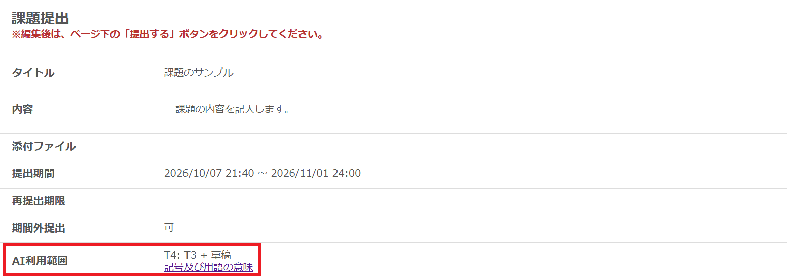

import If from "@components/utils/If.astro";

{/**
  * @typedef {object} Props
  * @property {"lecturer" | "student"} [variant] 既定値は`"lecturer"`
  */}

<If cond={props.variant === "student"}>

担当教員が「課題」ごとに設定した**AI利用範囲**が提出画面に示されていますので，課題に取り組む前に確認してください．詳しくは「[授業課題・取り組みにおけるAI利用範囲の類型と表示](/gen-ai/education/ai-use-policy-levels/)」をご覧ください．

<Fragment slot="else">

UTOLで「課題」を作成する際は，**AI利用範囲**の設定が必須です．詳しくは「[授業課題・取り組みにおけるAI利用範囲の類型と表示](/gen-ai/education/ai-use-policy-levels/)」をご覧ください．

</Fragment>

</If>

