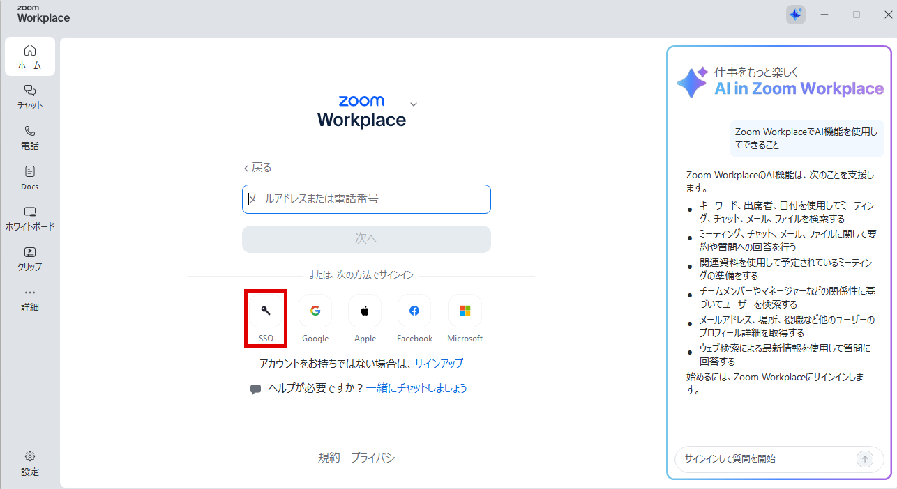
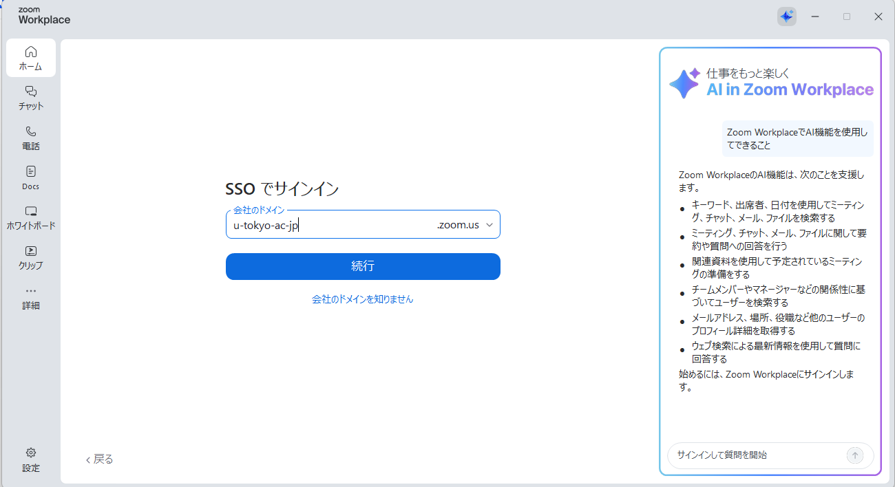

import If from "@components/utils/If.astro";
import Support from "@components/utils/Support.astro";
import Help from "@components/utils/Help.astro";
import SigninAppHelpDomain from "./SigninAppHelpDomain.mdx";

{/**
  * @typedef {object} Props
  * @property {boolean} support
  * @property {true} [inlineHelp]
  * @property {true} [big]
  */}

1. Zoomアプリを開き，「サインイン」ボタンを押してください．Zoomアプリのインストールについては「[Zoomのアプリの機能と使い方について](/zoom/misc/app/)」を参照してください．
2. サインイン画面で「SSO」，「SSOで続行」，または「SSOでサインイン」と書かれた文字を探して押してください<If cond={props.big}>（この画面のメールアドレス・パスワード欄に UTokyo Account の情報を入力してもサインインできません）</If>．
   <If cond={props.big}>
     {:.medium}
   </If>
3. 「会社のドメイン」の欄に，`u-tokyo-ac-jp`と入力してください（`ac`の前後はピリオドではなくハイフンであることに注意してください）．
   <If cond={props.big}>
     {:.medium}
   </If>
4. 既にUTokyo Accountにサインイン済みの場合を除き，UTokyo Accountのサインイン画面がブラウザで表示されるので，サインインしてください．
   <If cond={props.big}>
     {:.medium}
   </If>
   <If cond={props.inlineHelp}>
     <SigninAppHelpDomain type="details" />
   </If>
5. パソコンの場合は，「ホーム」画面右上のアイコンからアクセスできる設定画面の「プロフィール」タブで，自分のUTokyo Accountのメールアドレス（末尾が `@utac.u-tokyo.ac.jp`）が表示されていれば，正しくサインインできています．スマホの場合は，ホーム画面の左上のアイコンを押して表示される画面で，自分のUTokyo Accountのメールアドレスと「ライセンス ユーザー」の表示を確認してください．
   <If cond={props.big}>
     {:.small}
   </If>

<If cond={props.inlineHelp}>
  <Support lang="ja" show={props.support} />
  <Help lang="ja" support={props.support} slot="else">
    - <SigninAppHelpDomain type="oneline" />
  </Help>
</If>
