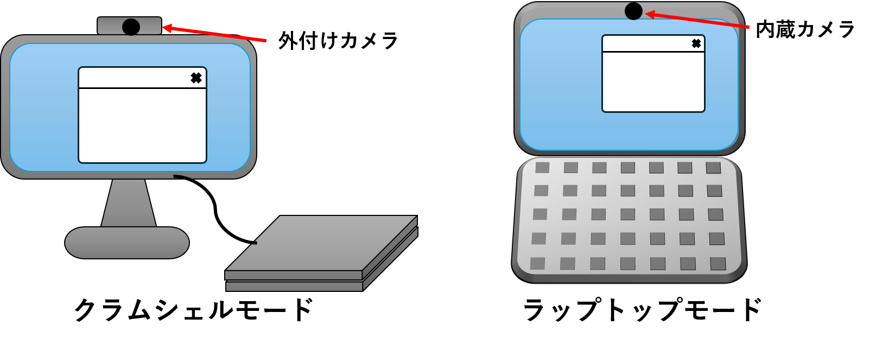

このページでは，ECCSのChromebookでカメラを利用する際に，撮影画面に何も映らない不具合について説明します．

## 概要

ECCS2026のChromebookには，端末本体の画面を使用する**ラップトップモード**と，端末を閉じて接続したモニターを使用する**クラムシェルモード**という2つの使い方があります．
それぞれのモードでカメラ機能を使用する際，ラップトップモードでは本体上部の内蔵カメラが，クラムシェルモードではディスプレイ上部の外付けカメラが起動します．

しかし，何らかの原因でクラムシェルモードで内蔵カメラが起動してしまう場合，撮影画面に何も映らなくなります．

## 原因と対処法

1. 「パーソナライズ」のアイコン編集機能でカメラによる撮影を行う場合，クラムシェルモード・ラップトップモードに関わらず内蔵カメラが起動します．そのため，端末を閉じているクラムシェルモードで撮影を行う場合は何も映らなくなります．
    この場合は，本体を開いてラップトップモードで使用し，内蔵カメラを使用してください．
1. カメラ起動時に利用するカメラの設定を変更した場合，自動でのカメラの切り替えが起こらない可能性があります．
    この場合は，[ハードウェアの利用方法](../../chromeos/hardware/)を参考に，使用するカメラの切り替えを行ってください．
