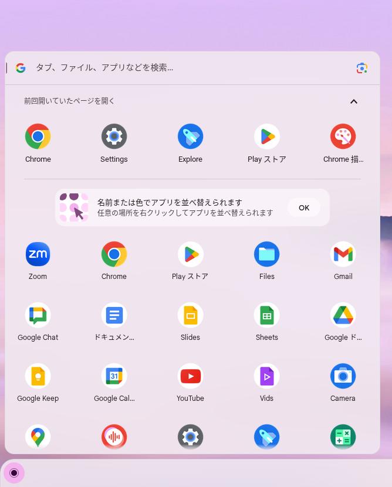

## Available Applications

On ChromeOS devices, Google Chrome, applications implemented as Chrome extensions, and certain Android apps that have been individually approved are available. You can also [request additional Android apps](#android-apps) under certain conditions.

In addition, the [Linux environment](../linux/) can be used subject to certain restrictions.

### List of Pre-Installed Applications
{:#preinstalled-apps}

The pre-installed applications are listed below. Some of these applications use a mechanism called Progressive Web Apps (PWAs), which displays website icons in a way similar to native apps on smartphones.

- Files: You can access files on the Google Drive associated with your ECCS Cloud Email account and on the OneDrive associated with your UTokyo Account. For details, please refer to [the page on storage](../storage/).
- Calculator
- Chrome: Google Chrome is available as a browser.
- Chrome Canvas (a drawing canvas)
- Gmail
- [Google Calendar](/en/google/calendar/)
- Google Chat
- Google Keep
- Google Maps
- Google Drive: For details, please refer to [the page on storage](../storage/).
- Play Store: You can install [permitted Android apps](#android-apps).
- Web Store
- Docs
- Sheets
- Slides
- Text
- [Vids](https://support.google.com/docs/topic/14950067?hl=en): AI-powered video editing and other functions are available.
- [YouTube](/en/google/#youtube)
- [Zoom](/en/zoom/)
- Scan: Please note that this app cannot be used with [the ScanSnap experimentally installed in the Information Education Building on the Komaba Campus](../../#ieb).
- Camera
- Settings
- Print jobs
- [Cursive](https://support.google.com/chromebook/answer/11073444?hl=en): A handwritten note-taking app.
- Key Shortcuts
- Gallery
- [Screencast](https://support.google.com/chrome/a/topic/15301726?hl=en): Screen recording and other functions are available.
- Recorder
- [Explore](https://support.google.com/chromebook/answer/15470775?hl=en): Tips and help for using your Chromebook.
- Terminal

## How to Use Apps

### Starting an App

1. Open the menu in the bottom-left corner of the screen.
2. Select the app you want to start. (You can also search for an app by entering its name in the search bar at the top.)
    

### Closing an App

Click the ❎ in the upper-right corner of the app.

## Requesting Additional Android Apps
{:#android-apps}

For free Android apps available on the Google Play Store that are necessary for education or research, you can submit a request using the application form below (sign-in with your ECCS Cloud Email account is required). Requested apps may be added to the allowlist and made available on ChromeOS devices.

<b class="box center">[Google Play Store Apps for ChromeOS](https://docs.google.com/forms/d/e/1FAIpQLSdZ7vt6-Tahig8CMhwE0Uipjqk1PeY_FRh4RnVpXox_ycyvGg/viewform?usp=sf_link)</b>
