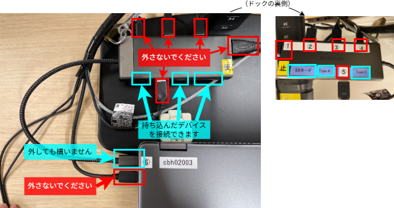
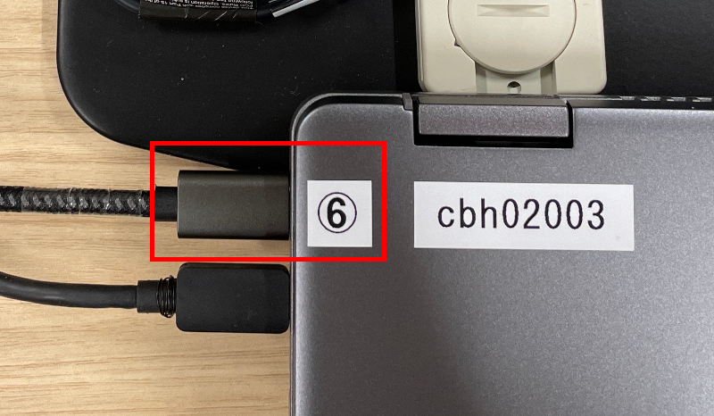
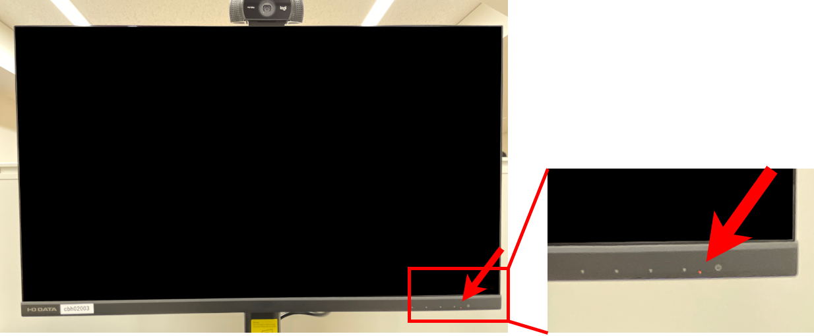
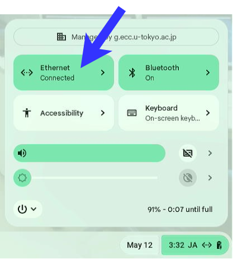
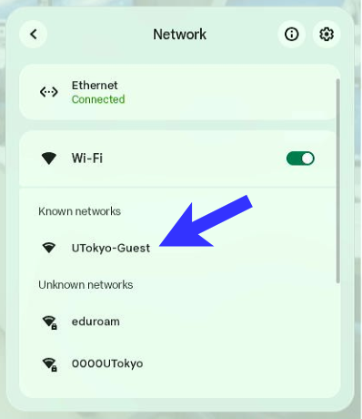
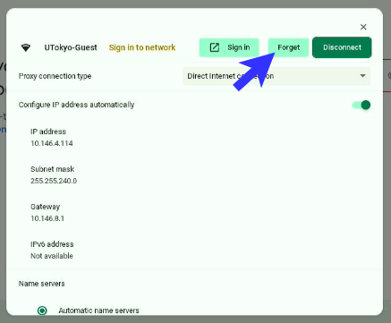
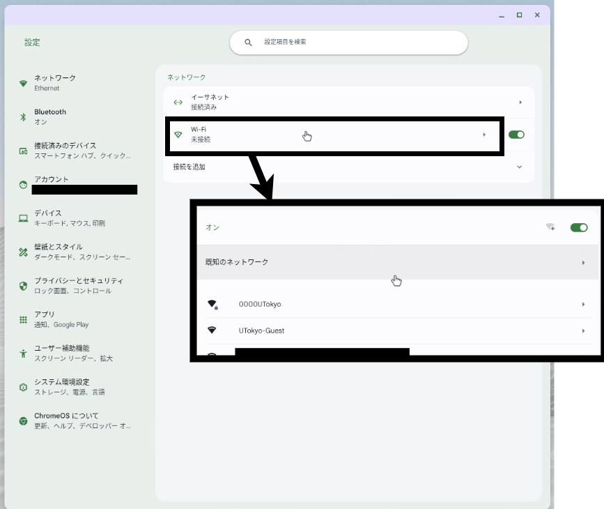
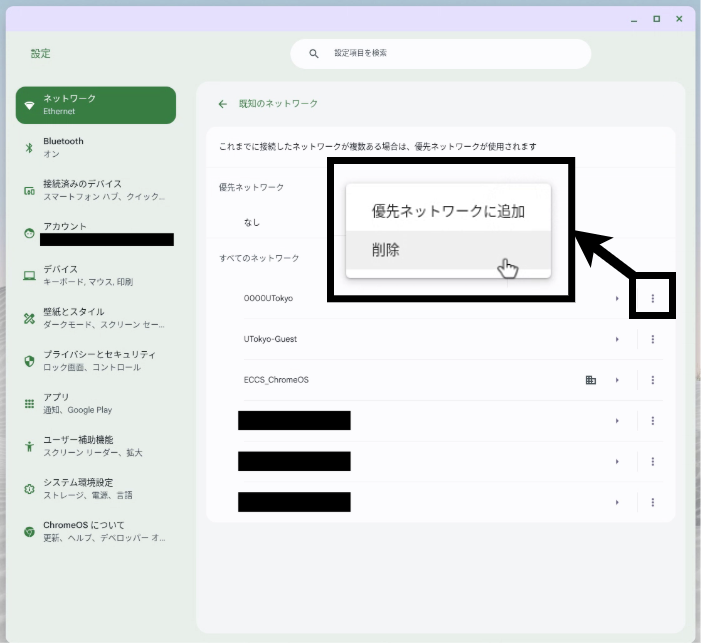
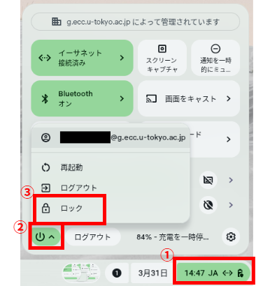
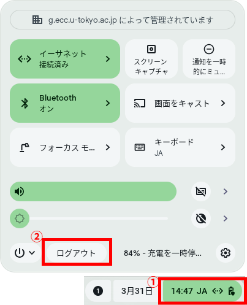

## 概要
## Overview

ECCSでは，ChromeOSを搭載したデバイス（以下，ChromeOSデバイス）を設置しています．ECCSクラウドメールのアカウントを持っていれば，これらのデバイスを利用して，ブラウザを利用したり，Zoomミーティングに参加したりすることができます．
ECCS provides devices running ChromeOS (hereinafter referred to as "ChromeOS devices"). If you have an ECCS Cloud Email account, you can use these devices to browse the web, join Zoom meetings, and more.

設置されているデバイスは席によって異なりますが，ChromebookまたはChromeboxのいずれかが設置されています．設置場所については，[ECCSのページ](../#location_and_business_hours)を参照してください．
The device provided varies by seat, but each seat is equipped with either a Chromebook or a Chromebox. For locations, see the [ECCS page](../#location_and_business_hours).

なお，設置されたChromeOSデバイスを使用せず，持ち込んだデバイスを接続して，モニターやカメラ等の周辺機器だけ使うことも可能です[^1]．その場合の利用方法は，[持ち込みデバイス利用席](../byod/)を参照してください．
You can also connect your own device and use only the peripherals, such as the monitor and camera, without using the ChromeOS device provided at the seat.[^1] For instructions, see [Seats for Using Your Own Device](../../../eccs/byod/)(in Japanese).

[^1]: 周辺機器のみを使う場合は，ECCSクラウドメールのアカウントは不要です．
[^1]: You don't need to have an ECCS Cloud Email account if you use only the peripherals.

### スペック
### Specifications

機器の仕様や使い方の詳細については，[ハードウェアの利用方法・設定方法](./hardware/)を参照してください．
For detailed specifications and instructions on using the equipment, see [Hardware Usage and Configuration](../../../eccs/chromeos/hardware/)(in Japanese).

Chromebook，Chromeboxの2種類がありますが，いずれもChromeOSがインストールされています．両者で利用できるソフトウェア等に違いはありません．
There are two types of devices: Chromebook and Chromebox. Both run ChromeOS, and there is no difference in the software available on either type.

- Chromebook
  - Acer Chromebook Plus Spin 514
    - Intel(R) Core(TM) 5 120U, SSD 128GB, memory 16GB
- Chromebox
  - Acer Chromebox CXI3
    - Intel(R) Core(TM) i5-8250U CPU @ 1.60GHz, SSD 64GB, memory 8GB
  - ASUS Chromebox 4
    - Intel(R) Core(TM) i7-10510U CPU @ 1.80GHz, SSD 256GB, memory 16GB
  - ASUS Chromebox 4
    - Intel(R) Core(TM) i5-10210U CPU @ 1.60GHz, SSD 128GB, memory 8GB

なお，ChromebookはBluetooth 5.2に準拠し，利用可能であることを確認しています．詳しくは[ハードウェアの利用方法・設定方法](./hardware/)を参照してください．
Bluetooth 5.2 is supported and has been confirmed to work on the Chromebook. For details, see [Hardware Usage and Configuration](../../eccs/hardware/)(in Japanese).

また，ストレージが搭載されていますが，再度サインインした際にデータが保存されている保証はありません．**必要なデータは必ずデバイスの外部に保存するようにしてください．**
Although these devices have internal storage, there is no guarantee that your data will still be there when you sign in again. **Always save any data you need somewhere outside the device.**

## 重要な注意事項
## Important Precautions

ここでは重要なものに限って注意事項を説明します．
This section covers only the most important precautions.

- ケーブル類は原則として外さないでください．
  - Chromebook
    
- As a rule, do not disconnect any cables.
  - Chromebook
    

    - **以下のケーブル・端子については，抜き差ししても構いません**（画像では水色の枠で示されています）：
       - Chromebookとドックを接続しているUSB Type-Cケーブル：取り外して持ち込みデバイスに接続できます．
       - ドックに接続されているケーブルのうち，裏側に「SDカード」，「Type-A」，「Type-C」と書かれた空き端子：持ち込んだデバイスに接続できます．
    - **以下のケーブル・端子は，抜き差ししないでください**（画像では赤い枠で示されています）：
      - ドックに接続されていない方のUSB Type-Cケーブル（Chromebookに固定されています）
      - ドックに接続されているケーブルのうち，裏側に数字が書かれているもの

    - **The following cables and ports may be disconnected or used** (highlighted with light blue boxes in the image):
      - The USB Type-C cable connecting the Chromebook to the dock: You may disconnect it and connect it to your own device.
      - Among the cables connected to the dock, the unused ports labeled "SDカード", "Type-A", and "Type-C" on the back: You may connect your own device to these ports.
    - **Do not disconnect or unplug the following cables or ports** (highlighted with red boxes in the image):
      - The USB Type-C cable that is not connected to the dock (it is secured to the Chromebook).
      - Among the cables connected to the dock, those with numbers written on the back.
    {/*- ケーブルが外れている場合の対応については，[ケーブルの接続TODO](./hardware/#cables)を参照してください．*/}
  - Chromebox
    - 本体やモニターについているケーブルは外さないでください．
- Wi-Fiには接続しないでください．
  - ChromeOSデバイスは有線でネットワークに接続されているため，Wi-Fiに接続しなくてもインターネット等を利用できます．万一繋いでしまった場合は，[Wi-Fiに接続してしまった場合](#disconnect-wifi)を参照して，接続情報を削除してください．
- 使用を終えるときや，長時間席を外すときは，**必要なファイルを保存したうえで**，ログアウトするようにしてください．サインインしたまま放置すると，次に使いたい人が困るのでやめましょう．
    - Chromebox
      - Do not disconnect the cables attached to the Chromebox or the monitor.
- Do not connect to Wi-Fi.
  - ChromeOS devices are connected to the network via Ethernet, so you can access the internet and other services without connecting to Wi-Fi. If you accidentally connect to a Wi-Fi network, see [If You Have Connected to Wi-Fi](#disconnect-wifi) and delete the saved connection information.
- When you finish using the device or leave your seat for an extended period, **make sure to save any necessary files before logging out**. Do not leave the device signed in, as this will inconvenience the next person who wants to use it.

## 使い方
## How to Use the Devices

uteleconでは，ECCSのChromeOSデバイスに特有の事項を中心に説明します．ChromeOSの一般的な使い方については，[Googleのヘルプページ](https://support.google.com)を参照してください．
This page focuses on aspects specific to ECCS ChromeOS devices. For general instructions on using ChromeOS, see [Google Help](https://support.google.com).

なお，ECCSのChromeOSデバイスでは，**デバイス上に保存した内容が必ずしも保持されないため，Google DriveやOneDrive等，クラウド上のストレージに保存する必要があります**．詳しくは[ストレージ](./storage/)を参照してください．
On ECCS ChromeOS devices, **data saved on the device is not guaranteed to be retained, so you must save your files to cloud storage such as Google Drive or OneDrive**. For details, see [Storage](./storage/).

本ページでは利用開始・終了を説明します．その他については，以下のリンク先を参照してください．
This page explains how to start and end a session. For other topics, see the following pages.

- [再起動・ハードリセット](./restart/)
- [アプリの利用](./apps/)
- [ストレージ](./storage/)
- [言語設定・キーボードレイアウトの設定](./languages/)
- [アクセシビリティ](./accessibility/)
- [Linux環境の利用](./linux/)
- [Windowsリモート環境の利用](../vdi-windows/usage/#eccs-chromeos)
- [ハードウェアの利用方法・設定方法](./hardware/)
- [Restart and Hard Reset](./restart/)
- [Applications](./apps/)
- [Storage](./storage/)
- [Language and Keyboard Layout Settings](./languages/)
- [Accessibility](./accessibility/)
- [the Linux Environment](./linux/)
- [the Remote Windows Environment](../vdi-windows/usage/#eccs-chromeos)
- [Hardware Usage and Configuration](./hardware/)

### 利用開始・終了
### Startup and Shutdown

#### サインイン
#### Signing In
{:#signin}

1. デバイスの電源を入れるか，スリープから復帰させてください．
  - （Chromebookの場合）Chromebookの画面を一旦開けてください．
     

        
外付けディスプレイが点かないとき

        1. ドックに接続しているUSB Type-Cケーブルが外れていないか確認してください．外れていたら接続しなおしてください．
         {:.small}
        2. ディスプレイの右下にある電源インジケータが光っているか確認してください．光っていないときは電源が切れていますので，電源ボタンを押して電源を入れてください．
         {:.small}
        3. それでも点かなければ，起動時にドックが認識されなくなる，既知の問題の可能性があります．直し方については，[Chromebookを起動した際，ドックが認識されない問題](../defects/chromebook-dock-recognition/)をご覧ください．
     

     

     
When the external display does not turn on

     1. Check whether the USB Type-C cable connected to the dock is disconnected. If it has, reconnect it.
     {:.small}
     2. Check whether the power indicator at the bottom-right corner of the display is lit. If it is not lit, the display is turned off. Press the power button to turn it on.
     {:.small}
     3. If the display still does not turn on, the dock may not have been recognized during startup due to a known issue. For instructions on how to resolve this issue, see [Dock Not Recognized When Starting Up the Chromebook](../defects/chromebook-dock-recognition/).
    

  - （Chromeboxの場合）まず，キーボードのCtrlキーを押してください[^2]．
  - (For Chromebox) First, press the Ctrl key on the keyboard.[^2]

    [^2]: 任意のキーで構いませんが，Enterキー等は予期しない操作をしてしまう可能性があるため，避けたほうが無難です．
    [^2]: You can press any key, but it is best to avoid keys such as Enter, as they may trigger an unintended action.

    - ディスプレイの電源が切れているとき（右下にある電源インジケータが光っていないとき）は，画面右下の電源ボタンを押して，電源を入れてください．
    - 本体の電源がついていないときは，ディスプレイの背面にある，Chromebox本体の電源ボタンを押してください．
    - If the display is off (the power indicator at the bottom right is not lit), press the power button at the bottom right of the display to turn it on.
    - If the Chromebox itself is off, press the power button on the back of the display, where the Chromebox is located.
2. Wi-Fiへの接続を求められることがありますが，**この画面は無視し，画面が切り替わるのを待ってください．**
   You may be prompted to connect to Wi-Fi, but **ignore this screen and wait for it to change.**

  

  
Wi-Fiに接続してしまった場合

  
If You Have Connected to Wi-Fi

     もしWi-Fiに接続してしまった場合は，接続情報を他の人が利用できないよう，接続を削除してください．サインイン時の画面からも削除できますが，現在その場に存在しないネットワークや，接続できないネットワークはサインイン後でないと削除できません．
     If you have connected to Wi-Fi, delete the saved connection so that others cannot use the connection information. You can remove it from the sign-in screen, but networks that are not currently available or cannot be connected to can only be removed after signing in.

     **サインイン画面から削除する場合**
     **To Remove the Network from the Sign-In Screen**

     1. 右下の時刻表示を押し，「Ethernet」と表示されているボタンを押してください．
        
     1. Click the time display in the bottom-right corner, then click the button labeled “Ethernet.”
        
     2. 接続したWi-Fiを選択してください．
        
     2. Select the Wi-Fi network you connected to.
        
     3. 「Forget」を押してください．
        
     3. Click “Forget.”
        

     **サインイン後に削除する場合**
     **To Remove the Network After Signing In**

     1. 「設定」を開き，左側のタブから「ネットワーク」を選択してください．
     1. Open “Settings” and select “Network” from the tabs on the left.
     2. 「Wi-Fi」を開き，「既知のネットワーク」を開いてください．
        
     2. Open “Wi-Fi,” then open “Known networks.”
        
     3. 削除したいネットワークの右側の「⋮」を押し，「削除」を押してください．
        
     3. Click the “⋮” next to the network you want to remove, then click “Remove.”
        
  

3. 「Enter your email」の欄に，[ECCSクラウドメール](/google/)のメールアドレス（`@g.ecc.u-tokyo.ac.jp`で終わるメールアドレス）を入力して，「Next」を押してください．
   In the “Enter your email” field, enter your [ECCS Cloud Email](/google/) address (the address ending in `@g.ecc.u-tokyo.ac.jp`), then click “Next.”

  

  
「Couldn't find your Google Account」と表示される場合

  
If “Couldn't find your Google Account” Appears

  「[UTokyo Account 利用者メニュー](https://utacm.adm.u-tokyo.ac.jp/UserMenu/LoginServlet)」にアクセスの上，「ECCSクラウドメール」を選択し，「現在のメールアドレス」欄にあるメールアドレスを入力してください．なおECCSクラウドメールのアカウントの[エイリアス](/google/misc/localpart/)として設定されているメールアドレスは利用できません．
  Go to the [UTokyo Account User Menu](https://utacm.adm.u-tokyo.ac.jp/UserMenu/LoginServlet), select “ECCS Cloud Email,” and enter the address shown in the “Current email address” field. Email addresses configured as [aliases](/google/misc/localpart/) for your ECCS Cloud Email account cannot be used.
  

4. UTokyo Accountでのサインインを求められますので，サインインしてください．
   You will be prompted to sign in with your UTokyo Account. Complete the sign-in process.
  - FIDOセキュリティキーを利用して，パスワードレスでサインインすることも可能です．ドックのUSB Type-A，もしくはUSB Type-Cポートにセキュリティキーを接続して，「Sign-in Options」を押し，「Face, fingerprint, PIN or security key」を選択してください．
    You can also sign in without a password using a FIDO security key. Connect the security key to a USB Type-A or USB Type-C port on the dock, click “Sign-in Options,” and select “Face, fingerprint, PIN or security key.”
    - 認識されない場合は一度抜いて差し直してください
    - If the key is not recognized, unplug it and reconnect it.
  - Stay signed in?と聞かれますが，Yes/Noのどちらを選択しても影響はありません．
  - If you are asked “Stay signed in?”, your choice of Yes or No will not affect anything.

  

     
この次の手順で，2-Step Verificationと表示される場合

     
If “2-Step Verification” Appears at the Next Step

     表示されている手段のいずれかを用いて二段階認証を完了してください．
     Complete two-step verification using one of the methods shown.
  

5. パスワードレスでサインインした場合，パスワードを設定するよう求められます．（Please create a password to protect your local data）
   If you signed in without a password, you will be prompted to set one (“Please create a password to protect your local data”).
  - 任意のパスワードを決めて，入力してください．
  - Choose a password and enter it.
  - このパスワードは，デバイスをロックした後，再びサインインするときに必要です．また，次回サインインする際にデータがデバイスに残っている場合も，ここで設定したパスワードの入力が必要です．
  - You will need this password to sign in again after locking the device. You will also need to enter this password if data from your previous session remains on the device when you sign in next time.

6. 前回サインインした際のデータが残っている場合，前回のサインインで使用または設定したパスワードの入力を求められることがあります（「Your password has changed since the last time you signed in」）．
   If data from your previous session remains on the device, you may be asked to enter the password you used or set during that session (“Your password has changed since the last time you signed in”).
  - 今回のサインインで使用または設定したパスワードが，最後にそのデバイスにサインインしたときと異なる場合に表示されます．
  - This message appears if the password you used or set for the current sign-in differs from the one you used the last time you signed in to that device.
  - 最後にそのデバイスを利用した際のパスワードを入力してください：
  - Enter the password you used the last time you used that device:
    - 前回サインイン時，パスワードを使用してUTokyo Accountにサインインした場合：UTokyo Accountのパスワードを入力してください（パスワードを変更した場合は，変更前のパスワードを使用してください）．
    - If you signed in to your UTokyo Account using a password last time, enter your UTokyo Account password. If you have changed your password since then, use the old password.
    - 前回サインイン時，パスワードレスサインインを使用してサインインした場合：前回サインイン時に設定したパスワードを入力してください．
    - If you signed in without a password last time, enter the password you set during that session.

  

     
パスワードを忘れた場合

     
If You Have Forgotten Your Password

     デバイス内のデータは暗号化されているため，パスワードを忘れると取り出すことができません．ただし，保存されているデータを削除すれば，起動することは可能です．
     Data stored on the device is encrypted, so you cannot recover it if you forget the password. However, you can still start using the device by deleting the stored data.

     なお，ここで削除されるのはデバイス内のデータのみで，ECCSクラウドメールのGoogle Drive等には影響はありません．
     Only data stored on the device will be deleted. This will not affect Google Drive or other services associated with ECCS Cloud Email.

     1. 「Forgot old password」を押してください．
     1. Click “Forgot old password.”
     2. 「Local data will be deleted」と表示され，データの消去に関する警告が表示されます．「Continue anyway」を押してください．
     2. A warning stating “Local data will be deleted” will appear. Click “Continue anyway.”
  

7. 「Control your data」 /「データの管理」と表示されます．お好みでオプションを選択し，「↓」ボタンを押して下まで確認した後，「Accept and continue」 /「同意して続行」を押してください．
   The “Control your data” / “データの管理” screen will appear. Select your preferred options, use the “↓” button to scroll to the bottom, and then click “Accept and continue” / “同意して続行.”
  - 診断データと使用状況データの送信はオフにできません．
  - You cannot turn off the sending of diagnostic and usage data.
  - 右下に「Switch device laguage?」の通知が出ている場合は，「Switch」を押すと，Googleアカウントで設定している言語に変えられます．
  - If a “Switch device language?” notification appears in the bottom-right corner, click “Switch” to change the device language to the one set in your Google Account.

8. デバイスが起動します．
   The device will finish starting up.

  起動時，以下のような通知が表示されることがあります．
  You may see the following notifications when the device starts up.

  - 「OneDrive setup failed」/「OneDriveを設定できませんでした」
    - OneDriveに接続したい場合は，「OneDriveに手動で接続」を押すと接続できます．詳しくは[ストレージ](./storage/#onedrive)を参照してください．
  - “OneDrive setup failed” / “Could not set up OneDrive”
    - If you want to connect to OneDrive, click “Connect to OneDrive manually.” For details, see [Storage](./storage/#onedrive).
  - 「言語が変更されました」
    - 英語に戻したい場合は，「「英語(アメリカ合衆国)」に戻します（再起動が必要です）」を押してください．自動的にログアウトしてサインイン画面に移りますので，もう一度サインインしてください．
      - なお，再度サインインする際，手順6でForgot old passwordを選択すると，言語設定が反映されませんのでご注意ください．
    - “Language has changed”
      - To switch back to English, click “Switch back to English (United States) (restart required).” You will be logged out automatically and returned to the sign-in screen. Sign in again.
        - Note that if you select “Forgot old password” in Step 6 when signing in again, the language setting will not take effect.
    - 英語以外の言語に変えたい場合や，通知が消えてしまった場合は[言語設定・キーボードレイアウトの設定](./languages)を参照してください．
    - If you want to switch to a language other than English, or if the notification has disappeared, see [Language and Keyboard Layout Settings](./languages).
  - 「ChromeOSをアップデート」
    - ECCSのChromeOSデバイスは，随時OSのアップデートが行われます．特に対応の必要はありません．
  - “Update ChromeOS”
    - ECCS ChromeOS devices receive OS updates periodically. No action is required.

#### 画面ロック
#### Locking the Screen
{:#lock}

一時的に席を離れる場合は必ずデバイスをロックしてください．また，15分以上操作がないと自動的にロックされます．
Always lock the device if you leave your seat temporarily. The device also locks automatically after 15 minutes of inactivity.

なおこれは，あくまで一時的なお手洗いなどの想定です．長時間席を離れる場合には他の利用者の迷惑となるので，[ログアウト](#logout)してください．また，長く離れている場合に，情報基盤センター側でログアウトしないことは保証しません．
This is intended only for brief absences, such as going to the restroom. If you will be away for an extended period, please [log out](#logout), as leaving the seat occupied may inconvenience other users. Please also note that the Information Technology Center does not guarantee that your session will remain signed in if you leave for a long time.

デバイスをロックするには，キーボード上で🔍+L，◉+L（Chromebookの場合），Windows+L（Chromeboxの場合）のいずれかのショートカットキー操作をしてください．もしくは，画面右下の時刻表示を押し，電源のアイコンを押し，「ロック」を押すことでもロックできます．
To lock the device, use one of the following keyboard shortcuts: 🔍+L or ◉+L (on a Chromebook), or Windows+L (on a Chromebox). Alternatively, click the time display in the bottom-right corner, click the power icon, and select “Lock.”

{:.small}

ロックした状態から再びサインインする際，パスワードの入力を求められます．入力するパスワードは，以下のようにサインイン方法によって異なります：
When signing in again after locking the device, you will be asked to enter a password. The password required depends on how you signed in:

- パスワードレスサインインを使っていない場合（最初のサインイン時にパスワードを入力してサインインした場合）：UTokyo Accountのパスワード
- If you did not use passwordless sign-in (that is, you entered a password when you first signed in): your UTokyo Account password.
- パスワードレスサインインを使っている場合：サインイン時に入力，または設定したパスワード
- If you used passwordless sign-in: the password you entered or set during sign-in.

#### 利用終了（ログアウト）
#### Ending a Session (Logging Out)
{:#logout}

使用が終了したら，必ずログアウトしてください．
Always log out when you have finished using the device.

ログアウトするには，画面右下の時刻表示を押し，「ログアウト」を押してください．
To log out, click the time display in the bottom-right corner, then click “Log out.”

{:.small}

なお，[Chromebookを起動した際，ドックが認識されない問題](../defects/chromebook-dock-recognition/)を回避するため，シャットダウンはできない仕様になっています（Chromeboxはこの問題の影響を受けませんが，同様にシャットダウンできません）．
To avoid the [issue where the dock is not recognized when a Chromebook starts up](../defects/chromebook-dock-recognition/), the devices are configured so that they cannot be shut down. (Although Chromebox devices are not affected by this issue, they likewise cannot be shut down.)

## その他の補足事項
## Additional Notes

Chromebookは閉じた状態でも，開いた状態でも利用できます．どちらで利用しても構いません．
You can use a Chromebook with its lid either open or closed. Either is fine.

## 故障・不具合時の対応
## Handling Malfunctions and Problems

### 既知の不具合
### Known Issues

ChromeOSデバイスの既知の不具合については，[ChromeOSデバイスの既知の不具合](../defects/#chromeos)を参照してください．
For known issues with ChromeOS devices, see [Known Issues with ChromeOS Devices](../defects/#chromeos).

{/*また，ケーブルが外れている場合の対応については，[ケーブルTODO](./hardware/#cable)を参照してください．*/}

### 不具合時の連絡先
### Contact for Reporting Problems

ケーブルが外れていて自分での復旧が困難な場合や，バグ・故障等を見つけた場合，[ECCSの利用に関するサポート](../support/)のページに記載の問い合わせ窓口に問い合わせてください．
If a cable has come loose and you cannot reconnect it yourself, or if you discover a bug or hardware failure, contact the support desk listed on the [ECCS Usage Support](../support/) page.

その際，建物名・階・部屋と，デバイスの本体もしくはディスプレイに貼られている番号（`cbh*****`，`cbx***`等）がわかるとスムーズです．
When contacting support, it will help to provide the building name, floor, room number, and the identifier attached to the device or display (e.g., `cbh*****` or `cbx***`).
