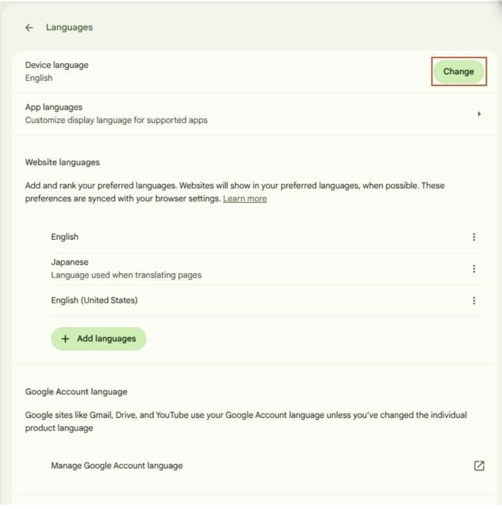
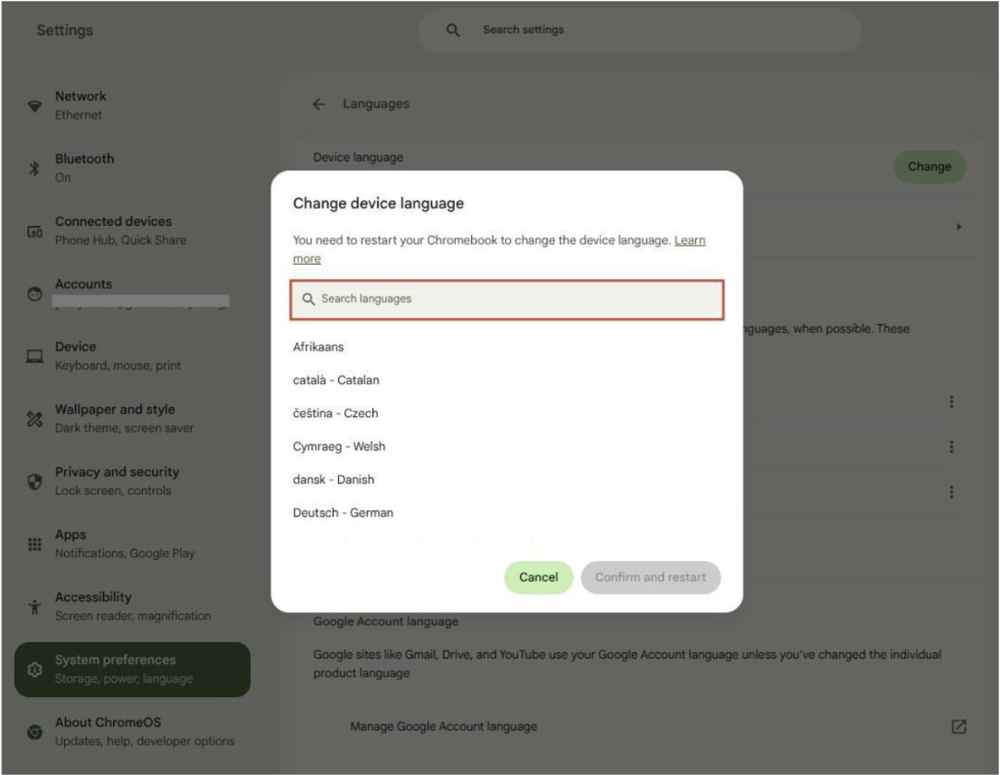
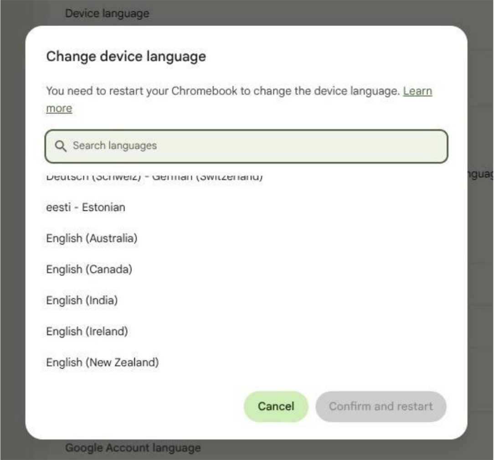
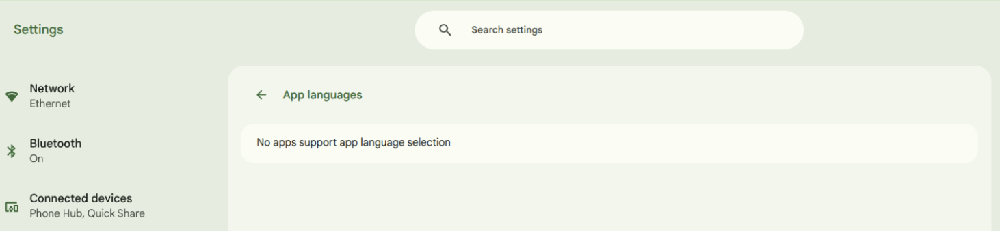
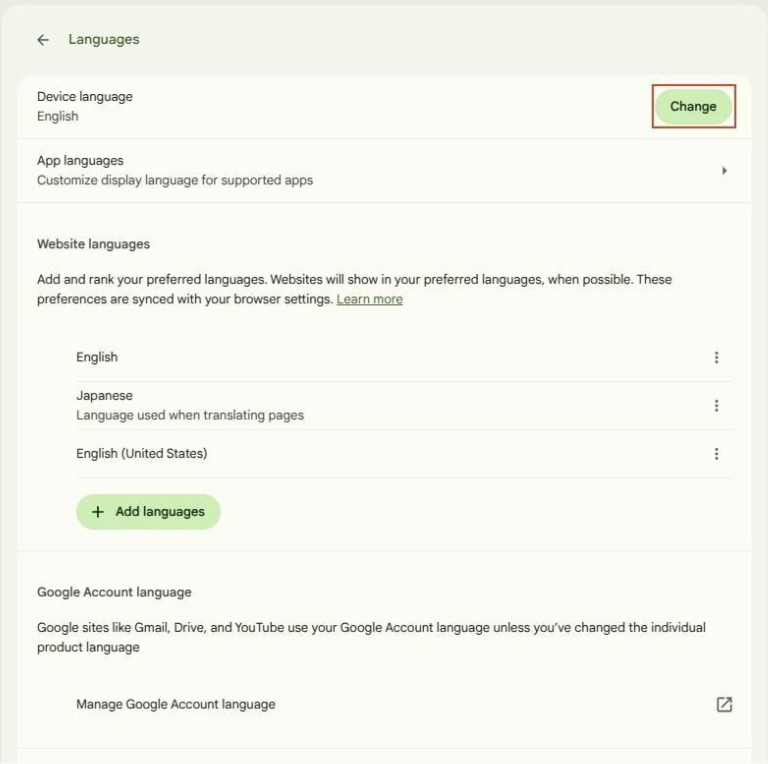
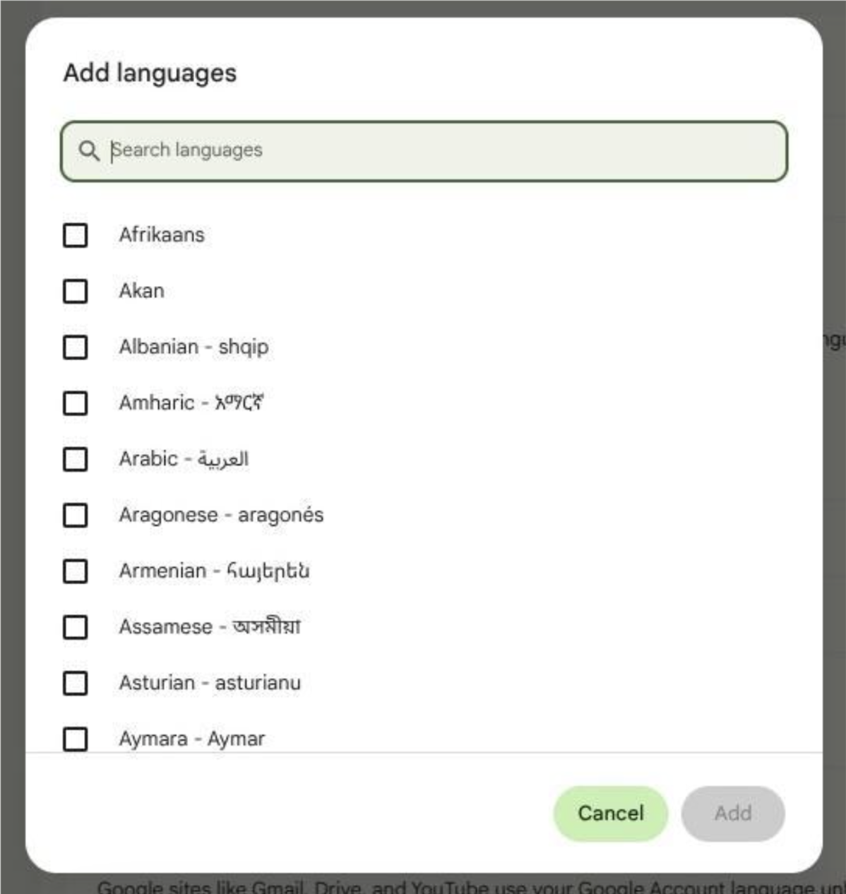
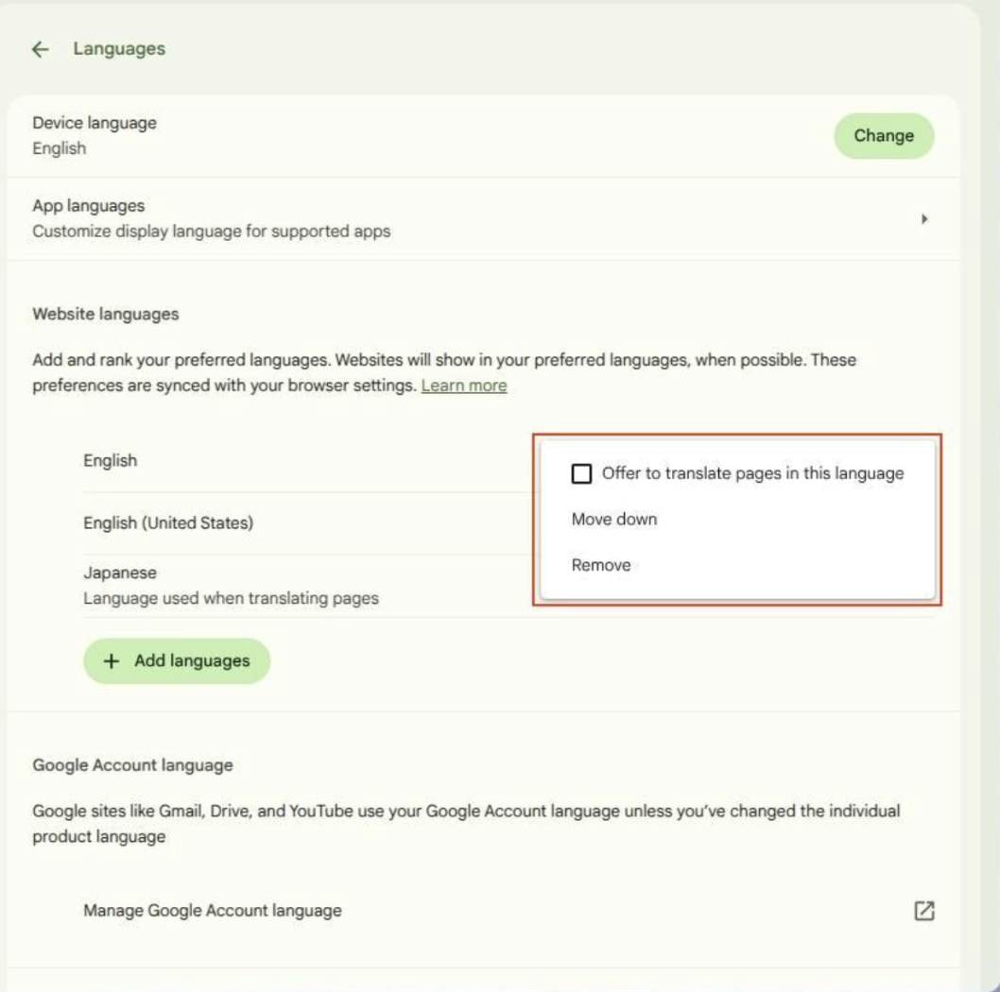

import OpenLanguageSettings from "./_OpenLanguageSettings.mdx";

## Overview
On ChromeOS devices, you can change [the display language](#display-language) for the OS, individual apps, and the browser. You can also change [the keyboard layout](#keyboard-language) associated with the selected display language.

This page explains these settings and procedures, with references to the Official Help. 

## Display Language
{:#display-language}

By default, the display language is the language set for your ECCS Cloud Email. However, changing the language settings requires restarting the device. Therefore, if you start using a ChromeOS device after the previous user has logged out without restarting the device, the language used by the previous user may be carried over. In this case, a notification will be displayed when you sign in. If you want to change the language, please follow the instructions in the notification to restart the device. For more details, please refer to "[Information on signing in](../#signin)".

Language settings can be changed for the OS as a whole, for individual apps, and for the default display language of the website.

Please note that language settings for individual apps are available only for Android apps that support this feature. None of [the pre-installed apps](../apps/#preinstalled-apps) support changing the language settings for individual apps.

For more details on how to change the language settings, please also refer to "[Manage your Chromebook's languages](https://support.google.com/chromebook/answer/1059490?hl=en)" (Official Help) .

### Changing the OS Language
{:#change-os-language}

<OpenLanguageSettings />

4. Select "Change" next to "Device Languages".
  {:.medium.border}
5. Search for and select the language you want to use. (A check mark will appear when you click it).
  {:.medium.border}
  {:.medium.border}
6. Select "Confirm and restart". After a while, the sign-in screen will appear when the device starts up. [Sign in](../#signin) as usual to sign in, and the language settings will be changed.
{:start="4"}

### Changing the Language of Apps
{:#change-app-language}
For more details, please refer to "[Change your Chromebook's Android apps language](https://support.google.com/chromebook/answer/14792769?hl=en)" (Official Help).

 
If "No apps support app language selection" is displayed in the settings

  {:.medium.border}
 Language settings for individual apps are available only for Android apps that support this feature.
 If there are no apps that support this feature, this message will be displayed.
 Please note that none of [the pre-installed apps](../apps/#preinstalled-apps) support changing the language settings for individual apps.

### Changing Website Languages
{:#change-web-language}
You can set multiple website languages. For languages you add, you can use the translation feature in Google Chrome.

#### Additions
<OpenLanguageSettings />

4. Click "Add languages".
  {:.medium.border}
5. Select the languages you want to add.
  {:.medium.border}
{:start="4"}

#### Editing and Deleting
<OpenLanguageSettings />

4. Click the three-dot menu right next to the language you want to edit and select your action.
  {:.medium.border}
  * Available actions are as follows.
    * **Offer to translate pages in this language**: [A Google Translate pop-up for the web content](https://support.google.com/chrome/answer/173424) will be displayed on pages in this language.
    * **Move up/ Move down**: You can change the priority of the language (languages higher on the list have higher priority).
    * **Delete**: The language will be removed from the list of display languages.
{:start="4"}

## Keyboard Language
{:#keyboard-language}
* If the language displayed in the bottom-right corner of the screen is "JA”, this means **English (Japan)** (Alphanumeric with Japanese keyboard), and Japanese input (IME) is not available.
To type in Japanese, you need to set the input method to "Japanese".
  * In many cases, you can switch to Japanese input by pressing the "Kana (かな)" key.
  * For more details on how to change the setting, please refer to "[Choose keyboard language & special characters](https://support.google.com/chromebook/answer/1059492?hl=en)"(Official Help).
* For information on automatic word correction and dictionary settings, please 
  refer to "[Use your Chromebook keyboard](https://support.google.com/chromebook/answer/1047364?hl=en)"(Official Help).
