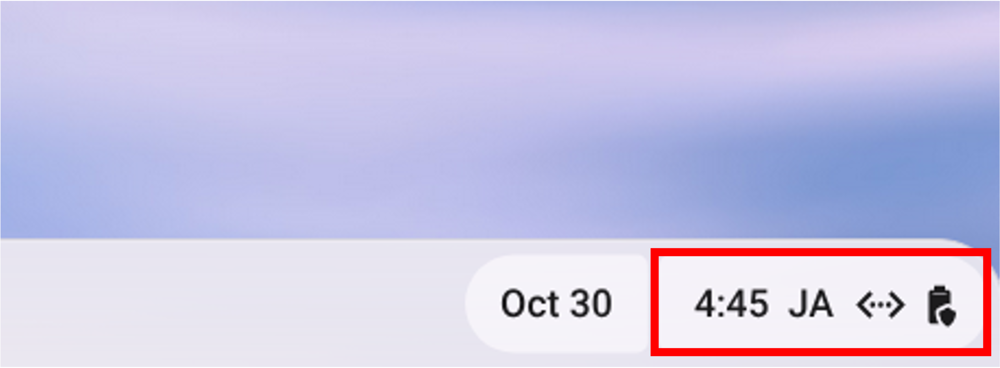
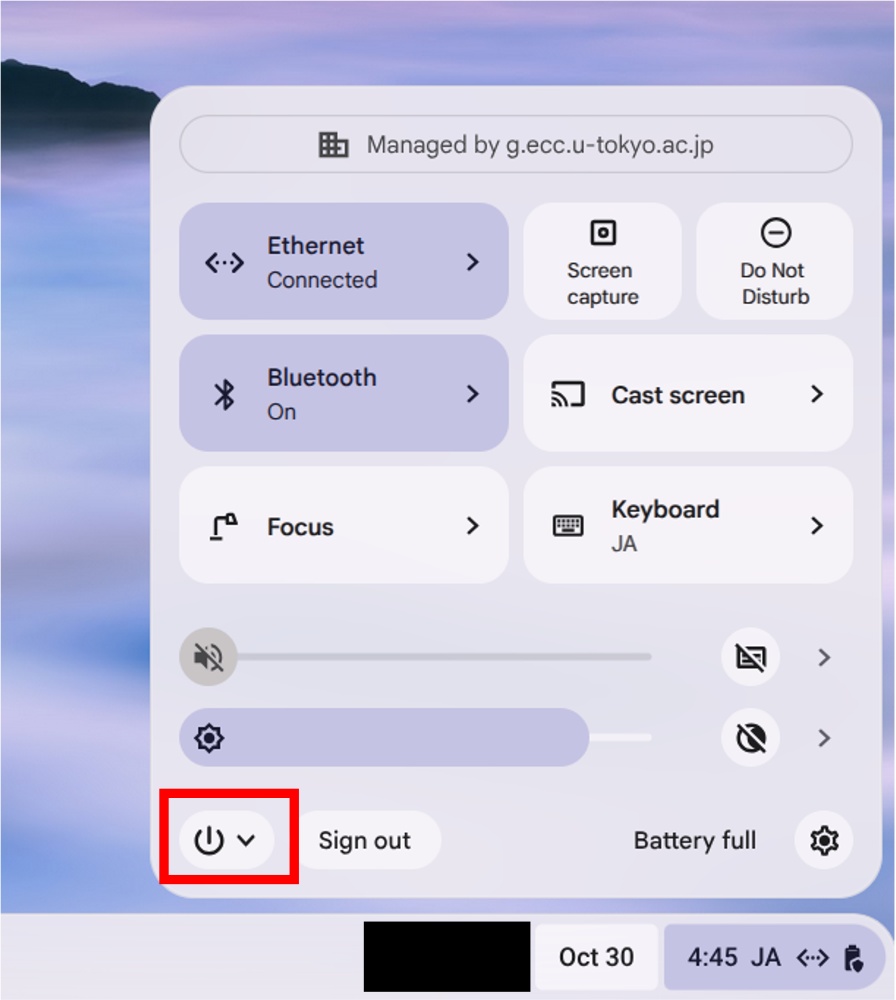
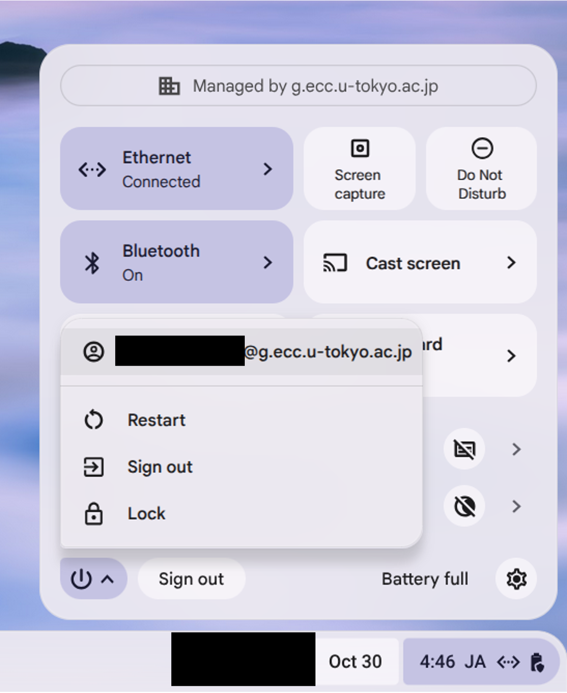

## Overview

There are two ways to restart a ChromeOS device: a regular “[Restart](#restart)” and a “[Hard reset](#hard-reset)”, which is used to troubleshoot device issues.

## Restart
{:#restart}

1. Select the time display in the bottom-right corner (the area showing “HH:MM JA[^1]”, for example).
  {:.medium.border}
1. Select the power icon (⏻).
  {:.medium.border}
1. Select “Restart.”
  {:.medium.border}
1. Wait a moment for the sign-in screen to appear, then “[sign in](https://utelecon.adm.u-tokyo.ac.jp/eccs/chromeos/#signin)" (in Japanese).

[^1]: In practice, the current time and keyboard input settings are displayed.

### When the device is running (e.g., before signing in)

Select the “Restart” button in the bottom-left corner to begin restarting the device.

## Hard Reset
{:#hard-reset}

* For procedure, refer to [Reset your Chromebook hardware](https://support.google.com/chromebook/answer/3227606?hl=en&sjid=12720944697556813749-NC)(official help).
* For Chromebox devices, a hard reset requires unplugging the power cable, which may be difficult for users to perform. In such cases, do not attempt to force a hard reset; instead, contact the ”[Technical support desk](https://utelecon.adm.u-tokyo.ac.jp/eccs/support/)” (in Japanese) for assistance.

## Supplement

* On ECCS, you cannot "[Reset your Chromebook to factory settings](https://support.google.com/chromebook/answer/183084?hl=en&sjid=12720944697556813749-NC)"(a process commonly known as Powerwash).
* Restarting the device may cause issues such as the display not working. For troubleshooting instructions, refer to "[Issue Where the Dock Is Not Recognized When Starting a Chromebook (External Display Not Working, Keyboard and Other Devices Not Recognized)](https://utelecon.adm.u-tokyo.ac.jp/eccs/defects/chromebook-dock-recognition/)" (in Japanese).
