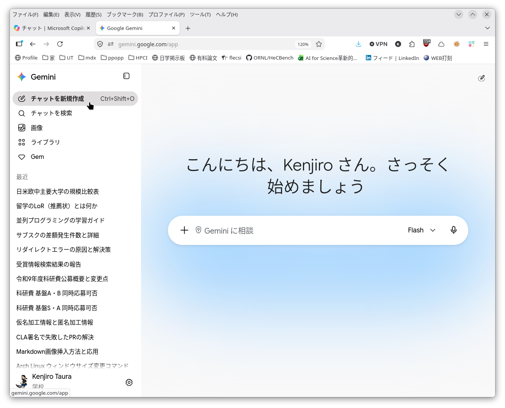
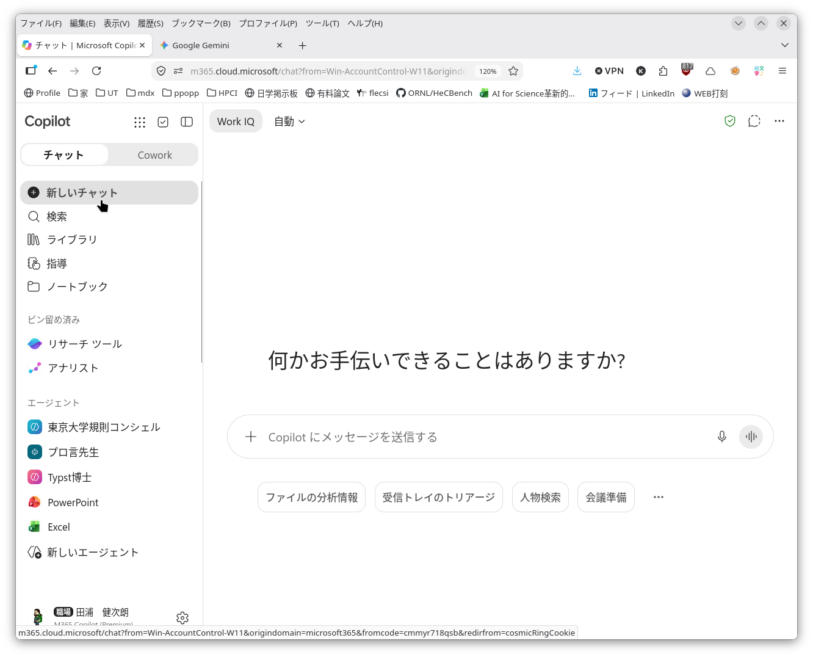
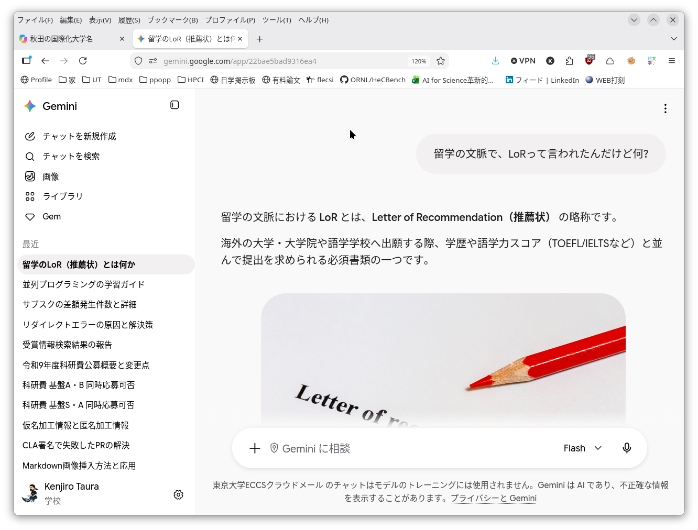
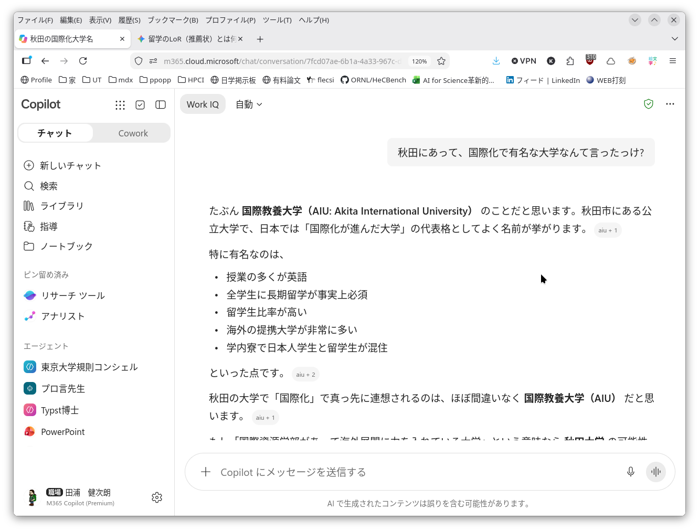
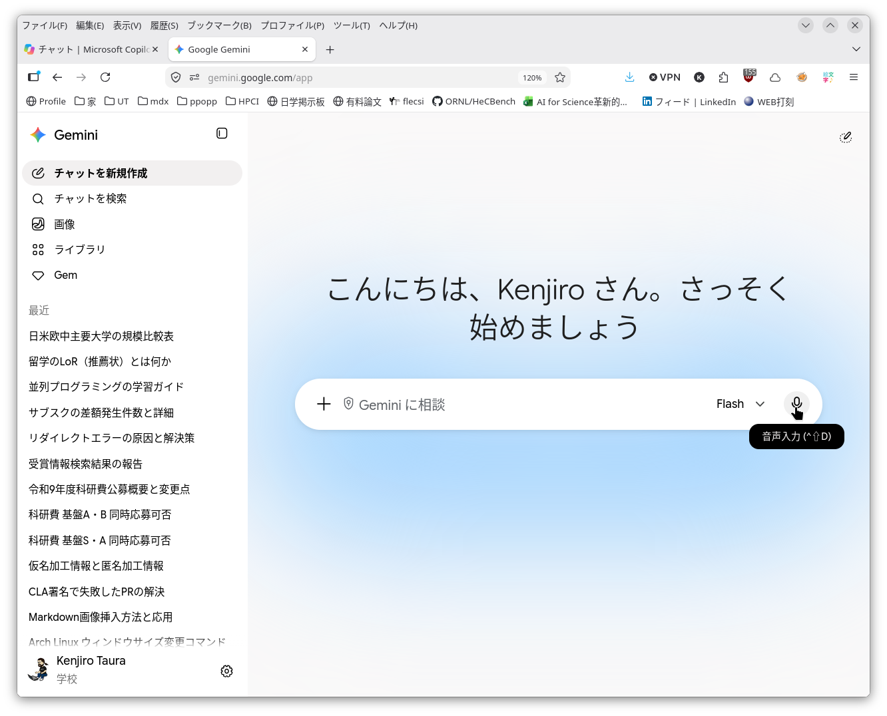
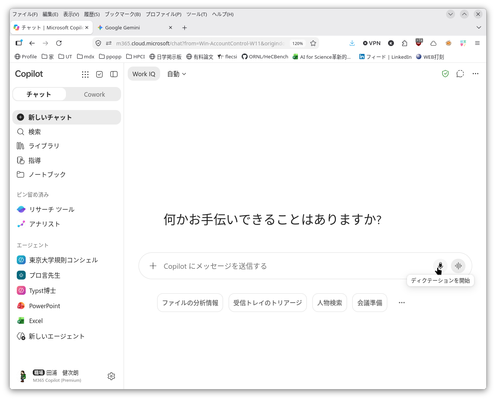

This page is under construction. Both its content and its URL are subject to change.

## Starting a Conversation

From the menu on the left, choose "New chat", "Create new chat" or similar.

|                                                                                          |                                                                        |
|------------------------------------------------------------------------------------------|------------------------------------------------------------------------|
| [Google Gemini](https://gemini.google.com/app)                                           |             |
| [Microsoft Copilot Chat](https://www.microsoft.com/ja-jp/microsoft-365-copilot/chat)     |   |

## Asking Questions

We give a few examples below, but the point is that you can ask anything, so there is no need to learn what sorts of things to ask. Just try asking about whatever you do not know or are wondering about. The examples below are questions that it was hard to find answers to with conventional search engines.

Examples:

- Asking about a three-letter acronym you do not know, together with its context (ordinary search engines may turn up too many possible answers you are not looking for)
  - "**In the context of studying abroad**, someone said LoR to me. What is it?"
- Asking about something you cannot recall (when the search keyword _is_ the answer itself)
  - "You know, **what's the name of that university in Akita that's famous for internationalization?**"
- Wanting an explanation suited for you (ordinary searching turns up only long explanations you do not want to read)
  - "What is this 'user list' everyone mentions when we take in international students?"

|                                                                                          |                                                                          |
|------------------------------------------------------------------------------------------|--------------------------------------------------------------------------|
| [Google Gemini](https://gemini.google.com/app)                                           |             |
| [Microsoft Copilot Chat](https://www.microsoft.com/ja-jp/microsoft-365-copilot/chat)     |   |

## Research and Summarizing

With a single instruction you can have AI look up many things and go as far as pulling them together for you. Where ordinary searching would mean searching here and there and doing the summarizing yourself, AI does that summarizing too. If you notice that you are repeating similar searches, it is worth trying whether AI can pull it all together in one go.

Caution:

- Check the claims against their sources. To that end, have the AI give its sources and, as far as possible, go and look at the originals. AI is known to fabricate sources (bibliographic details and links) more often than not, so please be careful. Follow the link, or search again for the bibliographic details, so as to confirm that the source exists and it says what AI claims it does.
- For other points to be careful about, see [Responsible AI Use](../responsible-use/)

Examples:

- "Tell me how to get from Tokyo Station to Nagoya Station by various means, including Shinkansen, conventional lines and highway bus, as a table with the time required and the one-way fare. Please give your sources as well."
- "Make a table of about five relatively large universities in each of the US, the EU, China and Japan, with their numbers of faculty, staff and students. Please give your sources as well."

## Discussion and Bouncing Ideas

You put your own thinking to the AI and have it respond, in a conversation that goes back and forth many times.  You can continue as long as you want, without a fear of being perceived as a sticky person if it were human. Here too the topic is entirely up to you. Just put to it whatever you are thinking about or wondering about.

Examples:

- "I hear American universities are supported by large endowments; why hasn't that happened in Japan?", followed by
	- "How does preferential tax treatment differ between Japan and the US?"
	- "I've heard the US has tax credits (where the amount donated comes straight off your tax). Is that true?"
	- "Is giving supported by a small number of wealthy people, or by many people of average income? Please compare Japan and the US."
	- and so on...

## Voice Input Is Also Possible

Instead of typing, you can also speak your input (through the smartphone app, or the microphone button in many services).

|                                                                                          |                                                                          |
|------------------------------------------------------------------------------------------|--------------------------------------------------------------------------|
| [Google Gemini](https://gemini.google.com/app)                                           |             |
| [Microsoft Copilot Chat](https://www.microsoft.com/ja-jp/microsoft-365-copilot/chat)     |   |

## Next

[Reading and Producing Files](../input-output-files/)
