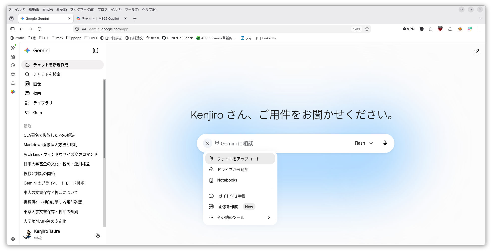
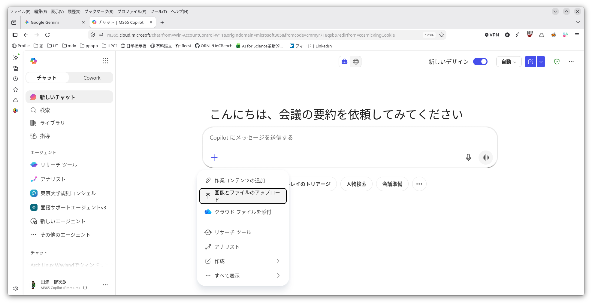
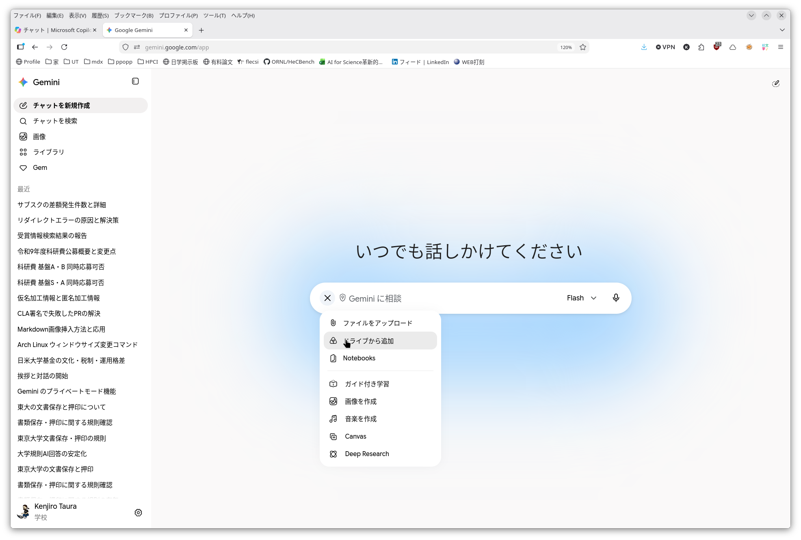
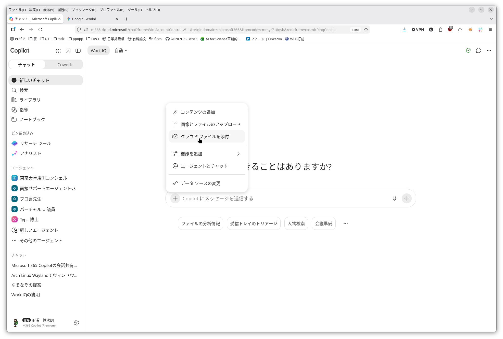

This page is under construction. Both its content and its URL are subject to change.

## Having Materials Read

You can have files, web pages and other materials read. Files may contain confidential information. To check whether information may be entered, see [Information Security and the Risk of Information Leakage](../../security/).

### Files

- Google Gemini
  - the `+` button beside the box you type into -> "Upload files"
- Microsoft Copilot Chat
  - the `+` button beside the box you type into -> "Upload images and files"

|                        |                                                                           |
|------------------------|---------------------------------------------------------------------------|
| Google Gemini          |             |
| Microsoft Copilot Chat |   |

You can then ask questions about, and give instructions concerning, the file you have given it.

Examples:

- Having a long text in a language that is not your own translated
  - upload the paper
  - "Put this into ○○ (Japanese, for example)" or similar
- Having a thick call for proposals read and asking about its contents
  - upload this [KAKENHI call for proposals](https://www.jsps.go.jp/file/storage/kaken_kiban_2026_g_4978/r9_7_kobo.pdf)
  - "Can I apply for Kiban S and Kiban A at the same time? Where does it say so?" or similar
- Having a thick manual read and asking about a procedure
  - upload this [manual](https://documentation.extremenetworks.com/CLI_X-Ref/1.0/CLI_X-Ref_Guide_1.0.pdf)
  - "How do I find out which ports are assigned to the same VLAN? Where does it say so?" or similar
- Extracting data from irregularly structured sources (PDFs or hard-to-machine-read Excel files)
  - upload the Excel files of ten budget requests
  - "Extract the title, the amount requested, ... and put them in a table" or similar

### Files in Google Drive or OneDrive

With Google Gemini you can also have files in Google Drive read directly, and with Microsoft Copilot Chat, files in OneDrive. It works almost the same way as with ordinary files.

- Google Gemini
  - the `+` button beside the box you type into -> "Add from Drive"
- Microsoft Copilot Chat
  - the `+` button beside the box you type into -> "Attach cloud files"

|                        |                                                                          |
|------------------------|--------------------------------------------------------------------------|
| Google Gemini          |             |
| Microsoft Copilot Chat |   |

### Public Web Pages

If you put the page's URL (a string like https://...) into your question, the AI will read it.

Examples:

- "In the Act on the Protection of Personal Information https://laws.e-gov.go.jp/law/415AC0000000057/ , tell me what pseudonymously processed information and anonymously processed information are and how they differ. Tell me which articles they appear in as well."
- Following up with "Suppose I had raw data listing students' names, student numbers, courses and grades. How would I turn that into pseudonymously processed information, or anonymously processed information?"

## Tips for Having Long Documents Read

With PDFs you will often have the impression that the contents were not read correctly. In most cases the cause cannot be pinned down, but it is likely because most AIs try to read a PDF by extracting only its text. Depending on the page layout (a two-column layout, for instance), this gives rise to various problems: meaningless text is extracted, figures and tables are ignored, extraction of Japanese strings fails, and so on. For the same reason, AI is often unable to answer correctly about pages (what page something appears on, or conversely what appears on page ○○). As usual, it will nonetheless answer with an air of knowing, so you need to be careful not to take what it says at face value.

In such cases, instructing it to **read the file as images** sometimes works. It is also worth asking questions that test whether the AI recognizes page boundaries, such as how many pages there are, or what is on page ○○.

Examples:

- When uploading, instruct it: "Read this file as images and understand its contents"
- Then ask questions such as "How many pages are there? What is written on page 30?"
- Once it looks right, ask the question you actually care about

## Receiving Results as a File

You can also receive output in the form of a file. All it takes is a word added to your instruction.

Examples:

- Continuing from "Extracting data from irregularly structured sources (PDFs or hard-to-machine-read Excel files)" above
  - upload the Excel files of ten budget requests
  - "Extract the title, the amount requested, ... and put them in a table"
  - **"Give me the result as a CSV file"**

Rather than using the result you receive as it is, it is important to check for yourself that it contains no errors before using it ([Responsible AI Use](../responsible-use/)).

## Next

[Sharing a Conversation with AI](../share-conversations/)
