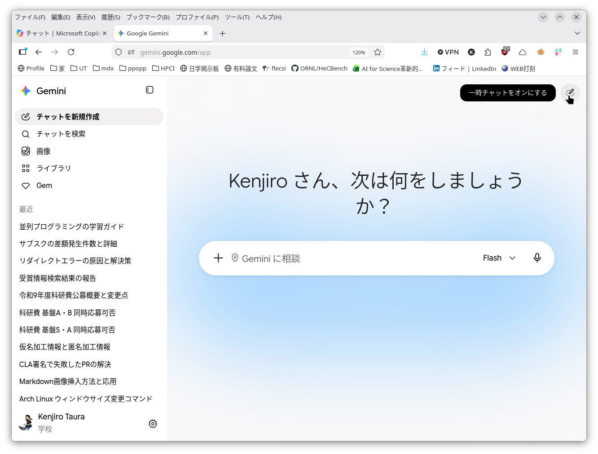
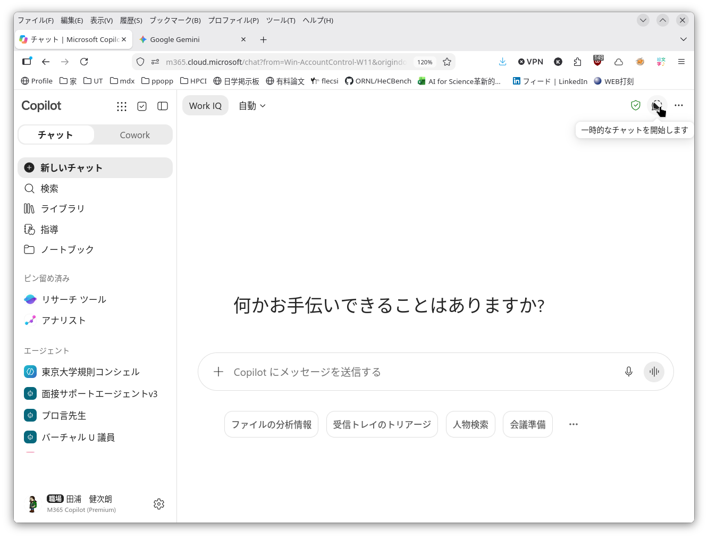

This page is under construction. Both its content and its URL are subject to change.

## What Private Mode Is

Many conversational AIs have a setting under which the contents of the conversation (your input and the AI's responses) are not saved on the service's side. The names vary from service to service ("temporary chat", "incognito", and so on), but the idea is common to all of them: the conversation is treated as disposable. Below we refer to all of these as "private mode".

In the ordinary, everyday mode, past conversations remain as history and can be reflected in later conversations. If you have been using AI for work or research for a while, you have probably noticed it responding as though it somehow knew whether you are faculty, staff or a student, and what you specialize in, are responsible for, or are studying, or connecting what you said in one conversation to another. This is the flip side of the convenience of "it remembers what I told it before": information you entered in the past may pop up unexpectedly in a response in a different conversation.

In private mode the AI does not use the history of past conversations, and the history of the current conversation is not used in subsequent ones either.

Note that even in private mode, what you enter is still sent over the internet to the servers of the AI provider (Google, Microsoft and so on). Please bear in mind that this does not mean "nothing leaves the University at all". For where information flows and accumulates depending on how you use AI, see [Information Security and the Risk of Information Leakage](../../security/).

|                        |                                                                            |
|------------------------|----------------------------------------------------------------------------|
| Google Gemini          |             |
| Microsoft Copilot Chat |   |

## Limitations of Private Mode

- Naturally, you cannot look back at the conversation afterwards, nor search it
- It follows that you cannot close a conversation and pick it up again later
- Nor can you share the conversation with other people

## Next

[Responsible AI Use](../responsible-use/)
