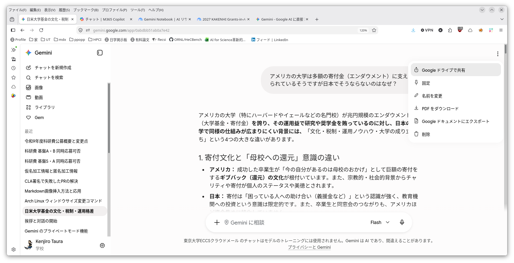
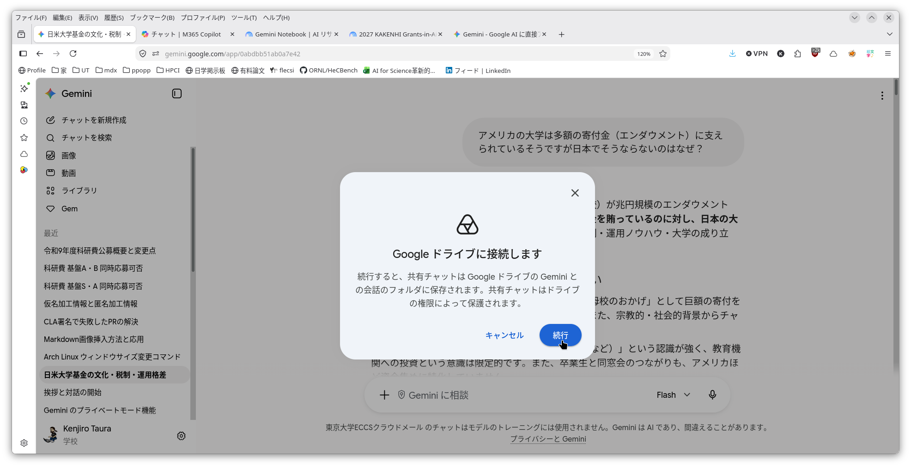
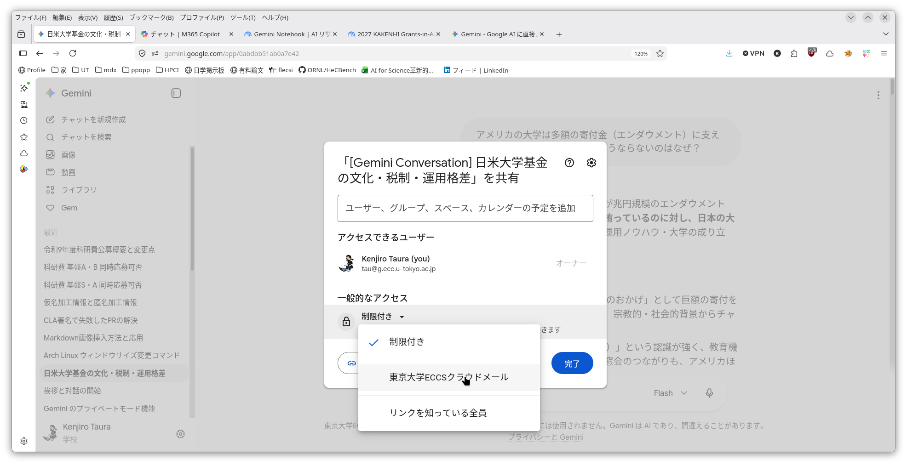

This page is under construction. Both its content and its URL are subject to change.

## Sharing a Conversation

The history of a conversation with AI can be shared with other people.

### Google Gemini

1. From the three-dot menu at the top right of the conversation page, choose "Share to Google Drive"
	
1. "Connecting to Google Drive" appears, so choose "Continue"
	
1. A menu appears for choosing who to share with; choose the one that is appropriate. This is the same as [sharing a file on Google Drive](https://utelecon.adm.u-tokyo.ac.jp/en/google/drive/share/), and there are the following three options
   - share only with specified people
   - share so that people at UTokyo (with an ECCS Cloud Email account) can see it
   - share so that anyone can see it

   
1. Once you have chosen the appropriate setting, clicking "Copy link" copies the link (URL) to the clipboard; after that, paste it into whichever application you want to send the link through (email, Teams, Slack, and so on)

### Microsoft Copilot Chat

Individual responses can be shared, but a whole conversation cannot (as of September 2026).

## Points to Note When Sharing a Conversation

The same care applies when sharing a conversation with AI as when sharing a document with other people. Please check that what you entered, and what the AI produced, contains no information that ought not to be shared with that person.

Make sharing only with specified people your default, and check the contents carefully when sharing more widely than that (this applies not only to conversations with AI but to many documents). With conversations with AI, unlike ordinary documents, there is seldom any need to share widely (with everyone at UTokyo, that is, anyone with an ECCS Cloud Email account, or with anyone at all).

For other points about handling information, please read [Information Security and the Risk of Information Leakage](../../security/).

## Next

[Private Mode](../private-mode/)
