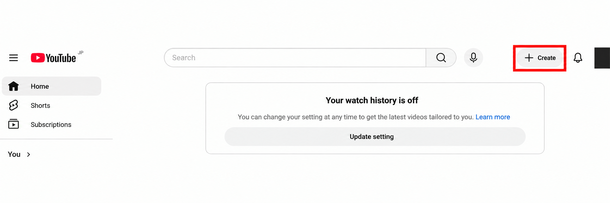
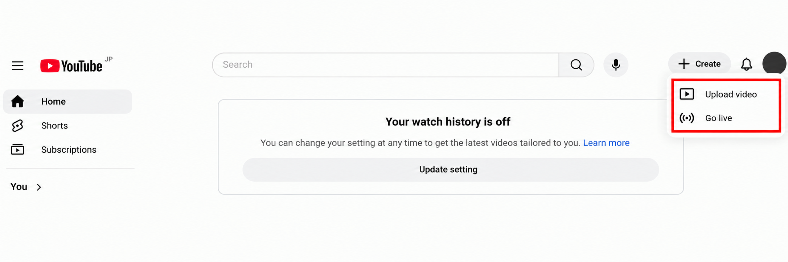
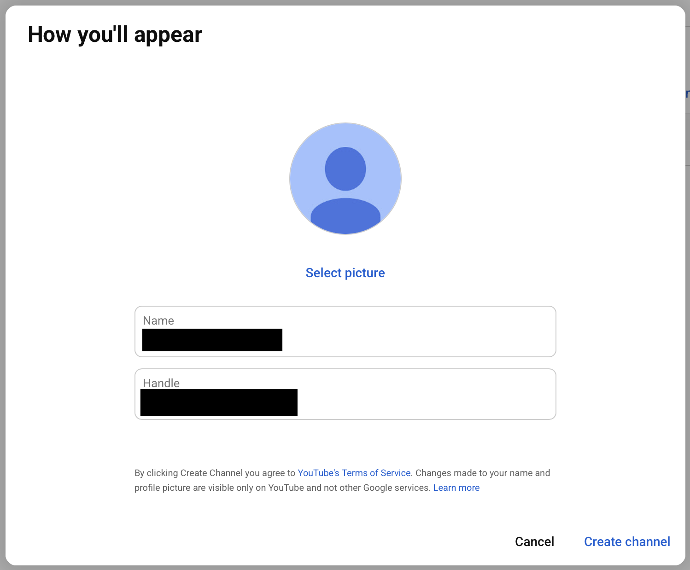
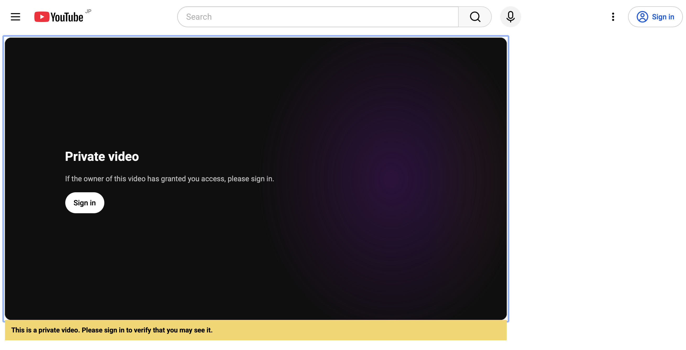
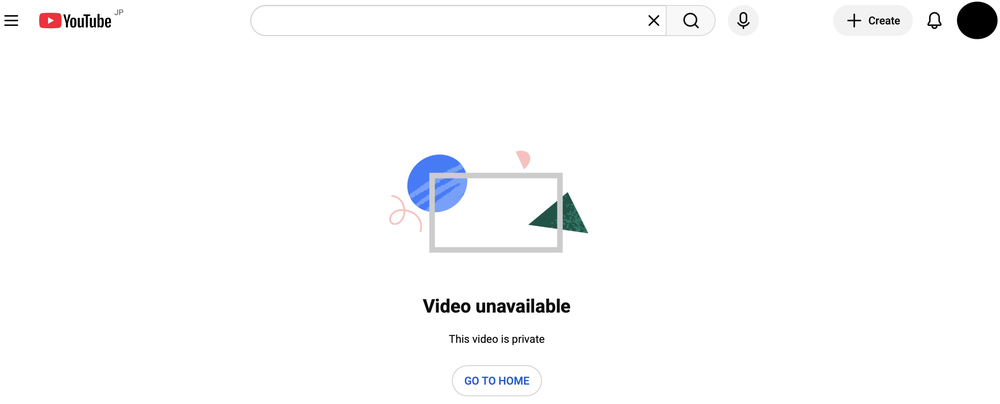
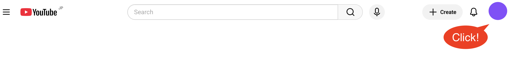
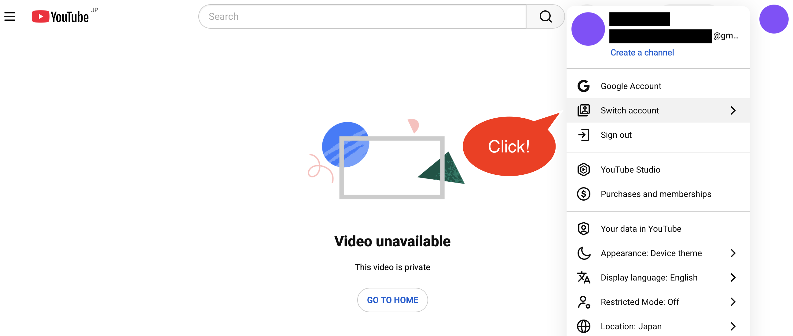
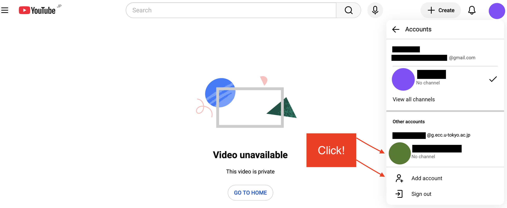

**YouTube** is a video streaming service provided by Google in which you can upload and release videos, or offer live streaming of events. 

If you are a student or faculty/staff of the University of Tokyo, you can use YouTube with your ECCS Cloud Email account. You can upload videos of lectures, livestream a ceremony and share any other content available only to members of the University of Tokyo with your ECCS Cloud Email account.

This page describes how to upload videos and offer livestreaming, and how to watch contents available only to students and faculty/staff of the University of Tokyo. If you need to know basic procedures to use YouTube, please visit [Google's official help page](https://support.google.com/youtube?hl=en&sjid=14250656160075261256-NC#topic=9257498). 

## To Upload a Video and Offer a Live Streaming
{:#for-creators}

Follow the procedures below to upload videos and offer livestreaming on YouTube with your ECCS Cloud Email account. Please create your channel first, then you can upload videos, complete video visibility settings or offer livestreaming as needed.

### About Your Channel and Account
{:#channel}

To upload videos or offer livestreaming on YouTube, you need **a channel** linked to your account. 

There are two kinds of YouTube channels: **created with a personal account** and **created with a “brand account”.** **On a channel created through a personal account, you can share content available only to students and faculty/staff of the University of Tokyo.** **If you upload a video or offer livestreaming only for students and faculty/staff of the University of Tokyo, you need to use a channel created with your personal account.** However, with the channel created with a brand account, you cannot restrict contents available to only students and faculty/staff of the University of Tokyo, but you can manage the account with other members and create multiple channels with one account.

### To Create a Channel
{:#create-channel}

Before uploading a video or offering livestreaming, you need to create a personal channel with your ECCS Cloud Email account. Follow the procedures below to sign in to YouTube with your ECCS Cloud Email account and create a channel with your personal account. **To create a channel with a brand account, please visit "[Create a YouTube channel](https://support.google.com/youtube/answer/1646861?hl=en&sjid=12429287744673113938-NC)" > "Create a channel with a business or other name".** 

1. Sign in to YouTube with your ECCS Cloud Email account.
2. Click "Create" on the upper right of the screen. 
   {:.border}
3. Click "Upload video" or "Go live."
   {:.small.border}
4. Enter the profile of your channel. 
   {:.small}
5. Click "Create channel."

### To Upload a Video
{:#upload}

To understand the basic procedures to upload a video on YouTube, please check "[Upload a video on YouTube (in Japanese)](/google/youtube/upload/)."

### To Complete Video Visibility Settings
{:#sharing}

To understand the differences between "Public", "Private" and "Unlisted" and the procedures to make content available only to students and faculty/staff of the University of Tokyo, please check "[Video Visibility settings on YouTube (in Japanese only)](/google/youtube/sharing/)."

### To Offer a Live Streaming
{:#live}

To turn on the livestreaming option and start livestreaming, please check "[Live Streaming on YouTube Using your ECCS Cloud Email Account](./live/)." Please note that **it takes around 24 hours to turn on the livestreaming option after your request.** Therefore, please make sure to turn it on with enough time in advance before offering livestreaming.

Furthermore, **you can livestream a meeting or a webinar on Zoom through YouTube.** Please check "[Streaming Zoom Meetings and Webinars on YouTube](./live/streaming/zoom/)" for more details. 

## To Watch a Video Available Only to Students and Faculties of the University of Tokyo
{:#watching}

To watch a video available only to students and faculty/staff of the University of Tokyo, **you need to switch your account to your ECCS Cloud Email (`xxxx@g.ecc.u-tokyo.ac.jp`) account on YouTube.**

One of the following error messages may appear when you try to watch such videos without signing in or with another account. 

- ["**Private video: If the owner of this video has granted you access, please sign in**"（The "Sign in" button **is** in the center of the display）](#watching-private)
- ["**Video unavailable: This video is private**"（The "Sign in" button is **NOT** on the display）](#watching-cannot-play)

Please follow the procedures below to watch the video with your ECCS Cloud Email account in each case.

### When the Video Is Displayed as "Private"
{:#watching-private}

If you try to watch a video available only to students and faculty/staff of the University of Tokyo without signing in, the video will be displayed as "Private."

{:.border}

In this case, please follow the procedures below to sign in and watch the video. 

1. Click the "Sign in" button in the center of the display. 
    - If there is no "Sign in" button on the display, please check "[When the Video Is Displayed as 'Video unavailable'](#watching-cannot-play)."
2. Enter your ECCS Cloud Email address (the address you set up using your chosen username, or your 10-digit Common ID + `@g.ecc.u-tokyo.ac.jp`) on Google's sign-in screen. 
3. Sign in to your [UTokyo Account](/en/utokyo_account/) to watch the video. 

### When the Video Is Displayed as "Video unavailable"
{:#watching-cannot-play}

{:.border}

This error message will be displayed in the cases below. 

- You have signed in with an account **other than** your ECCS Cloud Email account.
- You are using another account to watch YouTube, although you have signed in with your ECCS Cloud Email account. 

In these cases, please follow the procedures below to switch your account to your ECCS Cloud Email account on YouTube. 

1. As you cannot switch your account on the error screen, visit [the top page of YouTube](https://www.youtube.com/) and click the icon of your account on the upper right of the screen (if you have not set up an image as your icon, part of your name or your initial may be displayed as your icon).
   {:.border}
2. Click "Switch account."
   {:.border}
3. Select your ECCS Cloud Email account (the account with the domain `@g.ecc.u-tokyo.ac.jp`) if it is on the displayed list of your accounts you use to sign in. 
    - If your ECCS Cloud Email account is not on the list, please select "Add account," sign in with your ECCS Cloud Email account as described in "[When the Video Is Displayed as 'Private'](#watching-private)" and access the video again.

   {:.border}
4. Try accessing the video again. 
