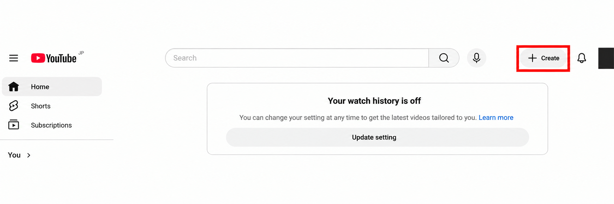
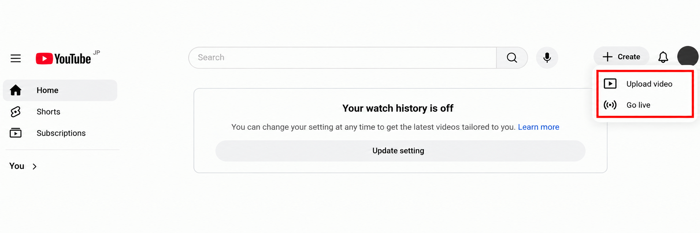
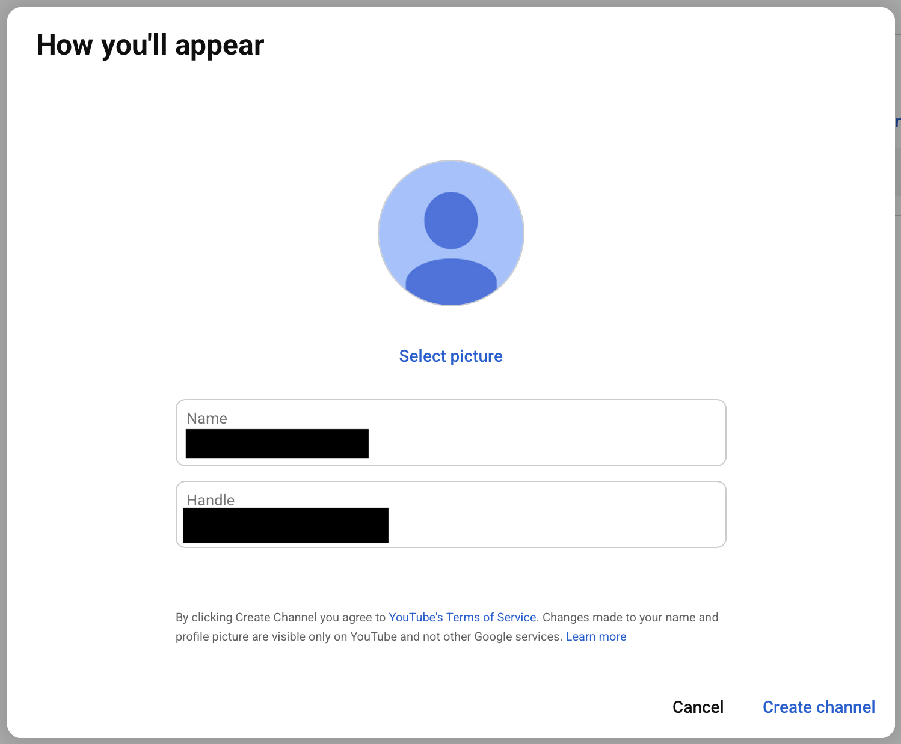
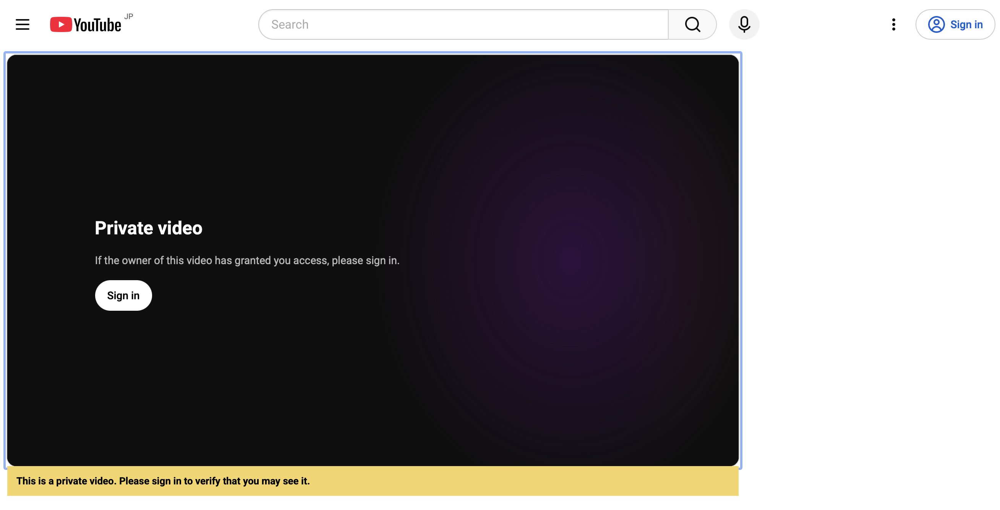
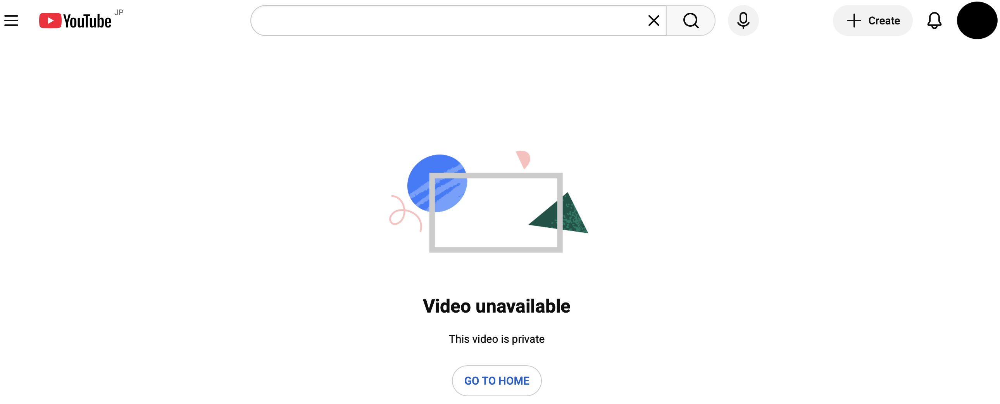
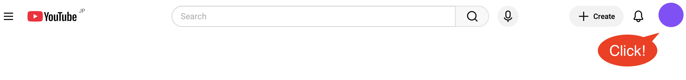
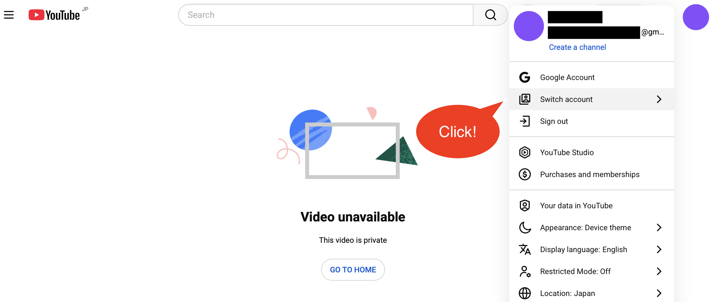
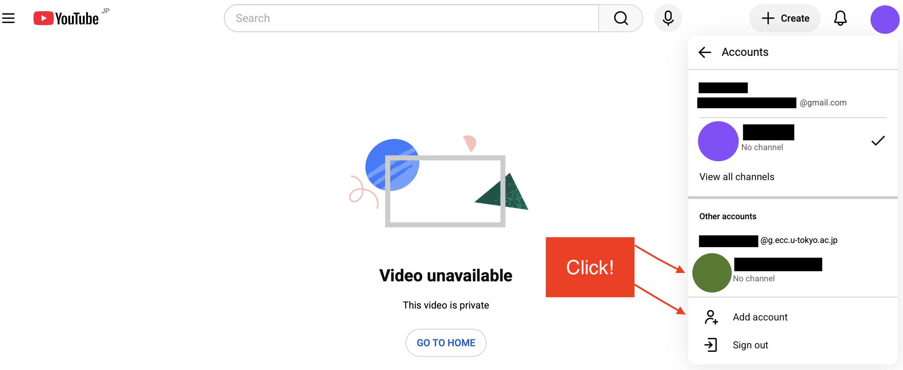

**YouTube** is a video streaming service provided by Google in which you can upload and release a video, or offer a live streaming of an event. 

If you belong to students and faculties of the University of Tokyo, you can use YouTube with your [ECCS Cloud Email account](/en/google). With your ECCS Cloud Email account, you can make a video of a lecture, a livestreamed ceremony and any other content **available only to students and faculties of the University of Tokyo.**

This page describes [how to upload a video and offer a live streaming](#for-creators) and [how to watch contents available only to students and faculties of the University of Tokyo](#watching). If you need to know basic procedures to use YouTube, please visit [Google's official help page](https://support.google.com/youtube?hl=en&sjid=14250656160075261256-NC#topic=9257498). 

## To Upload a Video and Offer a Live Streaming
{:#for-creators}

Follow the procedures below to upload a video and offer a live streaming on YouTube with your ECCS Cloud Email account. Please [create your channel](#create-channel) first and [upload a video](#upload), [complete video visibility settings](#sharing) or [offer a live streaming](#live) according to your purpose. 

### About Your Channel and Account
{:#channel}

To upload a video or offer a live streaming on YouTube, you need **your channel** linked to your account. 

There are two kinds of YouTube channels: **created with a personal account** and **created with "a brand account".** Also, **on a channel created by a personal account, you can make contents available only to students and faculties of the University of Tokyo.** **If you upload a video or offer a live streaming only for students and faculties of the University of Tokyo**, you need to **use a channel created with your personal ECCS Cloud Email Account (instead of the brand account)**. On the other hand, on a channel created with a brand account, you cannot make contents available only to students and faculties of the University of Tokyo but manage the account with other members and create plural channels with one account.

### To Create a Channel
{:#create-channel}

Before uploading a video or offering a live streaming, you need to create your channel with your ECCS Cloud Email account. Follow the procedures below to sign in to YouTube with your ECCS Cloud Email account and create a channel with your personal account. **To create a channel with a brand account, please visit "[Create a YouTube channel](https://support.google.com/youtube/answer/1646861?hl=en&sjid=12429287744673113938-NC)" > "Create a channel with a business or other name".** 

1. Sign in to YouTube with your ECCS Cloud Email account.
2. Click "Create" on the upper right of the screen. 
   {:.border}
3. Click "Upload video" or "Go live."
   {:.small.border}
4. Enter the profile of your channel. 
   {:.small}
5. Click "Create channel."

### To Upload a Video
{:#upload}

To understand the basic procedures to upload a video on YouTube, please check "[Upload a video on YouTube (in Japanese)](/google/youtube/upload/)."

### To Complete Video Visibility Settings
{:#sharing}

To understand the differences between "Public", "Private" and "Unlisted" and the procedures to share contents only with students and faculties of the University of Tokyo, please check "[Video Visibility settings on YouTube (in Japanese)](/google/youtube/sharing/)."

### To Offer a Live Streaming
{:#live}

To turn on the option of live streaming and start it, please check "[Live Streaming on YouTube Using your ECCS Cloud Email Account](./live/)." Also, **it takes around 24 hours to turn on the option of live streaming after your request.** Before offering a live streaming, please turn it on enough time in advance.

Furthermore, **you can livestream a meeting or a webinar on Zoom through Youtube.** Please check "[Streaming Zoom Meetings and Webinars on YouTube](./live/streaming/zoom/)" for more details. 

## To Watch a Video Available Only To Students Faculties of the University of Tokyo
{:#watching}

To watch a video available only to students and faculties of the University of Tokyo, **you need to switch your account to your ECCS Cloud Email (`xxxx@g.ecc.u-tokyo.ac.jp`) account on YouTube.**

One of the following error messages may appear when you try to watch such a video without signing in or with another account. 

- ["**Private video: If the owner of this video has granted you access, please sign in**"（The "Sign in" button **IS** in the center of the display）](#watching-private)
- ["**Video unavailable: This video is private**"（The "Sign in" button is **NOT** on the display）](#watching-cannot-play)

Please follow the procedures below to watch the video with your ECCS Cloud Email account in each case.

### When the Video Is Displayed as "Private"
{:#watching-private}

When you try to watch a video available only to students and faculties of the University of Tokyo without signing in, the video will be displayed as "Private."

{:.border}

In this case, please follow the procedures below to sign in and watch the video. 

1. Click the "Sign in" button in the center of the display. 
    - If there is no "Sign in" button on the display, please check "[When the Video Is Displayed as 'Video unavailable'](#watching-cannot-play)."
2. Enter your ECCS Cloud Email address (the address you set up using your chosen username, or your 10-digit Common ID + `@g.ecc.u-tokyo.ac.jp`) on Google's sign-in screen. 
3. Sign in to your [UTokyo Account](/en/utokyo_account/) to watch the video. 

### When the Video Is Displayed as "Video unavailable"
{:#watching-cannot-play}

{:.border}

This error message will be displayed in the cases below. 

- You have signed in with an account **other than** your ECCS Cloud Email account.
- You use another account to watch YouTube although you have signed in with your ECCS Cloud Email account. 

In these cases, please follow the procedures below to switch your account to your ECCS Cloud Email account on YouTube. 

1. Visit [the top page of YouTube](https://www.youtube.com/) because you cannot switch your account on the error screen and click the icon of your account on the upper right of the screen (if you have not set up an image as your icon, part of your name or your initial may be displayed as your icon).
   {:.border}
2. Click "Switch account."
   {:.border}
3. Select your ECCS Cloud Email account (the account with the domain `@g.ecc.u-tokyo.ac.jp`) if it is on the displayed list of your accounts used to sign in. 
    - If your ECCS Cloud Email account is not on the list, please select "Add account," sign in with your ECCS Cloud Email account as described in "[When the Video Is Displayed as 'Private'](#watching-private)" and access the video again.

   {:.border}
4. Access the video again. 
