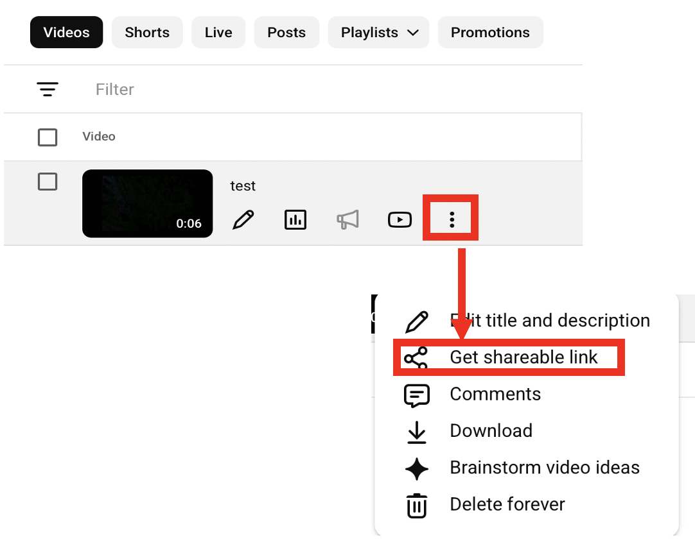
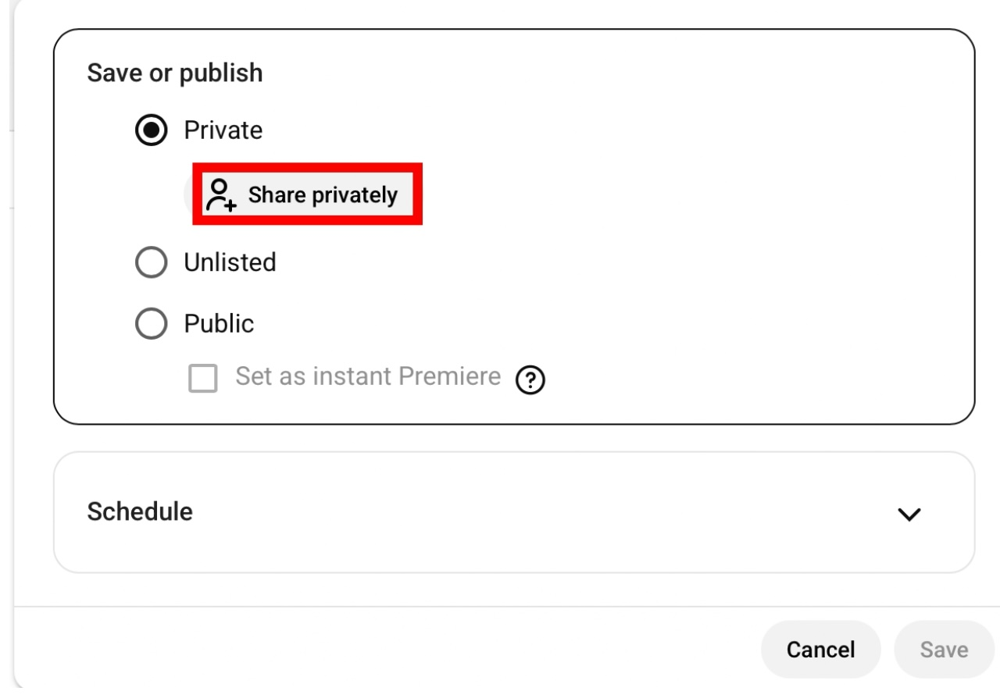
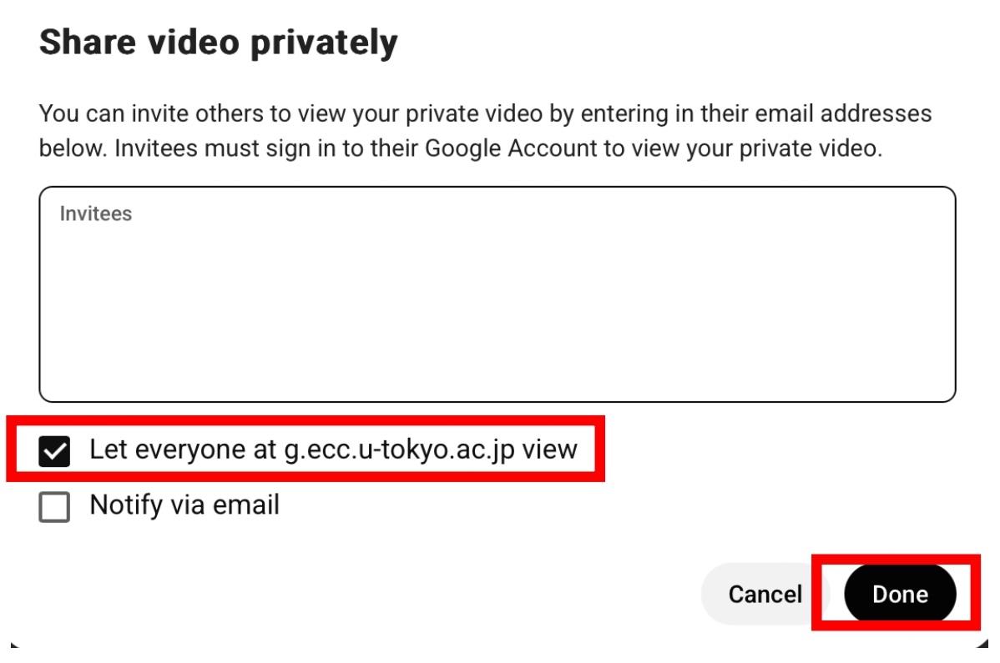

This page explains how to configure the visibility of videos uploaded to YouTube, with particular focus on how to **restrict viewing to students and faculties of the University of Tokyo.**．

When you sign in to YouTube with an [ECCS Cloud Email](/google/)（`xxxx@g.ecc.u-tokyo.ac.jp`）account and share content from a channel linked to that account, you can restrict viewing to students and faculties of the University of Tokyo.

## Visibility Types
{:#visibility-types}

YouTube videos have the following three visibility settings.

- **Public**：Anyone can watch the video. The video will appear in the channel's video list, search results, and other locations, and can be accessed from there.
- **Unlisted**：Only people who know the URL can watch the video. The video will not appear in video lists or search results and can only be accessed by entering the URL directly or via a link from outside YouTube.
- **Private**： Only you and the accounts you specify can watch the video.

Of these options, by**selecting “Private” and specifying the entire ECCS Cloud Email domain (g.ecc.u-tokyo.ac.jp) as the group to share the video with**h, you can restrict viewing to students and faculties of the University of Tokyo. The specific procedure is explained in the following section,「[ Share with UTokyo Members Only.](#utokyo-only)」.

Note that **videos can be restricted to UTokyo members only when the channel was created with an individual ECCS Cloud Email account**．Channels created with a “Brand Account” cannot restrict viewing to UTokyo members. For information about channel and account types, see “[About Channels and Accounts](../#channel)」.”

## Share with UTokyo Members Only
{:#utokyo-only}

### Upload a Video as Private
{:#upload-private}

First, upload the video as **Private**．Refer to “[Upload a Video](../upload/)」 and select “Private” on the visibility settings screen.

If you have already uploaded the video, change its privacy setting to “Private.”

Note that the setting must be **“Private,” not “Unlisted”** . (If the video is “Unlisted,” anyone who knows the URL can watch it, regardless of whether they are a UTokyo member.)

You can check whether the video is private by following these steps.

1..Sign in to [YouTube Studio](https://studio.youtube.com/)．
    - If you are already signed in to YouTube, click the channel icon in the upper-right corner and select “YouTube Studio.”
    - If you are already signed in to YouTube Studio, click the YouTube Studio icon in the upper-left corner.
2. Select “Content” from the menu on the left.
3. Check that the visibility setting for the video you want to check is set to “Private.” 
    {:.border}
    - If it is not set to “Private,” click the area that says “Unlisted” or “Public” and select “Private” from the visibility settings menu.

### Allow Students and Faculties of the University of Tokyo to Watch the Video
{:#share-with-utokyo}

1. Sign in to YouTube Studio.
    - If you are already signed in to YouTube, click the channel icon in the upper-right corner and select “YouTube Studio.”
    - If you are already signed in to YouTube Studio, click the YouTube Studio icon in the upper-left corner.
2. Select “Content” from the menu on the left.
3. Click the visibility setting for the video you want to share. 
    {:.border}
4. Select “Private” from the visibility settings menu, and click “Share privately.”
    {:.medium.border}
5. In “Share video privately,” check “Share with everyone at g.ecc.u-tokyo.ac.jp,” and click “Done.”
    {:.medium.border}
6. When you return to the visibility settings menu from Step 4, click “Save” in the lower-right corner to close the menu.
7. Select “Options” > “Get shareable link,” copy the video URL, and share it with the people you want to watch the video.
    {:.medium.border}

For instructions on how to watch videos shared using this procedure that are restricted to UTokyo students and faculty, please refer to “[Watching YouTube Content Restricted to UTokyo Members](../#watching)」．

## Share with the Public
{:#public}

If you want to make the video available to the general public rather than restricting it to UTokyo members, select “**Unlisted**” or “**Public**” instead of “Private” in the visibility settings menu described above.

The difference between “Unlisted” and “Public” is described in “[Visibility Types](#visibility-types).” For more details, also see YouTube Help, “[Change video privacy settings](https://support.google.com/youtube/answer/157177?hl=ja).”
