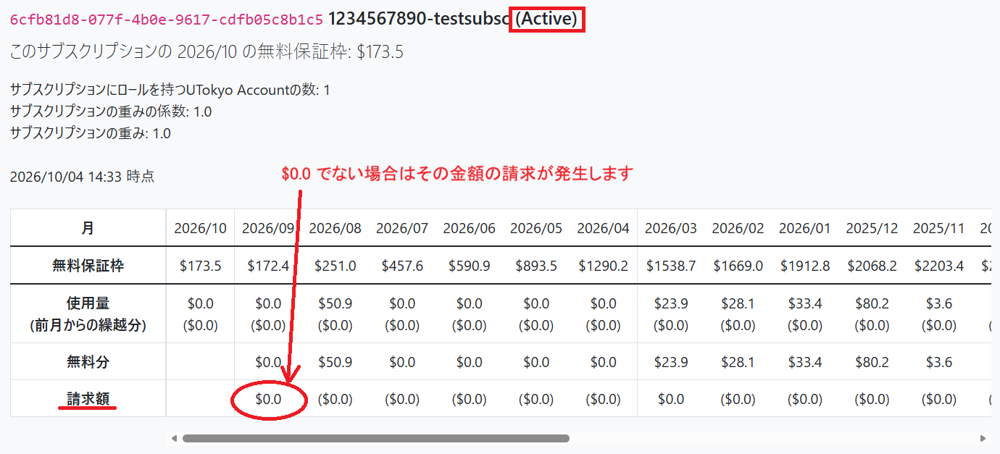
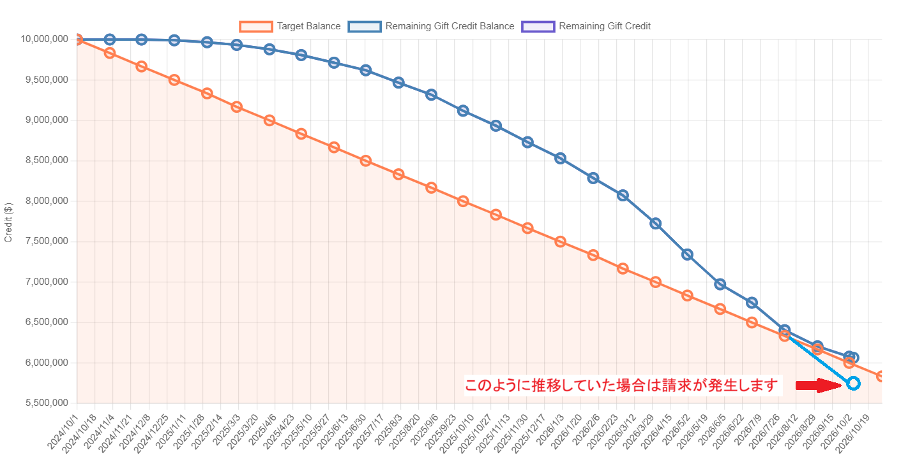
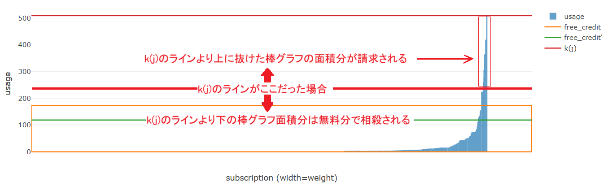

## How to Check the Billing Amount for Each Subscription

1. Access the [UTokyo Azure Subscription Management Site](https://azure.itc.u-tokyo.ac.jp/) and open the [**Usage**](https://azure.itc.u-tokyo.ac.jp/list/usage) tab.
2. For each **Active** subscription, if the billing amount is **greater than $0.0** as of **the end of September** or **the end of March**, the corresponding amount will be converted into Japanese yen and billed (see the figure below).
   - Charges incurred in each month from April through August are carried over to the following month, and the final billing amount is determined at the end of September. Similarly, charges incurred in each month from October through February of the following year are carried over to the following month, and the final billing amount is determined at the end of March.

{:.center.border}

## Conditions for Billing Across UTokyo Azure as a Whole and How to Check Them

1. Access the [UTokyo Azure Subscription Management Site](https://azure.itc.u-tokyo.ac.jp/) and open the [**Overall UTokyo Azure Usage**](https://azure.itc.u-tokyo.ac.jp/list/whole-usage) tab.
2. Billing will occur when the following condition is met in the first line graph:
   - If the blue line representing `Remaining Gift Credit Balance` falls below the orange line representing `Target Balance`, subscriptions will be billed in descending order of their excess amounts (see the figure below).
   - If the blue line does not fall below the orange line, no billing will occur across UTokyo Azure as a whole.

{:.center.border}

## How to Check How Many Subscriptions Are Being Billed Across UTokyo Azure as a Whole

1. Access the [UTokyo Azure Subscription Management Site](https://azure.itc.u-tokyo.ac.jp/) and open the [**Overall UTokyo Azure Usage**](https://azure.itc.u-tokyo.ac.jp/list/whole-usage) tab.
2. In the second bar chart, subscriptions that meet the following condition will be billed:
   - If a bar extends above the red k(j) line, the subscription will be billed for the portion extending above that line (see the figure below).
   - Each bar represents one subscription.

{:.center.border}

**Note 1:** The information in the [**Overall UTokyo Azure Usage**](https://azure.itc.u-tokyo.ac.jp/list/whole-usage) tab is provided to show overall usage trends and help users assess whether billing is likely to occur in the future. Information such as which subscriptions have high usage is not disclosed. Please check the [**Usage**](https://azure.itc.u-tokyo.ac.jp/list/usage) tab for information about subscriptions that you manage.

**Note 2:** This page provides only the essential explanations. For detailed explanations of each table and graph, please refer to the following URLs.

・[UTokyo Azure Usage Fee Regulations (Accessible only within the University)](https://drive.google.com/file/d/129vmaJJmDqkUK0iOMOlkICYMWMw_ZiZL/view)

・[About Usage Fees (and the Possibility of Being Billed)](/events/2025-02-21/slides/2_possible_billing.pdf)

