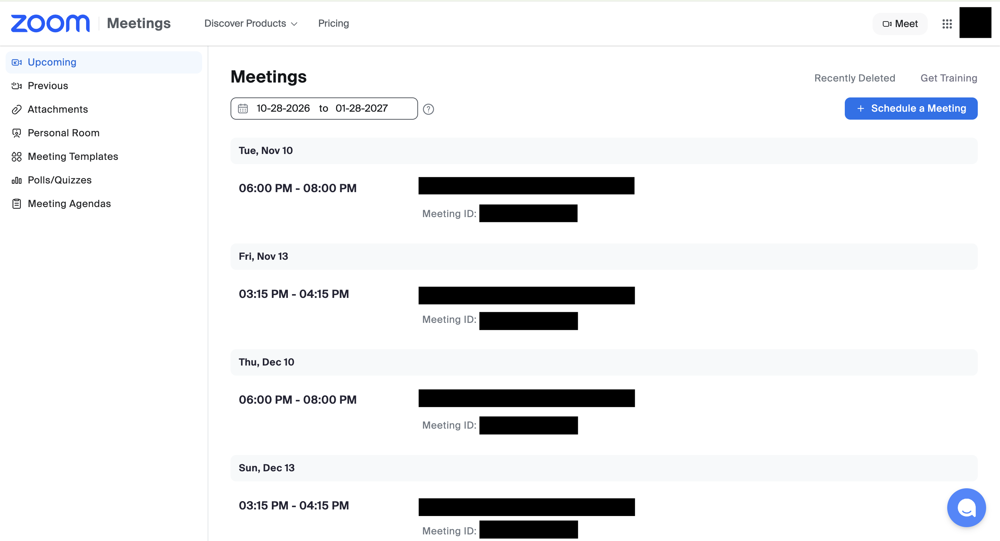
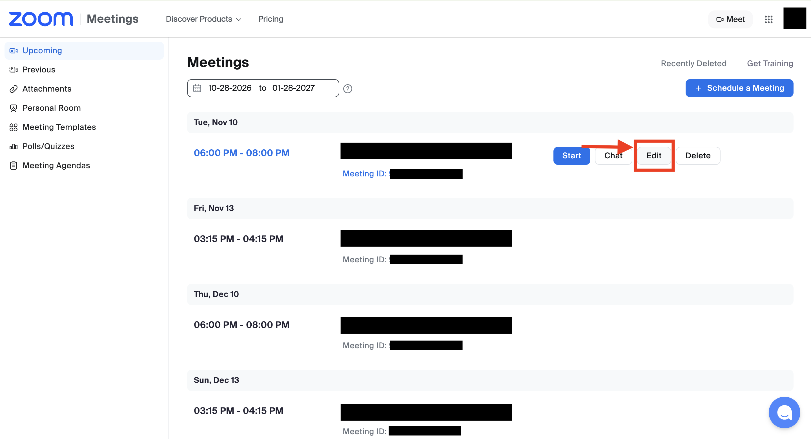
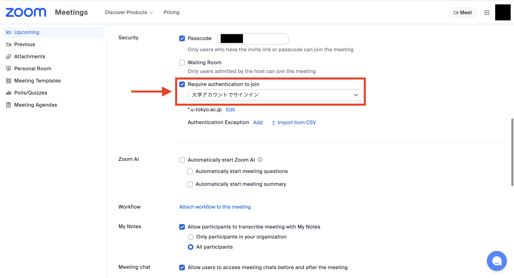
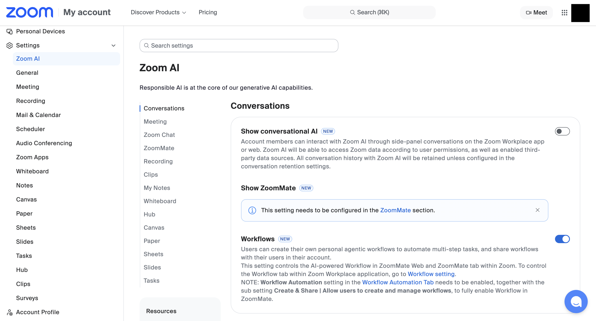
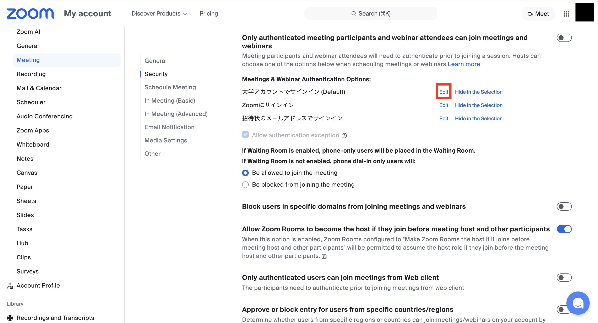
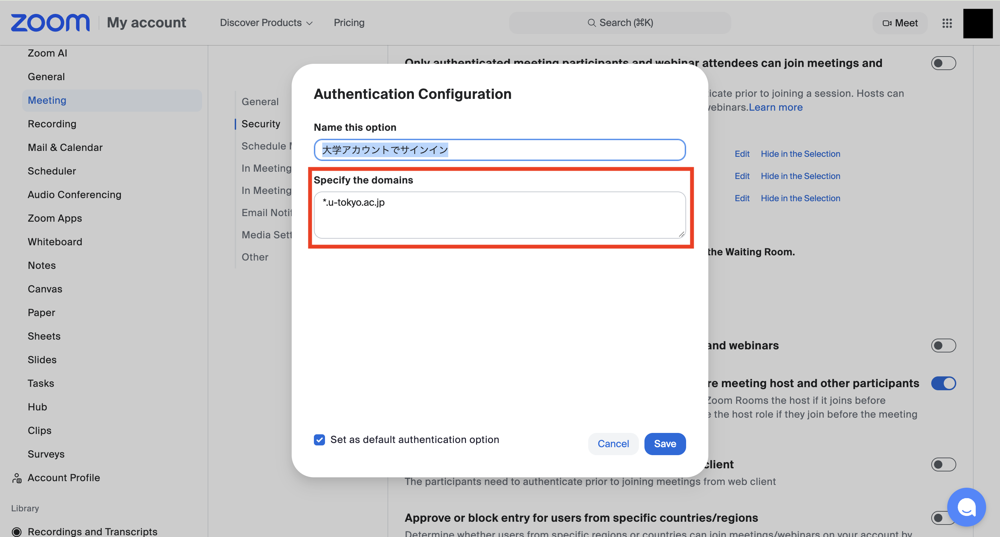

Authentication profiles allow hosts to restrict Zoom meeting participants to users whose email address matches a certain domain. If the option "大学アカウントでサインイン" ("Sign in with university account") is selected, participants will be asked to sign in with their UTokyo Zoom account to join the meeting.

If participants are not used to signing in with their UTokyo account (especially at the beginning of a semester), we recommend turning this setting off. See also “[Restricting Access to Zoom Meeting Rooms for Online Classes](./../../../faculty_members/zoom_access_control/)” for more information about the settings.

## Setting Up Individual Meetings

1. Open the [Zoom “Meetings” page](https://u-tokyo-ac-jp.zoom.us/meeting#/upcoming) in your web browser.
{:.medium.border}

2. Go to the meeting settings page.
    - To create a new meeting, click “Schedule a Meeting”.
    - To check or modify the settings of previously scheduled meetings, hover your mouse over the meeting in the list and click the "Edit" button on the right side.
    {:.medium.border}

3. Under “Security”, turn on "Require authentication to join" and select "大学アカウントでサインイン" (“Sign in with university account”).
    - Only participants who have signed in with their UTokyo Zoom account can join the meeting.
    - Check that the domain shown under "大学アカウントでサインイン" ("Sign in with university account") is `*.u-tokyo.ac.jp`. If not, click “Edit” and change it.
    {:.medium.border}

## Check the Default Domain Settings
It is also possible to change the default settings for newly scheduled meetings.

1. Open the [Zoom “Settings” page](https://u-tokyo-ac-jp.zoom.us/profile/setting) in your web browser.
{:.medium.border}
2. Go to 'Meetings', then open 'Security'. Then click the “Edit” button under “Meeting Authentication Options-大学アカウントでサインイン (Default) (Sign in with university account (Default))”.
{:.medium.border}
3. Check that the domain is set to `*.u-tokyo.ac.jp` in the field of “Sign in to Zoom with the following specified domains”. If not, please change it to `*.u-tokyo.ac.jp` and save your settings.
{:.medium.border}
