The participant registration feature of Zoom sets the system up so that it requires prospective participants to register in advance so that only those who have registered can attend the meetings.

The meeting host creates a registration link using this feature.
Subsequently, the host sends the relevant link to prospective participants and asks them to complete the registration procedure.

Prospective participants who wish to attend the meeting are required to access the registration page provided by the host and complete the registration procedure.

Prospective participants who register are automatically approved to join the meeting on completing the procedure and receive a confirmation email containing an individualized link. It is not possible to join the meeting unless you complete the registration procedure and obtain the link. However, this does not apply if registration is enabled later for an already scheduled meeting ([see below](#change-to-register)).

The host can check what information has been entered on the registration form by the prospective participants.
There is an option that allows the host to manually decide whether or not to approve the participation of a prospective participant who has completed the registration procedure.

## Basic Usage

Here, we will explain how the host creates a meeting where the participant registration feature is enabled and how the participants register in advance and how they attend the meeting.

### When Creating a New Meeting Requiring Participant Registration
{:#create-must-register-meeting}

1. Please go to the [Zoom meeting page](https://u-tokyo-ac-jp.zoom.us/meeting/) in your web browser and click on "Schedule a Meeting".
   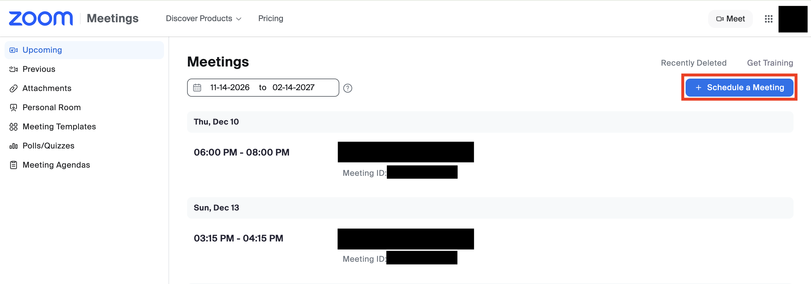{:.medium} 
1. On the next screen, please switch on  the "Required" checkbox for "Registration".
   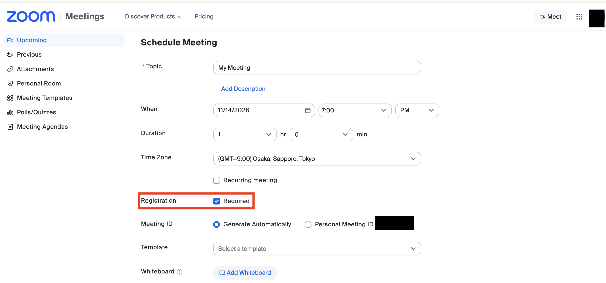{:.medium} 
1. Please click on the "Save" button at the bottom.
1. Please inform prospective participants of the "Registration Link" shown on the next screen.
   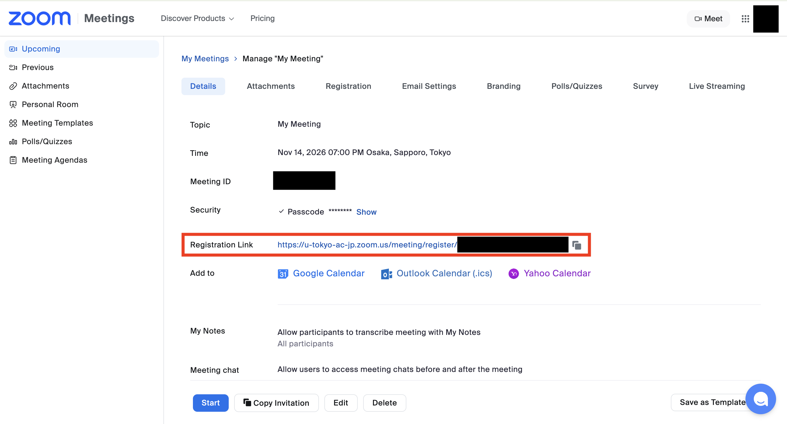{:.medium}
1. Prospective participants can perform the necessary registration procedures through the "Registration Link".
   Participants who have completed the registration procedure will automatically receive a confirmation email containing the individualized link.

※To individually decide whether to approve a prospective participant or not, please use the "[Manual Approval](#manual-approval)" option mentioned below.

### Enabling the Participant Registration Feature in an Already Created Meeting (Not Recommended)
{:#change-to-register}

You can change a meeting that did not require participant registration to one that requires after it has been scheduled. However, this is not recommended because if the participants have the original link instead of the registration link created after the host has applied this change, they will be able to attend the meeting without completing the registration procedure.

If you want to require registration, please create a new meeting by following the steps in "[When Creating a New Meeting Requiring Participant Registration](#create-must-register-meeting)" and share the new registration link.

1. Please go to the [Zoom meeting page](https://u-tokyo-ac-jp.zoom.us/meeting/) in your web browser.
1. When you hover the mouse over the meeting which you wish to enable the participant registration feature, the "Edit" button will be displayed on the right side. Please click on this button.
   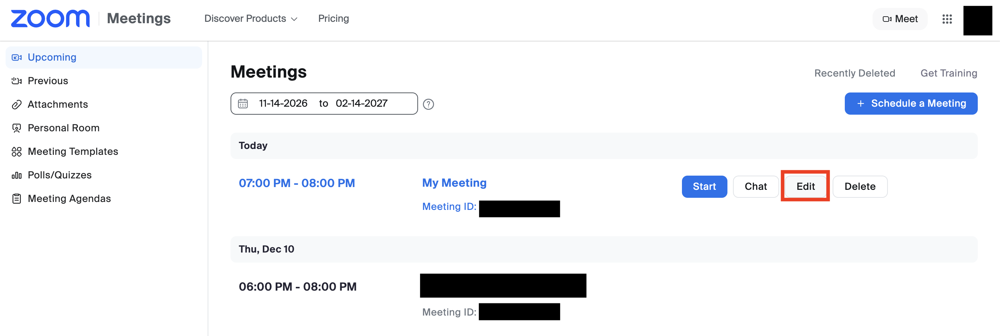{:.medium}
1. On the next screen, please switch on the "Required" checkbox for "Registration".
1. Click on the "Save" button at the bottom.
1. Please inform the prospective participants of the "Registration Link" displayed on the next screen.

### What Prospective Participants Need to Do

1. Please click on the "Registration Link" informed by the host.
1. The screen shown in the figure will be displayed. 
   Please enter your information in the entry fields and click on the "Register" button below. 
   In the email address field, enter your own email address. 
   Members of the University of Tokyo should enter their UTokyo Account (10-digit Common ID) followed by @utac.u-tokyo.ac.jp, e.g. `0123456789@utac.u-tokyo.ac.jp`.
   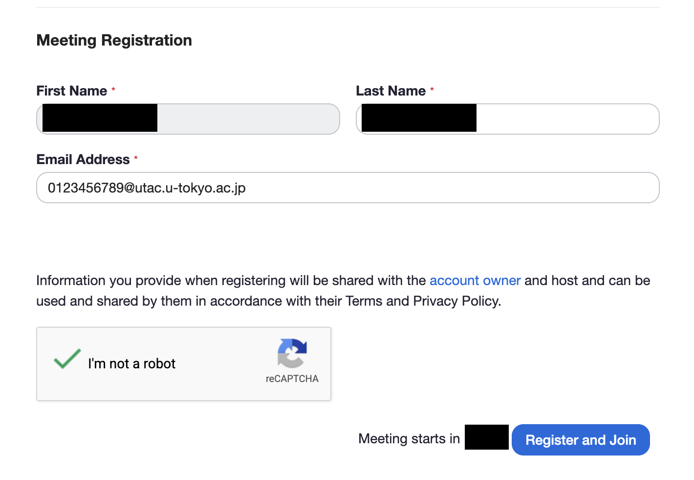{:.medium}
1. Once you complete registration (or, if manual approval is enabled, once the host approves you), a confirmation email will be sent to the entered email address. 
   An individualized link required to attend the meeting will be provided in the confirmation email. 
   Since this link is assigned individually to registered prospective participants, please make sure not to leak it to others or lose it.
1. On the day of the meeting, please click on the join link to attend the meeting.

#### If You Are Unable to Register for UTokyo Member Restricted Zoom Meetings

In spite of being a member of the University of Tokyo, if you cannot register for a meeting restricted to UTokyo members, please check the following. 
If participant registration is open to external participants as well, this step is not necessary.

-  **You have not entered your email address in the format `0123456789@utac.u-tokyo.ac.jp`**: Please enter your UTokyo Account (10-digit Common ID+ `@utac.u-tokyo.ac.jp`).
-  **You have never signed in to Zoom with your Zoom account of the University of Tokyo**： 
   If you have never logged into your account of the University of Tokyo before, it is possible that you cannot register for Zoom meetings restricted to UTokyo Member. 
   In such cases, please perform the registration procedure again after signing in following the [Sign-in Methods for Zoom](./../../signin/).

※For Hosts: This problem may occur when the "Require authentication to join" option is enabled.

## "Require authentication to join" Option

Here, we will explain the "**Require authentication to join**" option, which allows you to restrict registration in advance to UTokyo members. 
When this option is enabled, prospective participants who open the registration link must be signed in to a Zoom account with the specified domain. If you set the domain to `u-tokyo.ac.jp`, only UTokyo members can register.

1. Please go to the [Zoom meeting page](https://u-tokyo-ac-jp.zoom.us/meeting/) in your web browser and click on "Schedule a Meeting".
1. On the following screen, please switch on the "Required" checkbox for "Registration".
1. Then, on the same screen, please switch on the "Require authentication to join" checkbox.
   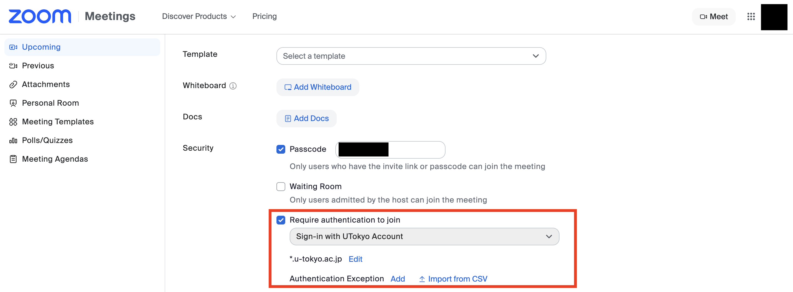{:.medium}
1. Then select "Sign-in with UTokyo Account" from the dropdown menu just below.
1. Please ensure that the field further down in the menu is "*.u-tokyo.ac.jp". If not, please click “Edit” next to it to change it.
   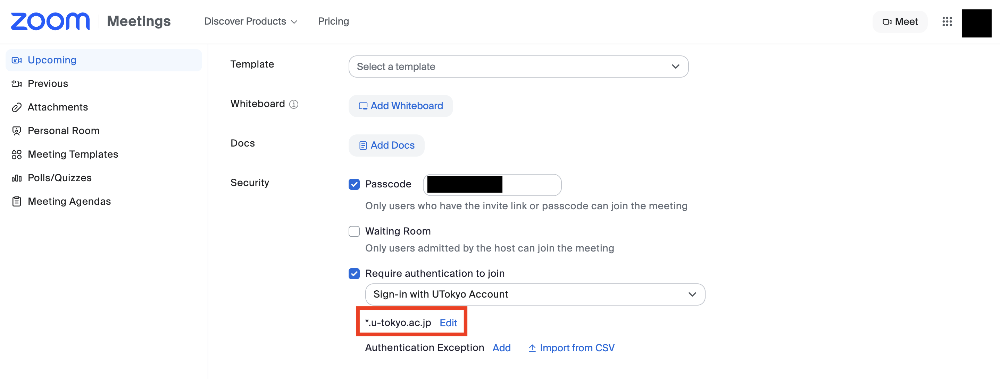{:.medium}
1. Click on the "Save" button at the bottom.
1.	Please inform the prospective participants of the "Registration Link" displayed on the next screen and guide prospective participants to enter their UTokyo Account (10-digit Common ID+ `@utac.u-tokyo.ac.jp`), e.g. `0123456789@utac.u-tokyo.ac.jp` in the email address field.
   {:.medium}

※If the email addresses of prospective participants are not in the format of `0123456789@utac.u-tokyo.ac.jp`, you may still be able to register in the Zoom system (if you have the Zoom account with `u-tokyo.ac.jp` at the end). 
However, because using the UTokyo Account (10-digit Common ID+ `@utac.u-tokyo.ac.jp`) as the Zoom account is standard at the University of Tokyo, please enter it in the format of `0123456789@utac.u-tokyo.ac.jp`.

## Resending Confirmation Email

Here, we will explain how to resend a confirmation email to registered prospective participants. This method allows you to resend the confirmation email as many times as needed to registered prospective participants. 
This is useful when you receive inquiries from prospective participants who have completed the registration procedure, such as "I lost the confirmation email" or "Please send the confirmation email again".

1. Please go to [Zoom meeting page](https://u-tokyo-ac-jp.zoom.us/meeting/) in your web browser.
1. Your scheduled meetings will be displayed as a list. Click the name of the meeting for which you want to resend the confirmation email.
   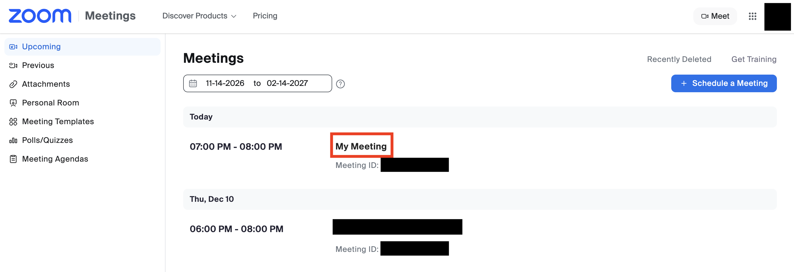{:.medium}
1. The meeting information will be displayed. You will see a row of tabs at the top, such as "Registration", "Email Settings", etc. Please select the "Registration" tab.
   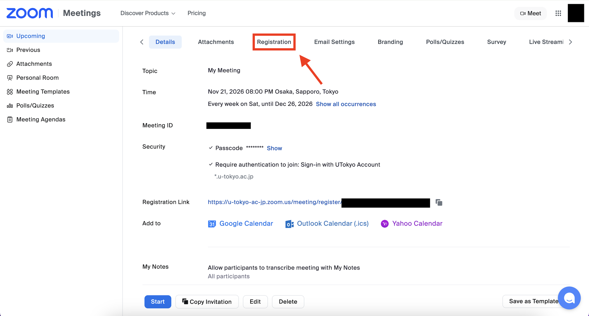{:.medium}
1. Please click on the "View" button located to the right of "Manage Registrants".
   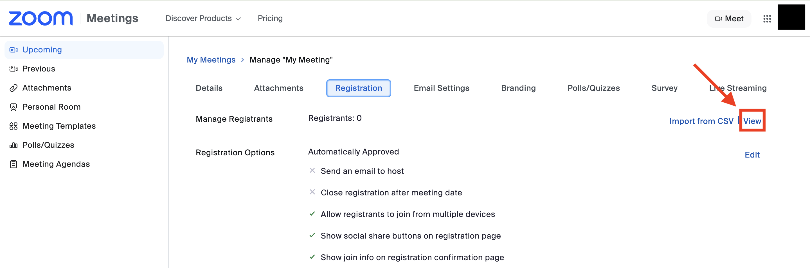{:.medium}
1. The list of the meeting registrants will be displayed.
1. Click on the checkbox for the registrants to whom you want to resend the confirmation email, and click on the "Resend Confirmation Email" button.
   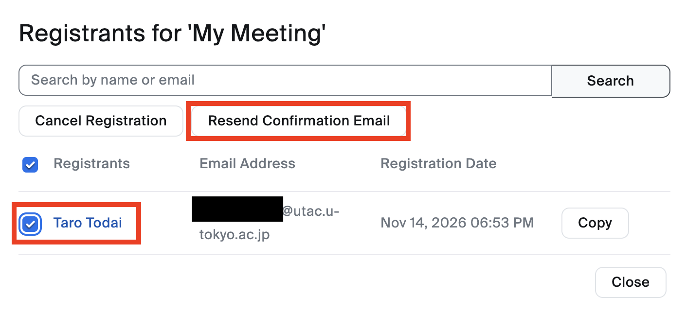{:.medium}

※If you have set up [manual approval](#manual-approval), you can only resend the confirmation email to prospective participants who are listed in the "Approved" list.

## Other Options

Using Zoom's participant registration feature allows you to accomplish the following.

-  Use the "Manually Approve" option to prevent registered prospective participants from receiving the join link until approved by the host.
-  Customize the fields in the form that prospective participants fill out on the registration page.
-  View the information entered on the registration page by prospective participants.
-  Ask for registration in advance for recurring meetings.
-  Close registration after the scheduled end date has passed.
-  Display original banners or logos on the registration website.

### Manual Approval
{:#manual-approval}

Here, we will explain about the option which prevents registered prospective participants from receiving the link until approved by the host. 
With this method, the host can choose which prospective participants receive the link.

※Usually, when prospective participants complete the registration procedure, the system automatically sends them their individualized link. 
Therefore, all registered prospective participants can receive their link.

#### Enabling the Option

Here, we will explain how to enable the "Manual Approval" option.

1. Please go to [Zoom meeting page](https://u-tokyo-ac-jp.zoom.us/meeting/) in your web browser.
1. Your scheduled meetings are displayed as a list. Please click on the name of the meeting for which you want to enable the manual approval option.
   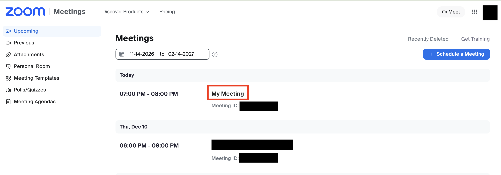{:.medium}
1. The meeting information will be displayed. You will see a row of tabs at the top, such as "Registration", "Email Settings", etc. Please select the "Registration" tab.
   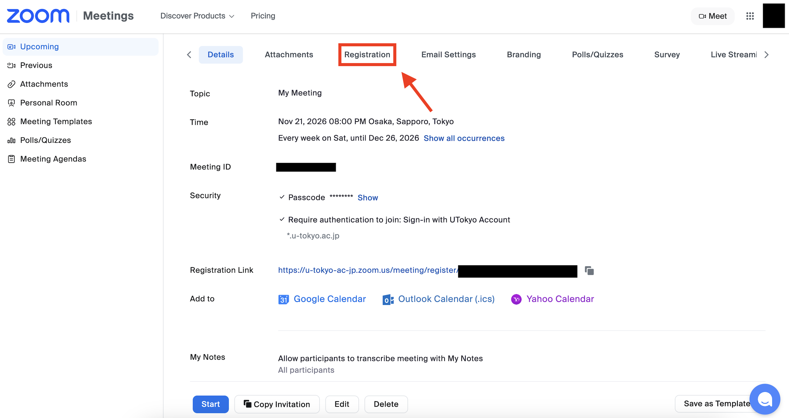{:.medium}
1. Click on the "Edit" button on the right of "Registration Options".
   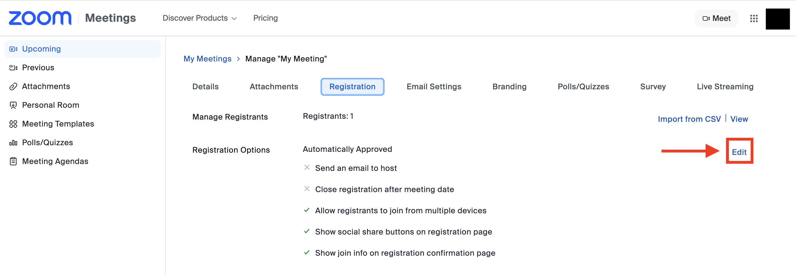{:.medium}
1. On the displayed screen, please select "Manually Approve". 
   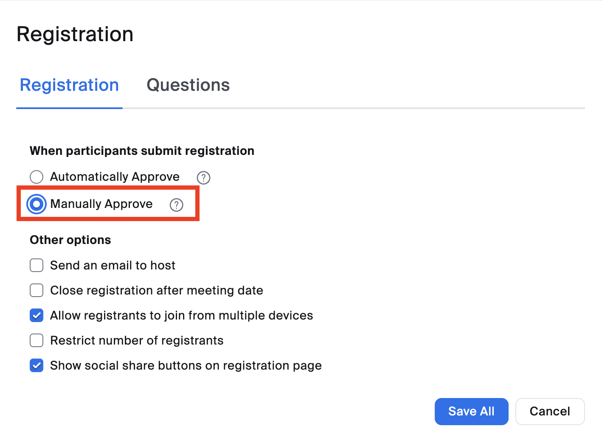{:.medium}
1. Click on the "Save All" button.

#### Participant Approval

Here, we will explain how to individually approve participants who have completed the registration procedure.

1. Please go to [Zoom meeting page](https://u-tokyo-ac-jp.zoom.us/meeting/) in your web browser.
1. Your scheduled meetings will be displayed as a list. Click the name of the meeting for the registrant you want to approve.
   {:.medium}
1. The meeting information will be displayed. You will see a row of tabs at the top, such as "Registration", "Email Settings", etc. Please select the "Registration" tab.
   {:.medium}
1. Please click on the "Edit" button on the right of the "Manage Registrants" section.
   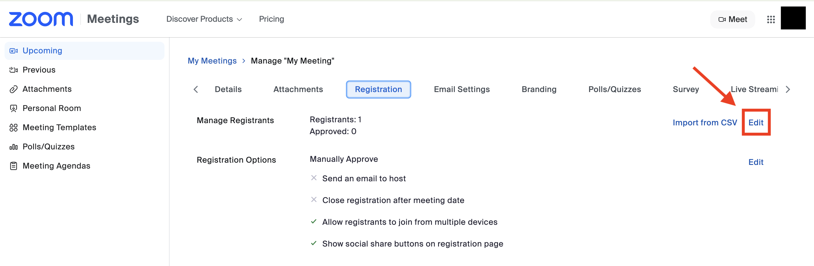{:.medium}
1. A list of prospective participants who have completed the registration procedure will be displayed in the "Pending Approval" list on the screen.
   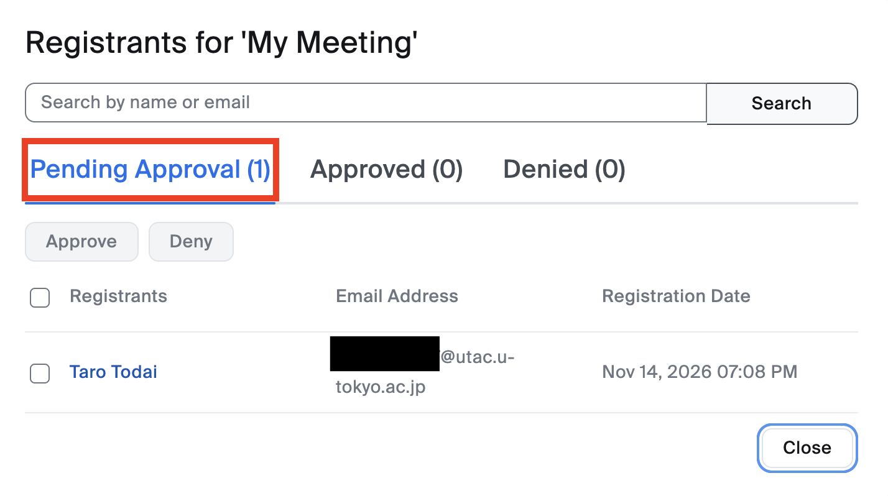{:.medium}
1. Click on the checkboxes on the left of the prospective participants you want to approve and click on the "Approve" button.
   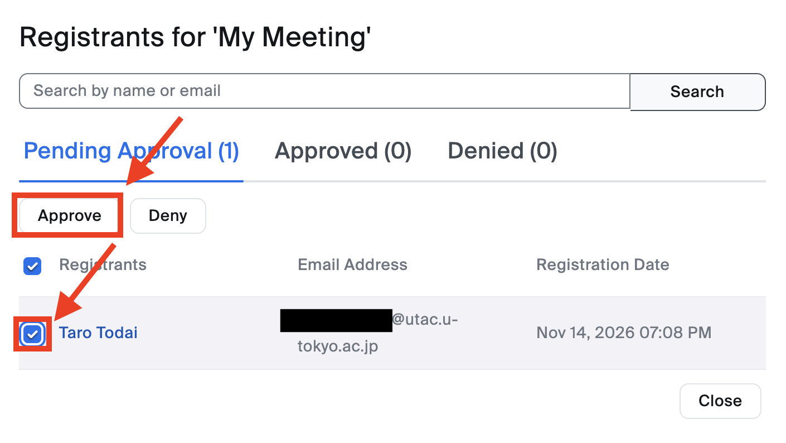{:.medium}

※The list of approved prospective participants can be viewed in the "Approved" list, which is located to the right of the "Pending Approval" list.

#### Participant Denial

Here, we will explain how a host can deny the participation of a prospective participant who has completed the registration procedure. 
The denied prospective participants will receive a "Registration Denial Email" indicating that their participation has been denied, rather than a confirmation email with the join link.

1. Please go to [Zoom meeting page](https://u-tokyo-ac-jp.zoom.us/meeting/) in your web browser.
1. Your scheduled meetings will be displayed as a list. Click the name of the meeting for the registrant you want to deny.
   {:.medium}
1. The meeting information will be displayed. You will see a row of tabs at the top, such as "Registration" and "Email Settings", etc. Please select the "Registration" tab.
   {:.medium}
1. Click on the "Edit" button on the right of the "Manage Registrants" section.
   {:.medium}
1. A list of prospective participants who have completed the registration procedure will be displayed in the "Pending Approval" list on the displayed screen.
   {:.medium}
1. Click on the checkbox on the left of the prospective participants you want to reject and click on the "Deny" button.
   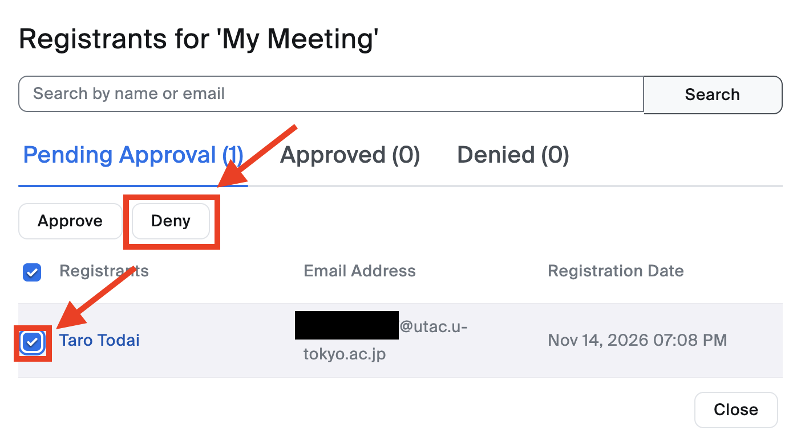{:.medium}
1. The screen for "Send Registration Denial Email" will be displayed. Enter the message you want to convey to the rejected prospective participant, and click on "Send" button. The rejected prospective participant will receive the registration rejection email that contains what you enter here.
   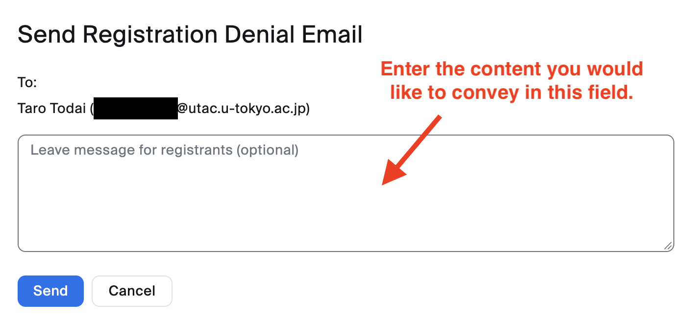{:.medium}

※The list of rejected prospective participants can be viewed in the "Denied" list.

##### Approval Procedure for Accidentally Denied Registrants
If you accidentally refused a prospective participant whom you wished to approve, you can undo the denial procedure by following the steps and approve their participation.

1. Please open the "Denied" list.
   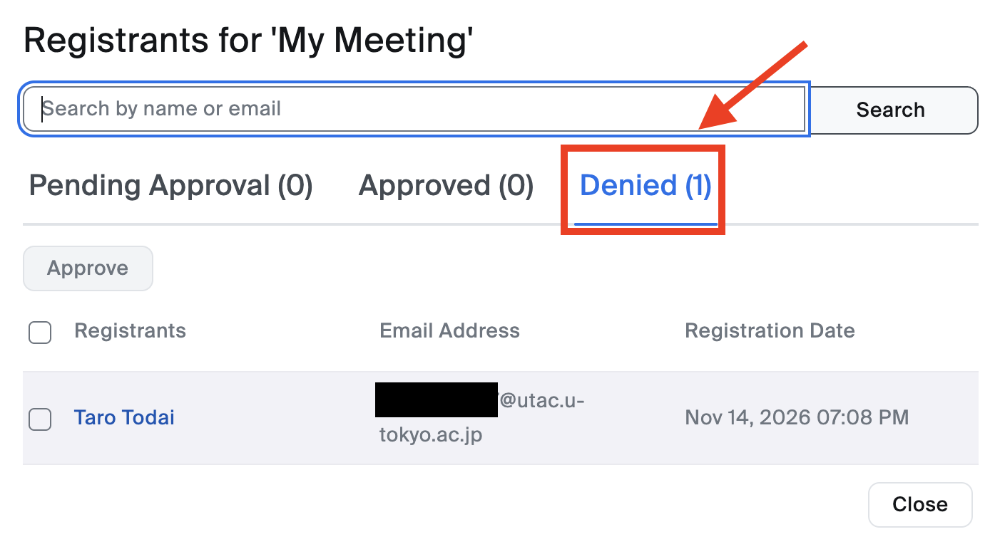{:.medium}
1. Click on the checkbox on the left of the prospective participant you wish to approve, and click on the "Approve" button.

### Customizing Fields in the Form that Prospective Participants Fill Out on the Registration Page

Here, we will explain how to customize the fields in the form that prospective participants fill out on the registration page.
This can be useful for conducting surveys with prospective participants in advance or for reference of approval when the "Manual Approval" option is enabled.

1. Please go to [Zoom meeting page](https://u-tokyo-ac-jp.zoom.us/meeting/) in your web browser.
1. Your scheduled meetings will be displayed as a list. Please click on the name of the meeting for which you want to customize the fields in the form.
   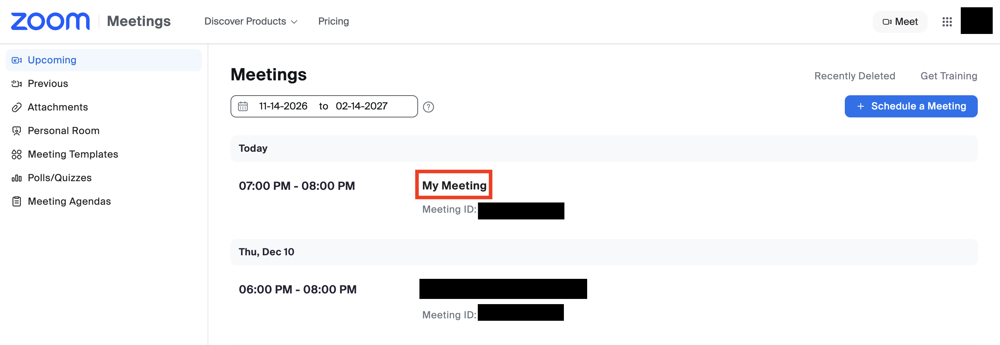{:.medium}
1. Meeting information will be displayed. You will see a row of tabs at the top, such as "Registration", "Email Settings", etc. Please select the "Registration" tab.
   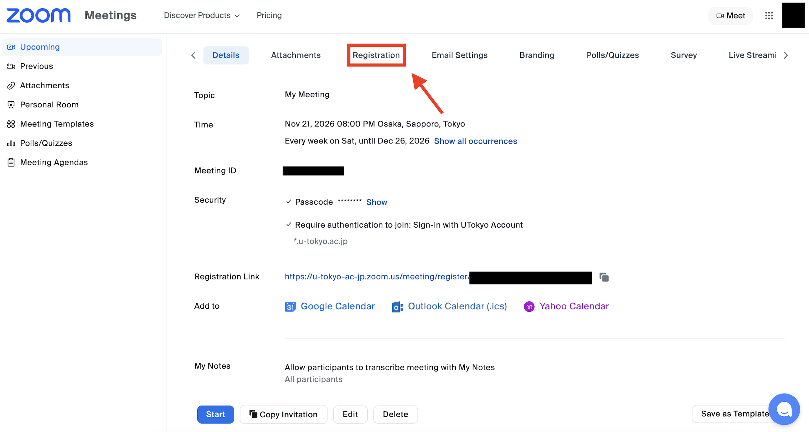{:.medium}
1. Click on the "Edit" button on the right of the "Registration Options" section.
   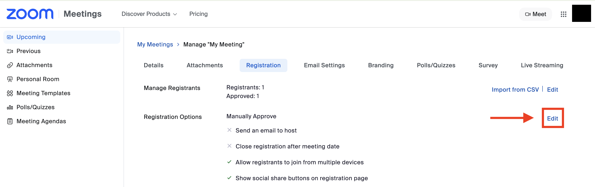{:.medium}
1. You can add predefined questions to the form by the following steps.

   1. On the displayed screen, please select the "Questions" tab.
      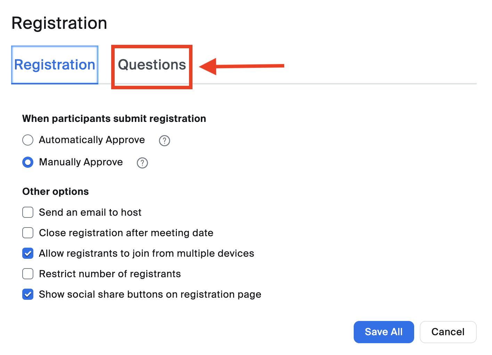{:.medium}
   1. Questions that can be added (such as "Country/Region", "Organization" etc.) will be displayed as a list.
   1. Click on the checkbox on the left of the question you want to add.
   1. To make an answer to the question mandatory, please switch on the checkbox in the "Required" column on the right.

1. You can add original questions to the form using the following steps.

   1. On the displayed screen, please select the "Questions" tab.
      {:.medium} 
   1. Click on "Add Question".
      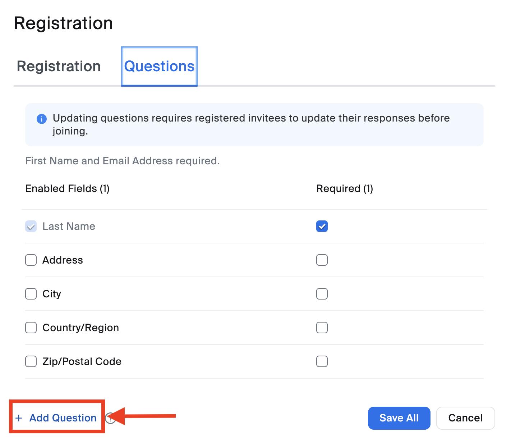{:.medium}
   1. Enter your custom question in the top text box.
      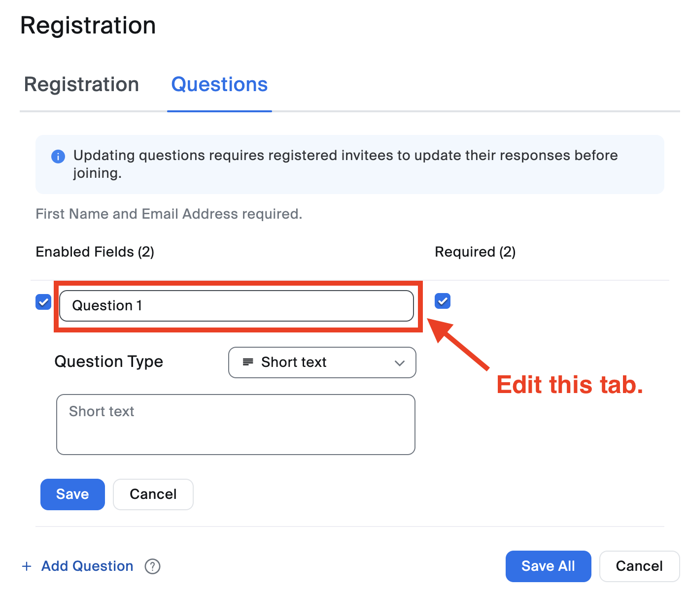{:.medium}
   1. From the menu next to "Question Type", select the format for your question. "Short text" is for open-ended responses, and "Single Choice" is for multiple-choice questions.
   1. To make it mandatory to answer the questions you want to add, click on the "Required" checkbox. If not required, please switch off the "Required" checkbox.
   1. Click on the "Save" button.
      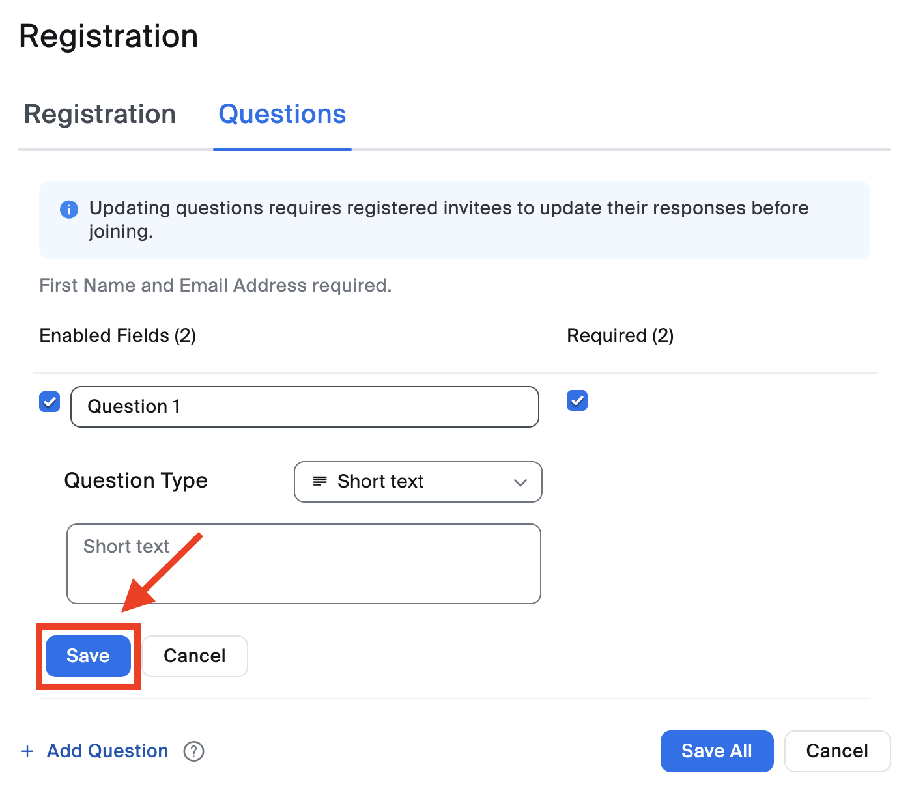{:.medium}
   1. Please confirm that your custom question is displayed on the following screen. 
      If you wish to edit a previously created customized question, please click on the pen icon displayed on the right. 
      If you wish to delete an original question, click on the trash can icon.
1. Click on the "Save All" button.

### Viewing the Information Entered on the Registration Page by Prospective Participants

Here, we will explain how to view and confirm the information that prospective participants entered in the form on the registration page.

#### How to confirm the answers for each Registered Prospective Participant

Here, we will explain how to view the answers provided by a specific participant

1. Please go to [Zoom meeting page](https://u-tokyo-ac-jp.zoom.us/meeting/) in your web browser.
1. Your scheduled meetings will be displayed as a list. Please click on the name of the meeting for which you want to view the answers of the registrants.
   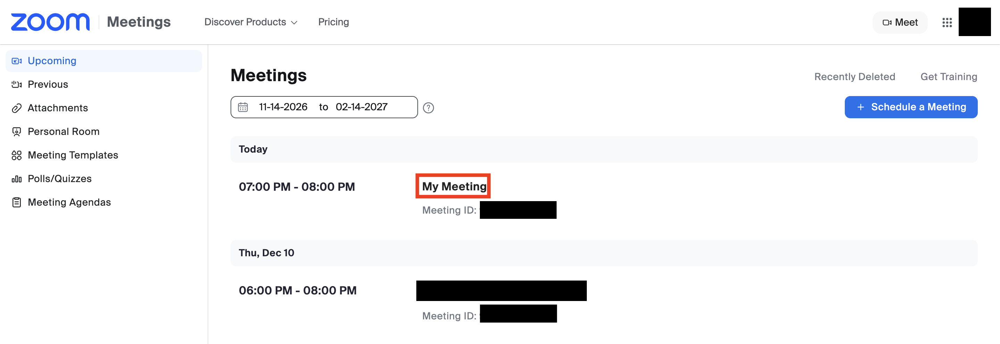{:.medium}
1. Meeting information will be displayed.  You will see a row of tabs at the top, such as "Registration", "Email Settings", etc. Please select the "Registration" tab.
   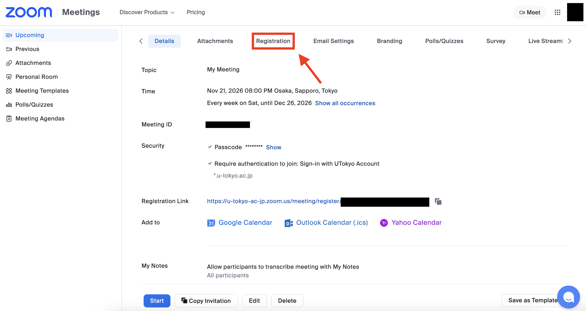{:.medium}
1. Click on the "View" button on the right of the "Manage Registrants" section. If manual approval has been enabled, an "Edit" button will be displayed.
   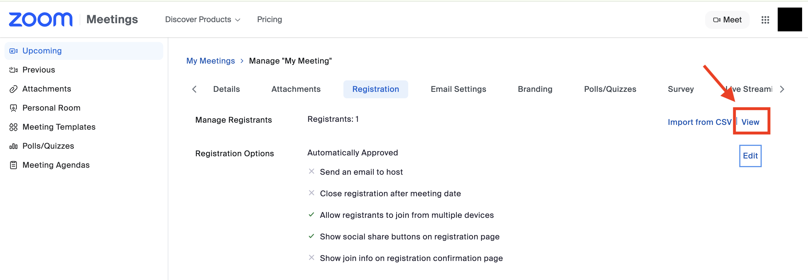{:.medium}
1. A list of prospective participants who have completed the registration procedure will be displayed.
1. Click on the name of the prospective participant whose answers you wish to view and confirm.
1. The information entered by the prospective participant will be displayed.

#### How to Retrieve a Registrant Report

Here, we will explain how to retrieve a registrant report.

1. Open the [Zoom Profile page](https://u-tokyo-ac-jp.zoom.us/profile) in your web browser.
2. Go to "Reports" and select the "Usage reports" tab.
   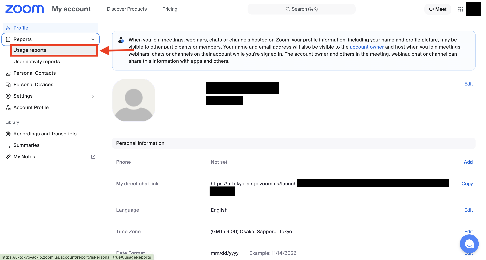{:.medium}
1. Click "Meeting and webinar registrations".
   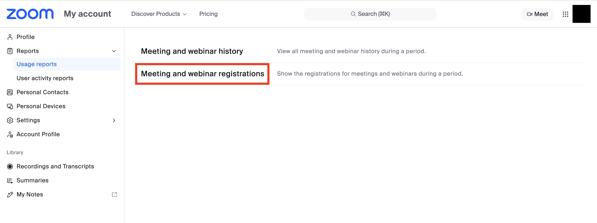{:.medium}
1. A list of meetings will be displayed. Find the meeting you want to view the report for, and click "Generate" on the right. Next, select the registrants you want to include in the report from "All registrants", "Approved registrants", or "Denied registrants".
   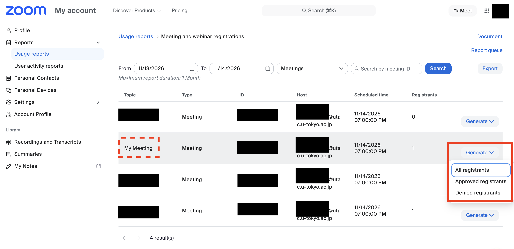{:.medium}
1. Click "Report queue".
   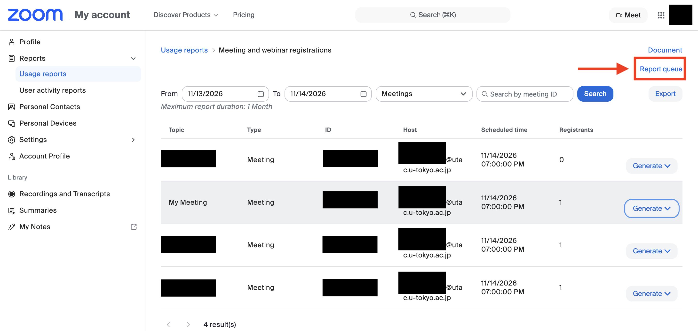{:.medium}
1. Find the meeting you want to view the results for, and click the download button on the right.
   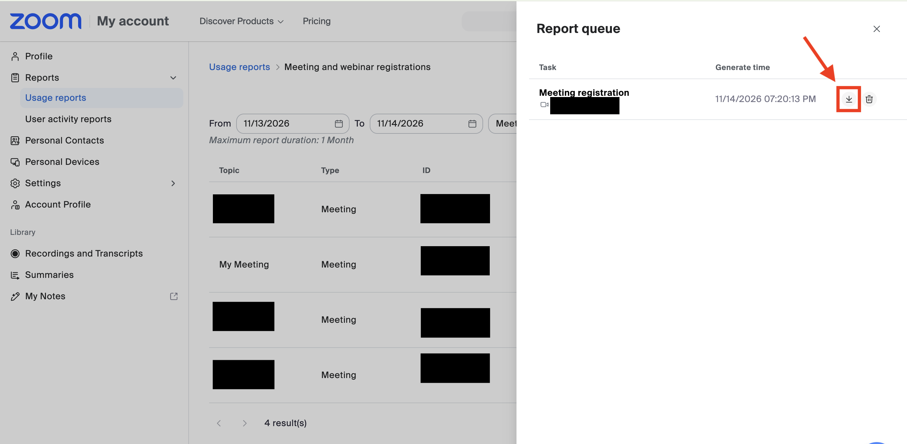{:.medium}
1. A CSV file will be downloaded.

### Require Advance Registration for Recurring Meetings from Prospective Participants

Here, we will explain how to use the registration feature for recurring meetings. 
If you use the registration feature for an already created recurring meeting, please follow the steps from Step 1. 
If you are creating a new recurring meeting, stay on the meeting creation screen and continue from Step 4. 
For more information on how to create a recurring meeting, please refer to "[Detailed Date and Time Settings for Zoom Meetings](./../date_and_time/)".

1. Please go to [Zoom meeting page](https://u-tokyo-ac-jp.zoom.us/meeting/) in your web browser.
1. A list of your scheduled meetings will be displayed. Hover over the recurring meeting for which you want to enable registration, and click Edit. You can select any occurrence.
   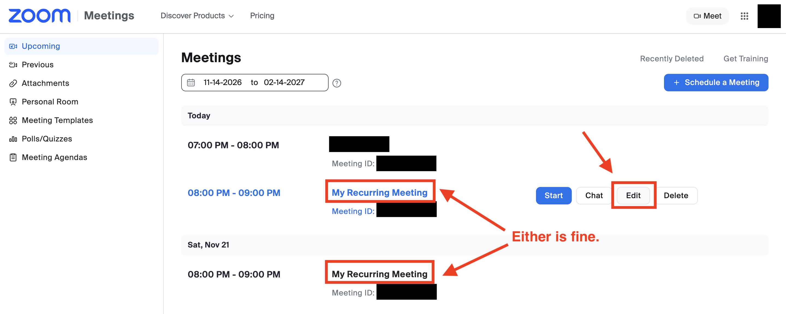{:.medium}
1. The "Edit Recurring Meeting" screen will be displayed. Click on the "Edit Entire Series" button.
   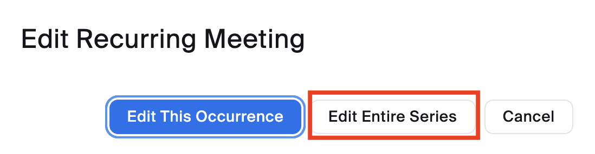{:.medium}
1. Click on the "Required" checkbox for "Registration".
   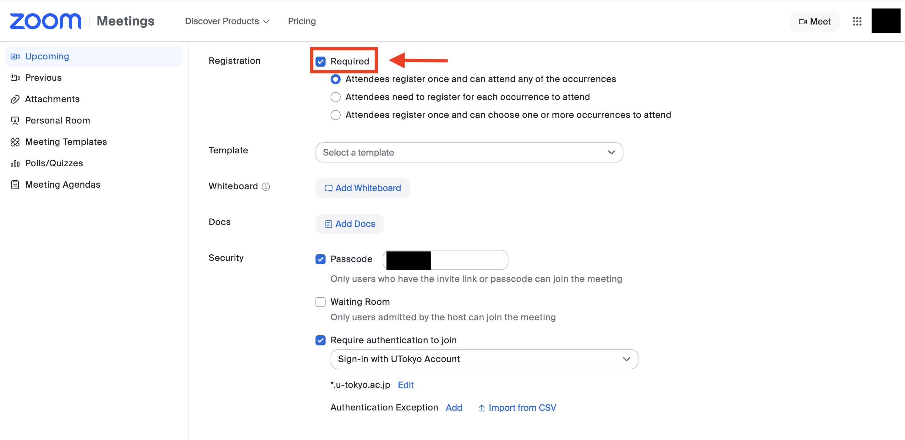{:.medium}
1. Once you click on the "Required" checkbox, three options will appear. Please select one.
   -  **Attendees register once and can attend any of the occurrences** – once a prospective participant registers, they can attend all sessions.
   -  **Attendees need to register for each occurrence to attend** – prospective participants need to perform the registration procedure each time.
   -  **Attendees register once and can choose one or more occurrences to attend** – prospective participants can select which session they want to register for.
1. Click on the "Save" button.

### Close Registration After the Scheduled End Date

Here, we will explain how to prevent accepting registrations after the scheduled end date has passed.

1. Please go to the [Zoom meeting page](https://u-tokyo-ac-jp.zoom.us/meeting/) in your web browser.
1. Your scheduled meetings will be displayed as a list. Please click on the name of the meeting for which you want to prevent accepting the registration procedure after the scheduled end date has passed. 
   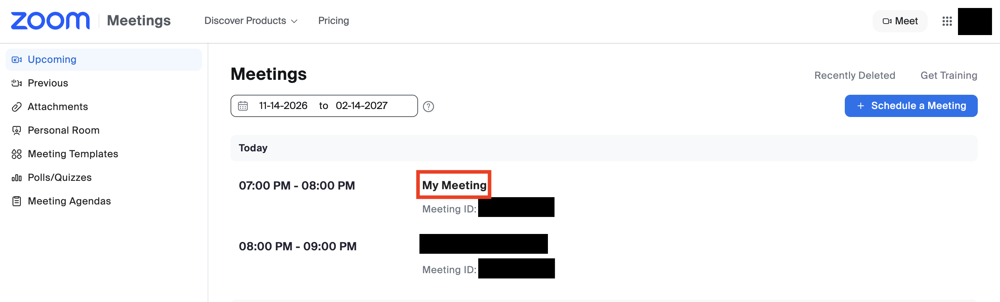{:.medium}
1. The meeting information will be displayed.  You will see a row of tabs at the top, such as "Registration", "Email Settings", etc. Please select the "Registration" tab.
   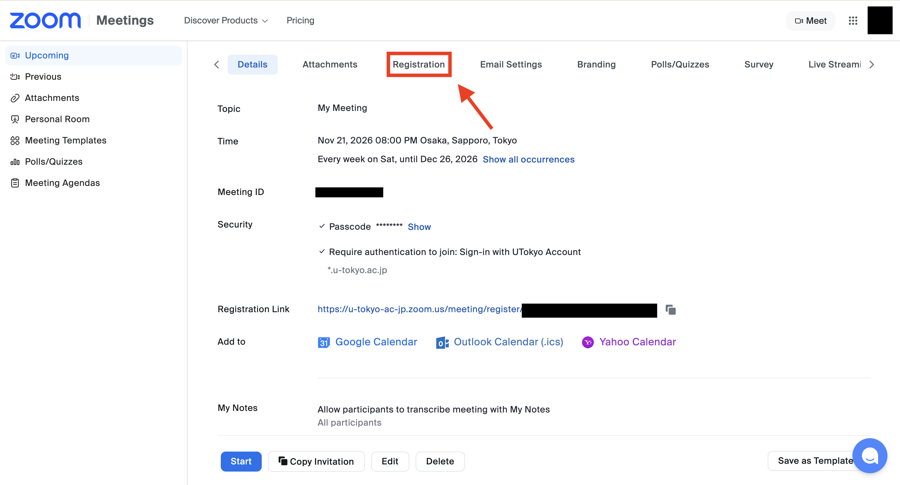{:.medium}
1. Click on the "Edit" button on the right of the "Registration Options" section.
   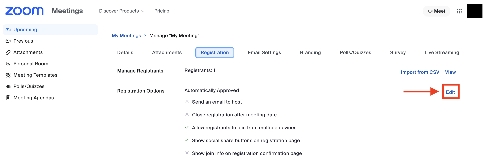{:.medium}
1. Click on the "Close registration after meeting date" checkbox.
   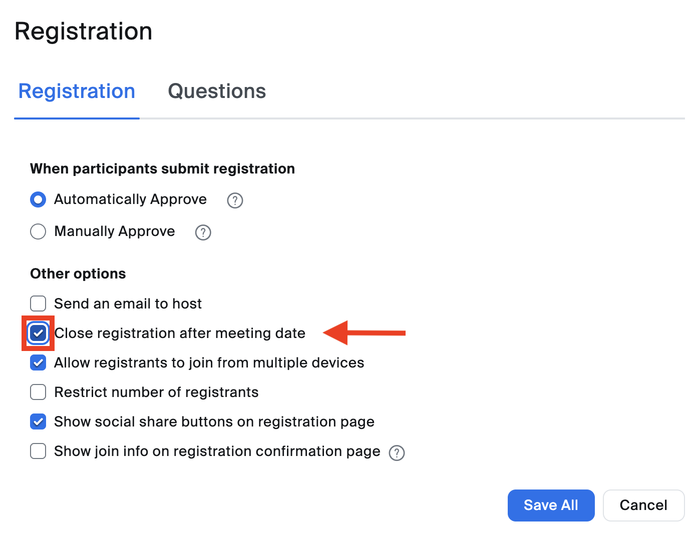{:.medium}
1. Click on the "Save All" button.

### Display Original Banners and Logos on the Registration Website

Here, we will explain how to add original banners and logos to the registration page.

1. Please go to the [Zoom meeting page](https://u-tokyo-ac-jp.zoom.us/meeting/) in your web browser.
1. Your scheduled meetings will be displayed as a list. Click on the name of the meeting for which you want to add banners or logos to the registration page.
   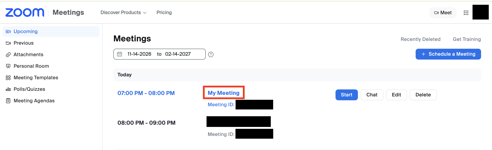{:.medium}
1. The meeting information will be displayed.  You will see a row of tabs at the top, such as "Registration", "Email Settings", etc. Select the "Branding" tab.
   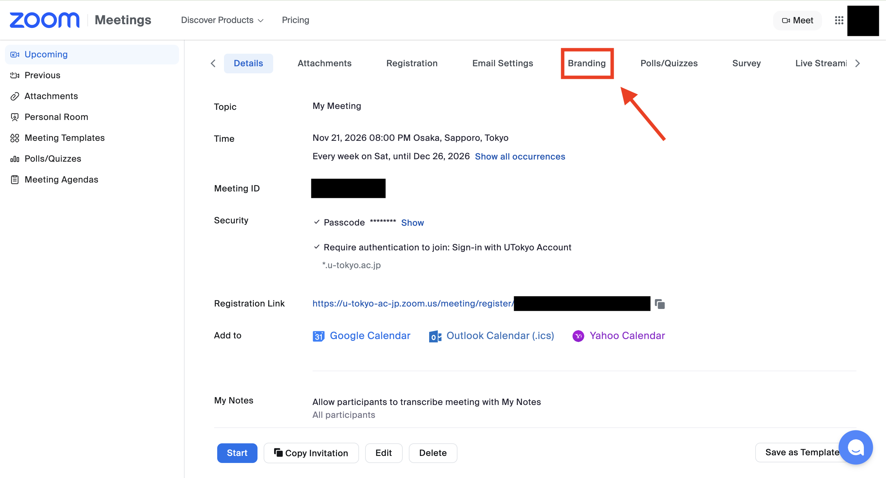{:.medium}
1. Please upload images for the banner and/or the logo. If they are uploaded normally, the images of the banner and/or the logo will be displayed.
1. The banner and/or the logo will be displayed on the registration page.