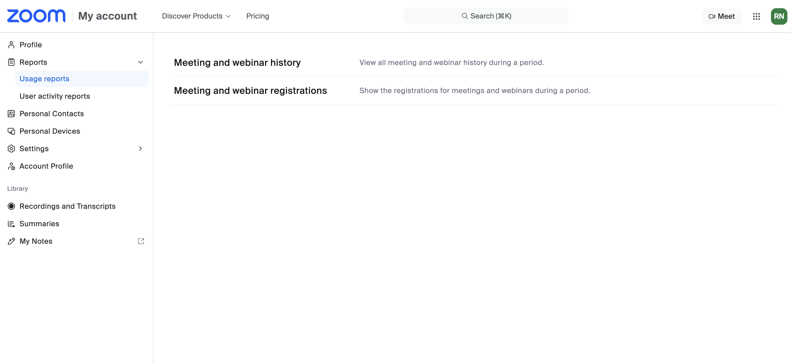
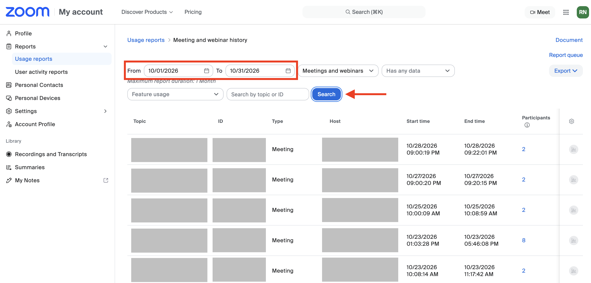
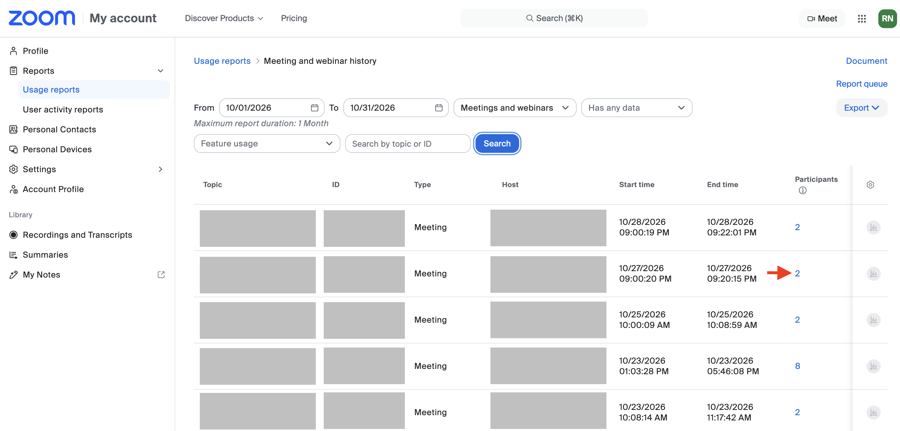
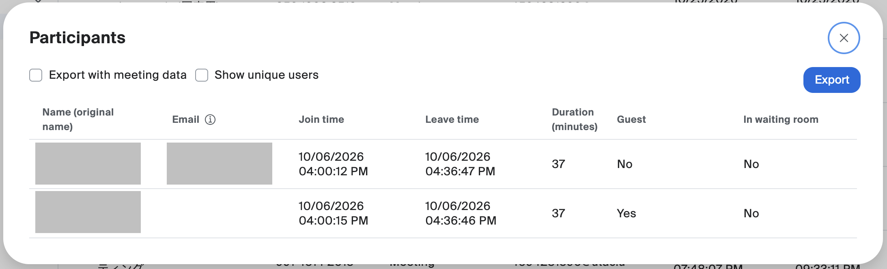
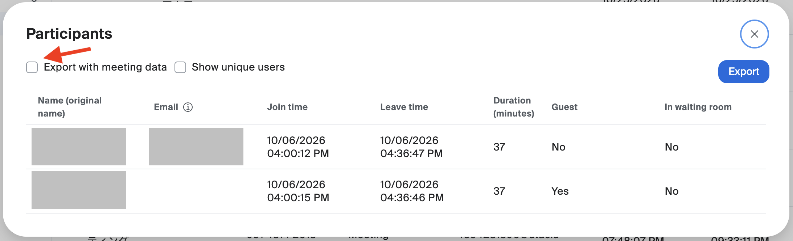

現在作業中。(2026/09/10)chatGPTに頼んだものをそのまま貼り付けている。英語内容の確認と、画像の準備が必要。上のタイトルとかは日本語版と結構違うように見えるがこれでいいの...?
Zoom's "**Reports**" feature allows the host to obtain a list (report) of meeting participants' names, email addresses, join times, leave times, and other information. You can use this feature to manage attendance.

No preliminary settings or procedures are required to use this feature.

## Viewing a Report

This section explains how to view a report that lists information about meeting participants.

1. Open the [Zoom Reports page](https://u-tokyo-ac-jp.zoom.us/account/report?isPersonal=true#/usageReports) in a web browser.
2. Click "Usage".
   {:.medium}
3. Meetings held in the past for which you were the host will be displayed.
4. Find the meeting for which you want to obtain a report. Set "From" and "To" so that the date of the meeting falls within the specified period, and click "Search" to display only the meetings held during that period.
   {:.medium}
5. Click the number displayed in the "Participants" column.
   {:.medium}
6. The names, join times, leave times, and duration (minutes) of the participants will be displayed. Their email addresses will also be displayed if they are signed in to their Zoom accounts.
   {:.medium}

※ You cannot obtain reports for meetings in which you were a co-host or an alternative host.

## Obtaining a Report as a CSV File

This section explains how to download the contents of a report as a CSV file.

1. Follow the steps through the final step of "[Viewing a Report](#viewing-a-report)".
2. Select the "Export with meeting data" checkbox.
   {:.medium}
3. Click "Export".
4. A CSV file containing the contents of the report will be downloaded.

## What to Do If a Participant's Record Is Missing Partway Through a Meeting

This section explains what to do when a participant's participation record is unintentionally missing partway through a meeting in the report.

If a participant changes their display name during the meeting or their network connection is interrupted, they are treated as having left the meeting at that point, and the leave time is recorded. A new participation record is then created when the participant changes their name or rejoins the meeting.

It may or may not be possible to determine whether the two participation records, one before leaving and the other after rejoining, belong to the same participant.

* **If the participant is signed in to Zoom**: The participant's email address is displayed in the "User Email" field under "Meeting Participants". Even if the participant changes their name during the meeting, you can determine that the records belong to the same person if the User Email is the same.
* **If the participant is not signed in to Zoom**: The "User Email" field under "Meeting Participants" is blank, so you cannot use the User Email to determine whether the records belong to the same person. If the participant changes their name during the meeting, the report records the person with the old display name as having left and the person with the new display name as having joined, so it may not be possible to determine that they are the same person.

To prepare for such situations, measures such as allowing participants to check their own attendance status may be necessary.

## How to Prevent So-called Fake Attendance

This section explains how to manage attendance using email addresses individually assigned to members of the University of Tokyo and prevent another student from impersonating a participant and faking their attendance (so-called "fake attendance").

To manage attendance using email addresses, restrict participation in the meeting to participants who are signed in to their UTokyo Zoom accounts. This ensures that the report records the email addresses individually assigned to members of the University of Tokyo and helps prevent impersonation. For instructions on restricting participation to participants who are signed in to their UTokyo Zoom accounts, see "[Requiring Authentication to Join a Zoom Meeting](/zoom/create_room/auth/)".

However, if participants are not used to signing in with their university accounts (i.e. accounts set up as UTokyo members), especially at the beginning of a semester, it is recommended that you turn off this setting. See also "[Restricting access to the Zoom conference room for classes](/faculty_members/zoom_access_control/)" for more information about the settings.
