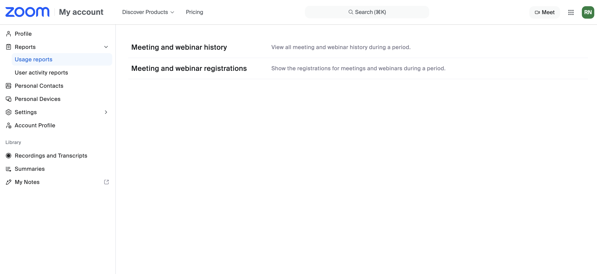
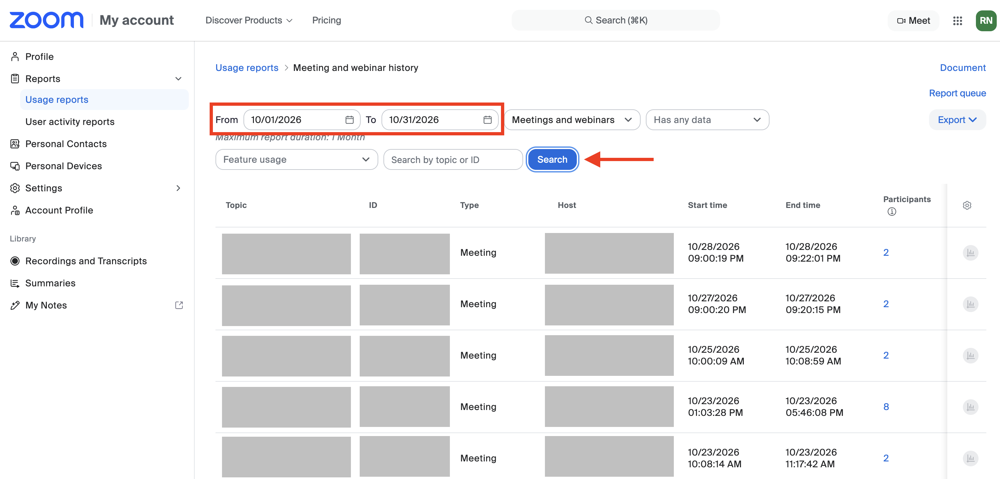
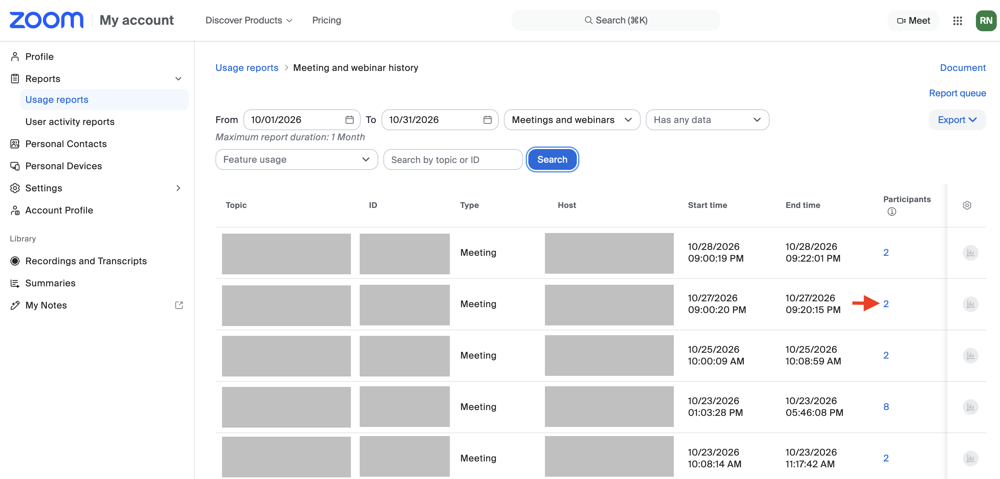
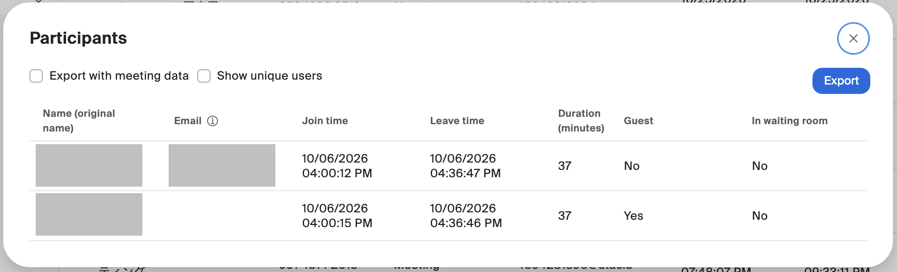
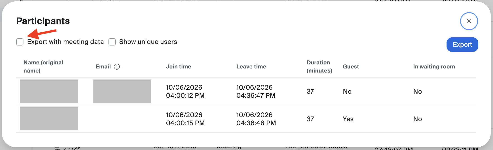

The Zoom "**Reports**" feature allows the host to obtain a list (report) of meeting participants, including their names, email addresses, join times, and leave times. You can use this feature to manage the attendance of participants.

No prior settings or procedures are required to use this feature.

## Viewing a Report

This section explains how to view a report that lists information about meeting participants.

1. Open [Zoom's Reports page](https://u-tokyo-ac-jp.zoom.us/account/report?isPersonal=true#/usageReports) in your web browser.
1. Click "Meeting and webinar history".
   {:.medium}
1. Find the meeting for which you want to obtain a report. Set the "From" and "To" dates so that the date of the target meeting falls within the range, and click "Search". Only the meetings held within the specified period will be displayed.
   {:.medium}
1. Click the number displayed in the "Participants" column.
   {:.medium}
1. The names of the participants, their join times, leave times, and durations will be displayed, as well as their email addresses if they signed in to their Zoom accounts.
   {:.medium}

Note: You cannot obtain reports for meetings in which you were a co-host or an alternative host.

## Downloading a Report as a CSV File

This section explains how to download the contents of a report as a CSV file.

1. Follow the steps in "[Viewing a Report](#viewing-a-report)" up to the last step.
1. Check the "Export with meeting data" checkbox.
   {:.medium}
1. Click "Export".
1. A CSV file containing the contents of the report will be downloaded.

## When a Participant's Record Drops Out During a Meeting

This section explains what to do when a participant's attendance record drops out partway through a meeting in the report, even though the participant did not intend to leave.

If a participant changes their display name during the meeting, or if their connection is interrupted, they are treated as having left the meeting at that point, and that leave time is recorded. After that, a new attendance record is created when the participant changes their name or rejoins the meeting.

Whether the two attendance records, before leaving and after rejoining, belong to the same participant can be determined in some cases but not in others.

- **If the participant is signed in to Zoom**: The participant's email address is displayed in the "Email" column of "Participants". Even if the participant changes their name during the meeting, you can identify them as the same person if the email addresses are the same.
- **If the participant is not signed in to Zoom**: The "Email" column of "Participants" is blank, so you cannot identify them as the same person by email address. If the participant changes their name during the meeting, it is recorded as if a person with the old display name left and a person with the new display name joined, so you may not be able to identify them as the same person.

To prepare for such situations, you may need to take measures such as allowing participants to check their own attendance status.

## Preventing Attendance Fraud (Proxy Attendance)

This section explains how to manage attendance using the email addresses individually assigned to members of the University of Tokyo, and how to prevent other students from impersonating participants (so-called "proxy attendance").

To manage attendance using email addresses, restrict participation in the meeting to participants who are signed in to their University of Tokyo Zoom accounts. By doing so, the email addresses individually assigned to members of the University of Tokyo will be recorded in the report, which prevents impersonation. For how to restrict participation to those signed in to their University of Tokyo Zoom accounts, please refer to "[Requiring Authentication to Join a Zoom Meeting](/en/zoom/create_room/auth/)".

However, if participants are not yet accustomed to signing in with their university accounts (especially at the beginning of the semester), we recommend turning this setting off. For the approach to these settings, please also refer to "[Restricting Access to Zoom Meeting Rooms for Online Classes](/en/faculty_members/zoom_access_control/)".
