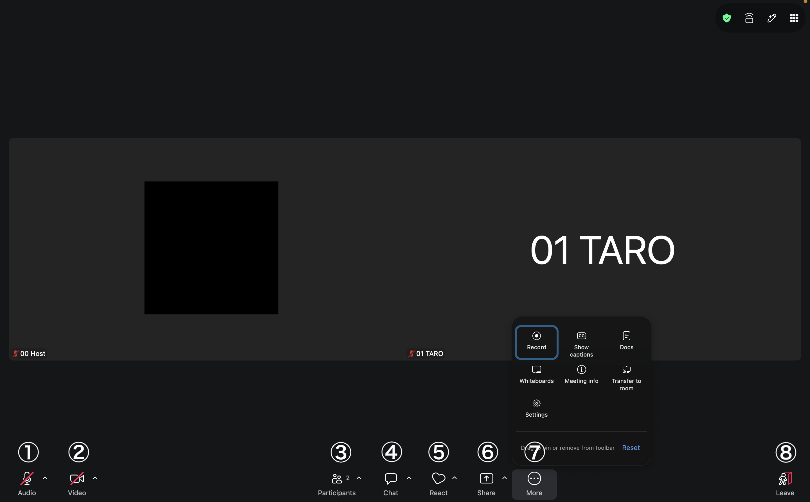
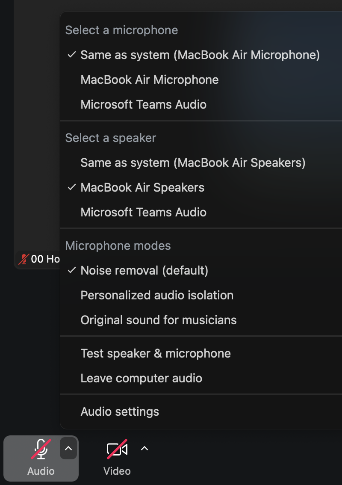
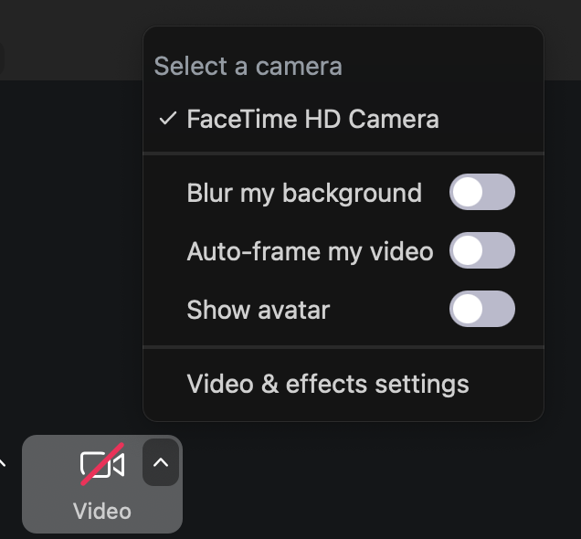
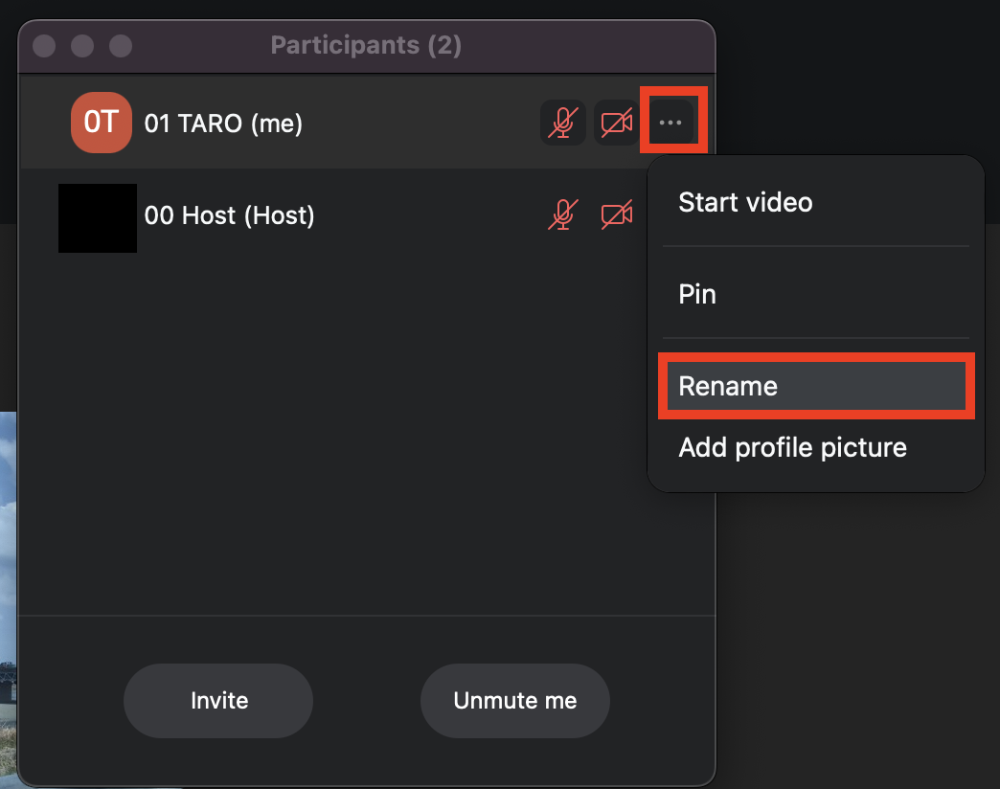
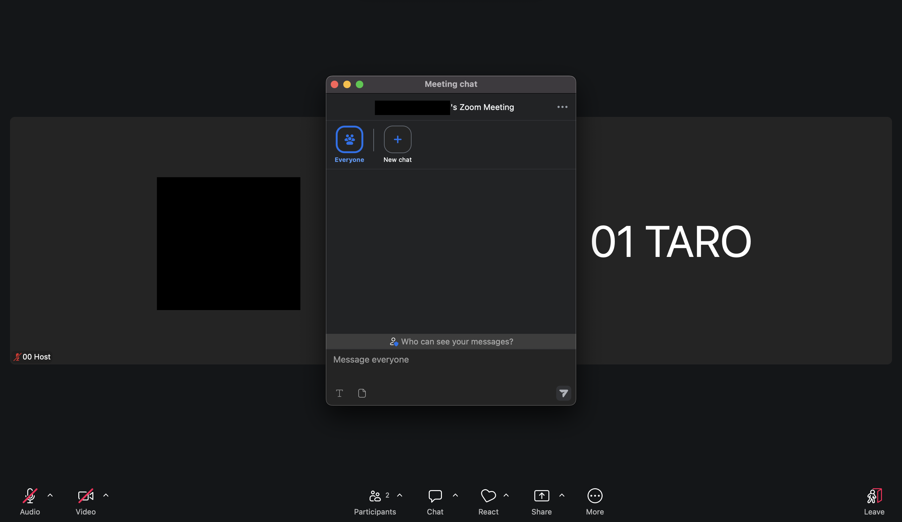
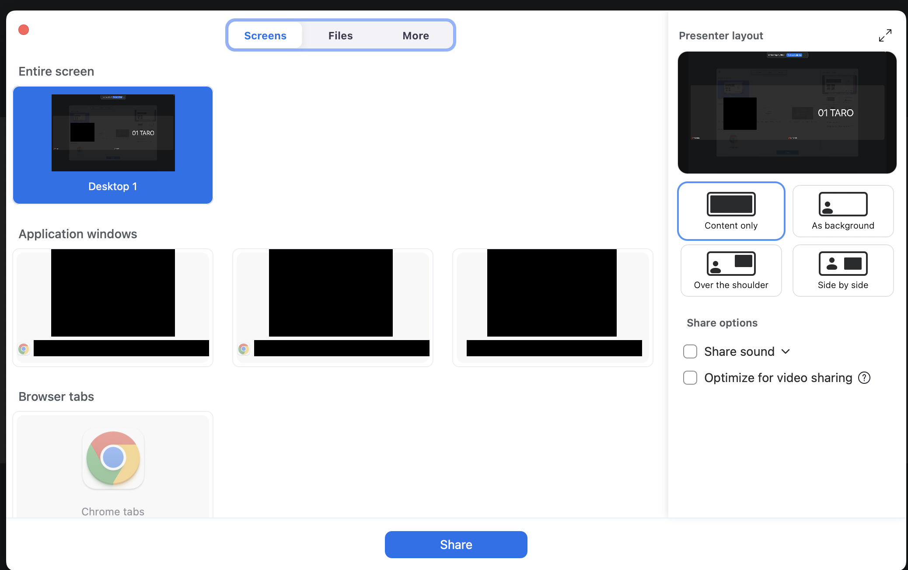
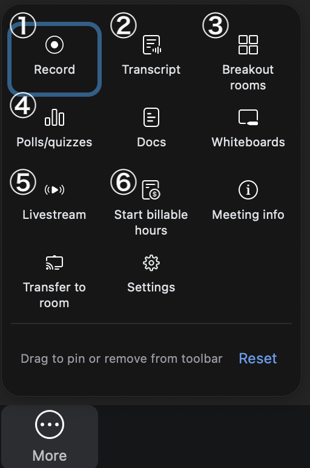

In this section we give concrete directions on how to use Zoom.  

The following screen is displayed when entering a meeting room (this screenshot shows a meeting room with only 1 participant).
If you move the mouse cursor over the Zoom screen, the menu bar shown in the figure below will pop up.
  
The menu buttons are explained from left to right (some versions may not display all the buttons as here).
  1. **Audio** : Press this to mute or unmute. Pressing the ^ (up arrow)  next to it enables you to make settings related to the microphone.
  1. **Video** : Press to turn the video on or off. Pressing the ^ (up arrow) next to it will allow you to make video settings.
  1. **Participants** : Displays the participant list. You can check who is attending and see who has raised their hand. Clicking the ^ (upward arrow) next to it allows you to send invitations via email or other methods, but since participants typically already know the meeting URL, you will rarely need to use this invite feature.
  1. **Chat** : Opens the text chat. 
  1. **React** : You can express your reactions using emojis and icons like "Clap," "Like," or "Raise Hand." "Raise Hand" is often used to show that you want to speak.
  1. **Share** : You can share your device's screen or specific windows. This feature is unavailable if the host has not granted permission.
  1. **More** : Menus that could not fit on the screen are included here.
     - **Record** : You can record if your host allows it. This button is often not used by anyone other than the host.  
     - **Show captions** : Displays transcriptions of spoken words in real time at the bottom of the screen. You can change the font size and language in "Subtitle Settings." This option may not appear if the host has not enabled the subtitle feature.
     - **Docs** : Creates and displays collaborative documents that all participants can edit together. Great for meeting minutes or shared notes.
     - **Whiteboards** : Opens a whiteboard that all participants can write on. Useful when you want to share diagrams or handwritten notes.
     - **Meeting info** : Allows you to check the meeting room URL, Meeting ID, passcode, and other details.
     - **Transfer to room** : Transfers your ongoing meeting to a Zoom Room device installed in the conference room.
     - **Settings** : Opens settings for audio, video, background, and more.

  1. **Leave** : Leave the meeting. A confirmation screen appears after you press it, so you do not exit immediately when you press the button. If you are the host, you can choose between "End Meeting for All" (everyone leaves) and "Leave Meeting" (only you leave). Please be careful not to select the wrong option.
  
The following describes the details of the menu items mostly used.

## Advanced microphone settings
  
  
  
If you press the ^ (up arrow) next to the microphone mark, an additional menu will appear. Below is a brief description of each command.
  * **Microphone** : You can select the microphone you want to use (if you have a separate microphone, you will have multiple choices, so choose the one you wish to use). Selecting "Same as System" uses the same microphone as your computer's audio settings. Any changes made to your computer's settings will automatically be reflected in Zoom.
  * **Speaker** : You can select the speaker you want to use (if you have a separate speaker, you will have multiple choices, please select the one you wish to use).
  
For details, please refer to [Using microphone and camera](mic_cam/). For instructions on using virtual backgrounds, please see [Set up a virtual background to hide the background from the camera](mic_cam/virtual_background/)
  
## Advanced video settings
  
  
  
If you press the ^ (up arrow) next to the video mark, an additional menu will appear. Below is a brief description of each option. 
  * **Camera** : You can select the camera you want to use (if you have a separate camera, you will have multiple choices, please select the one you wish to use).

For details, please refer to [Using microphone and camera](mic_cam/).

## Participants

Pressing the menu "Participants" will bring up a screen where you can see a list of participants.
  

  * You can mute or unmute yourself and change your name or profile picture by hovering over your name.

In addition to this, the host can:
  * Mute a participant, or mute all participants
  * Prevent participants from unmuting themselves
  * Lock a meeting so that there are no more participants

## Chat
  
If you press the menu "Chat", text chat will be available. It is important to note that if you join from the middle of a meeting, you will not be able to see past text chats. Therefore, it is important to wait and send texts after every member has joined the meeting.
    
  
  * By clicking the "To" button, you can change the destination of the message from "Everyone" to an individual. By default, messages are sent to everyone.
  * By selecting "File", you can send files from your computer or files from an online drive.

For details, please refer to [Using Chat in Zoom Meetings](chat/).

## Reactions

Clicking "Reactions" in the toolbar opens a menu where you can send reactions such as "Clap," "Thumbs Up," or "Raise Hand." Select an icon to display your reaction to all participants.

For details, please refer to [Zoom’s Reactions (Raised Hand & Emoji) Feature](reaction/).

## Screen sharing
  
When you press the menu "Share", the options of screens to be shared appear. Select the desired one and press "Share" to start sharing the screen.
  
  
  * Selecting "Screen" shares your entire screen with all participants. 
  * The currently open window is also displayed as an option. You can also share the screen in window units. If you don't want others to see all of your computer windows, we recommend that you select the window unit you want to share.
  * By checking "Share sound" in the bottom-right corner of the screen, audio played on your device will also be shared with all participants. If you plan to play a video during screen sharing, we recommend checking this option.
  
For details, please refer to [Screen Sharing](screen_sharing/).

## Host-specific menu
  
Here is a brief description of the menus specific to the host. 
  
  1. **Record** : You can record the state of the meeting.
     * For details, please refer to [How to use the recording feature](recording/).
  1. **Breakout rooms (setting required)** : Participants can be divided into subgroups. You can decide the number of people and assign them automatically, or you can assign them manually.
     * For details, please refer to [How to use Breakout Rooms](breakout/).
  1. **Polls/Quizzes (setting required)** : Allows participants to respond to polls. The questions themselves need to be created with a web browser. Questions must be created in advance in a web browser. Click “Add question” to create one for the first time, or “Edit” to modify an existing one.
     * For details, please refer to [Polls in Zoom](poll/).