Zoom's screen sharing enables you to share your screen with others. You can share the screen you are viewing on your PC or mobile device with all participants. If you open a Word or PowerPoint file on the shared screen, you can make your presentation showing the document to the participants.

## Start screen sharing

1. Click "Share" in the meeting controls. 
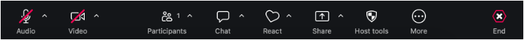

2. You will be given various options for sharing. 
In the sharing window, select the content you want to share.
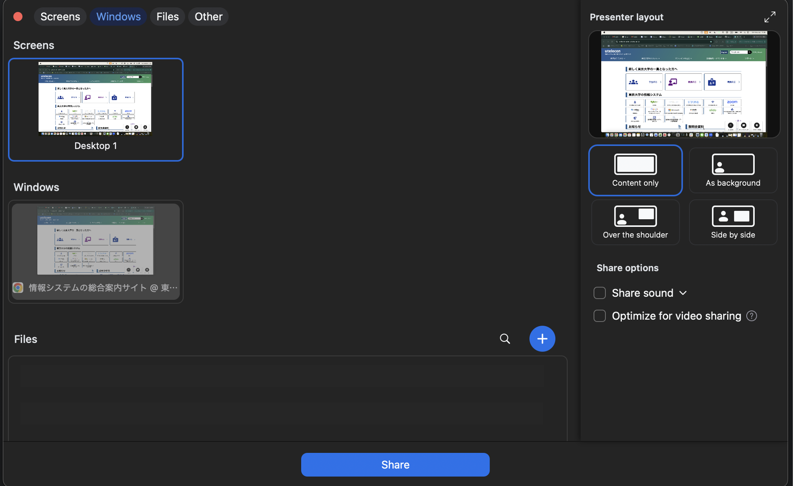
   * **[Screens]** Share your full desktop.
   * **[Windows]** Share a specific application window, such as Word, PowerPoint, or a web browser. Other windows on your desktop will not be shared.
   * **[Files]** Select files available through Zoom or supported file services.
   * **[Other]** Share other types of content, such as a browser tab, a portion of your screen, or a video file, depending on the available options.

3. Check the option at the bottom of the window if necessary. 
   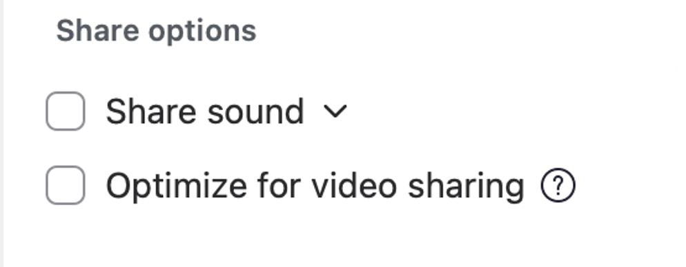{:.extra-small}
   * **[Share sound]** If checked, you can share the sound played on your computer during screen sharing.
   * **[Optimize for video sharing]** If checked, participants can see the optimized form of video clips played in full screen during screen sharing.

4. Select the screen you want to share and click the blue "Share" button at the bottom right corner.   

## Stop screen sharing

To end the screen sharing, click “Stop Share” at the bottom of the screen sharing controls. This will bring you back to your regular Zoom view.

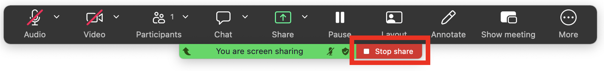

## Screen sharing controls

Screen sharing controls are displayed at either the top or bottom of the screen during screen sharing. The following explains how the controls work.

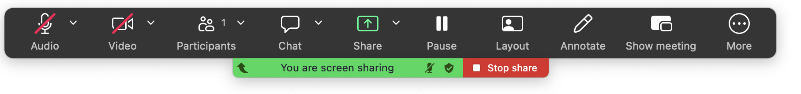 
* **[Annotate]** You can annotate the shared screen with the set of annotation tools provided. Tools include a text tool to type text onto the screen, a hand-drawing tool, a stamp tool, and a spotlight tool for highlighting the location of your cursor.
* **[More]** Click to display advanced options.  
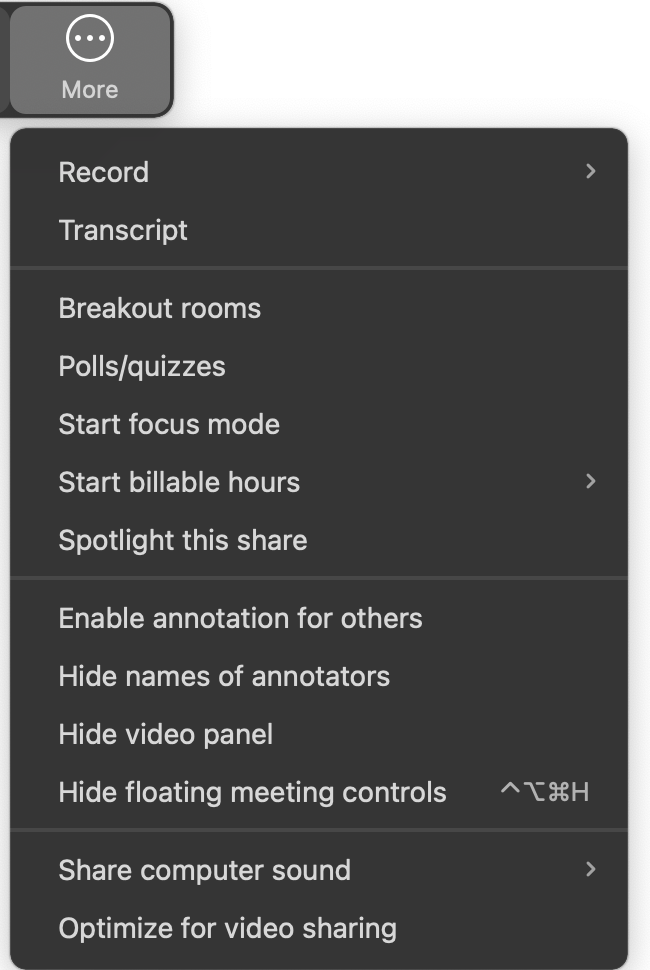{:.small}

  + Advanced options available only for teachers (hosts).
      + **[Breakout rooms]**: You can start and end breakout sessions.
      + **[Enable annotation for others]**: You can allow participants from annotating the shared screen to use the annotation tools.
      + **[Hide names of annotators]**: When a participant adds annotations to the shared screen, you can set it so that the participant's name does not appear on the screen.

## (For teachers) Settings and notes for screen sharing

Settings and notes for screen sharing are summarized as follows.

### Privacy considerations for screen sharing
When you share your desktop, your personal information may be revealed unintentionally. To prevent such a situation, you can share the screen by window.

### Displaying meeting controls during screen sharing
The meeting controls may be hidden at the top or bottom of the window during screen sharing. Move your pointer to the green bar displayed to the left of “Stop Sharing,” to display it again.

### Stop student’s full screen display
During screen sharing, the student's PC screen is basically full screen, and the student cannot move to other windows. If the student double-clicks on the Zoom screen or press Esc, the screen is no longer full-screen, which is easier to move to other windows. 
If you want the students to use other windows other than Zoom while the teacher’s screen sharing, it is better to instruct them to double-click the Zoom screen.

### Screen sharing controls

#### Setting up who can annotate
You can allow participants to annotate by selecting "Enable Annotation for Others" from "More" of the meeting controls.

#### Displaying names of annotators
By selecting "Show/Hide Names of Annotators" from "More" of the meeting controls, participants’ names will appear/disappear next to their annotations on the shared screen. 
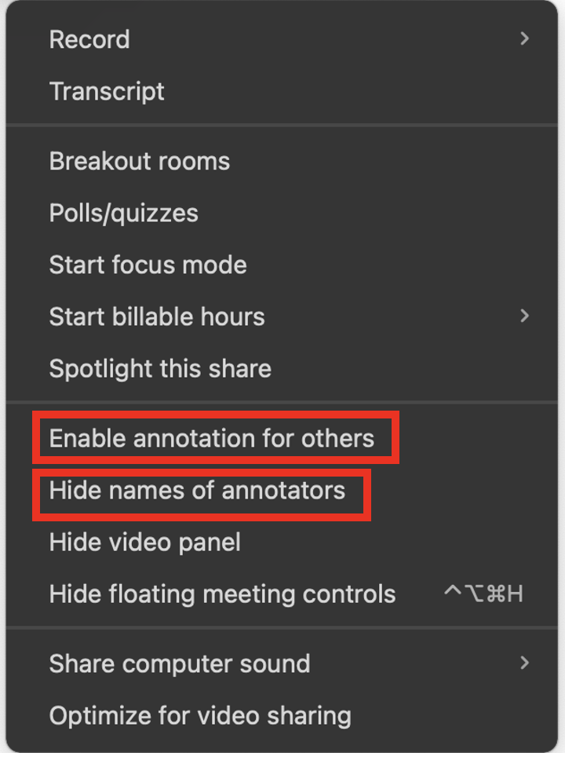{:.small}

### Configuring screen sharing settings
1. Hit the small green "^" button in the “Share" button and select "Host tools for share" from the drop-down menu.  
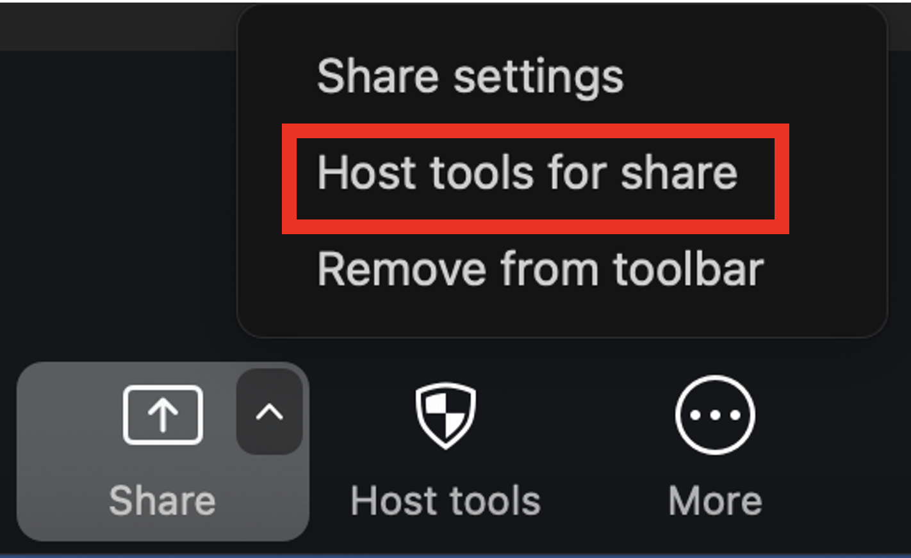{:.extra-small}

2. "Share" window will open.  
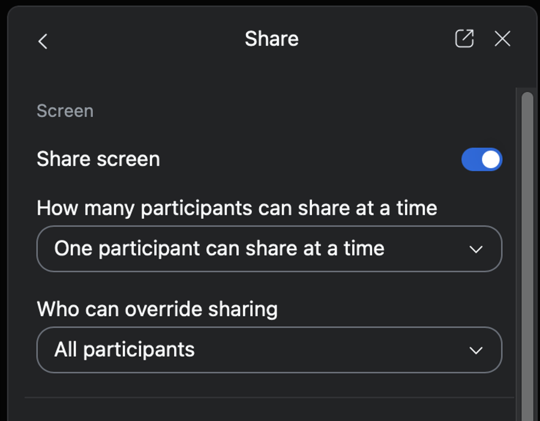{:.small}

#### Allowing participants to share their screens
Use the **Share screen** toggle to allow or prevent participants from sharing their screens.

#### Settings for sharing multiple screens simultaneously.
+ Under "How many participants can share at a time?”, you can choose between "One participant can share at a time" and "Multiple participants can share simultaneously". 
+ When multiple screens are sharing simultaneously, participants using dual monitors will see the two most recently shared screens on each monitor. 
This feature is useful when you want to compare multiple documents at the same time. 
You can set it as default by checking "Dual window" in "Settings" →"Meetings & webinars" of the Zoom application.
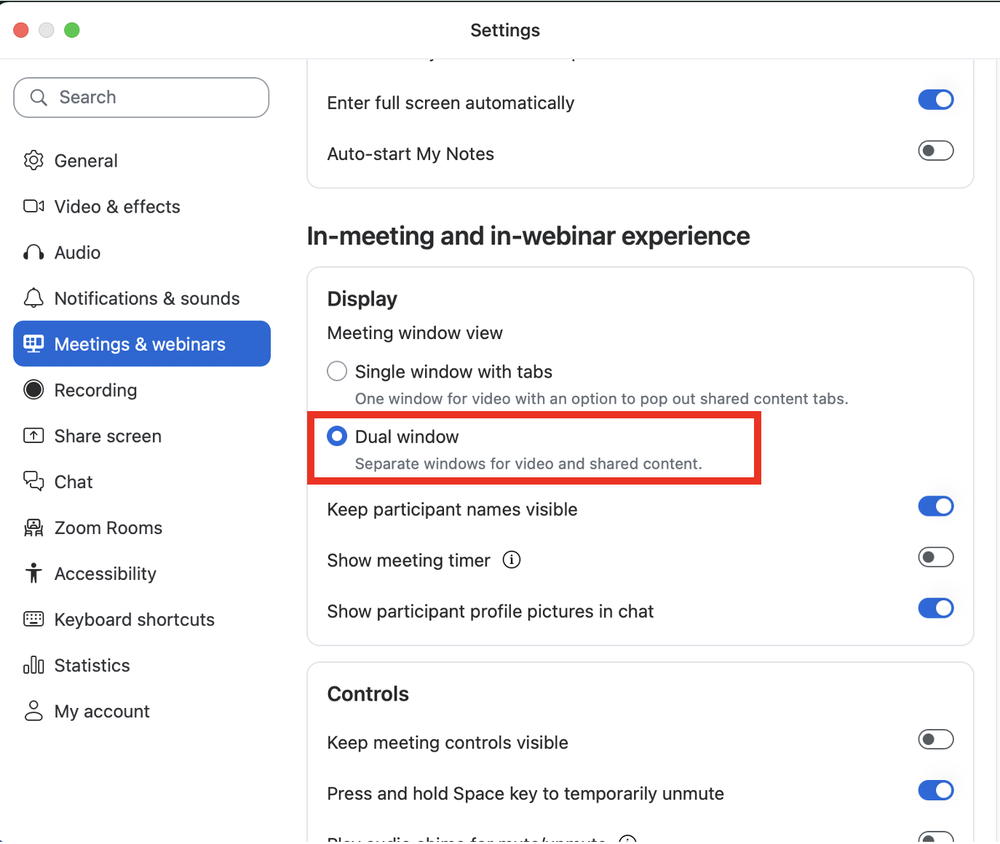
+ Participants using a single monitor will see the most recently shared screen. 
Participants can select “View Options” to change the screen they are viewing.

※Note  
If you select "Multiple participants can share simultaneously", the option "Optimize screen sharing for video clips" will not be available when sharing the screen on some older versions and other platforms. 
Also, when multiple participants are sharing their screens at the same time, the person sharing the screen can only see his own screen.

#### Starting a new share when someone is sharing.
If the setting is "One participant can share at a time", you can select "Host only" or "All participants" under "Who can override sharing?”. 
If you choose "All participants", everyone can start a new share when someone is sharing.

### Screen Annotation
You can annotate the shared screen using the horizontal or vertical annotation toolbar that appears when you click "Annotate" in the screen sharing controls.

* **[Mouse]** Deactivate annotation tools and switch to your mouse pointer.
* **[Select]** Select, move, or resize your annotations.
* **[Text]** Insert text. Text format can be changed from "Format".
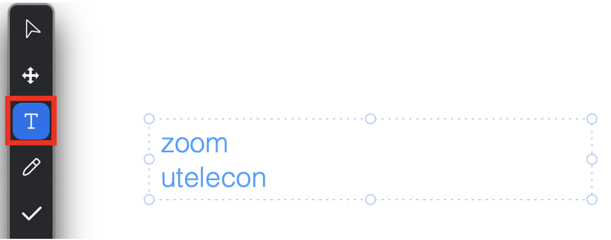 

* **[Draw]** Insert lines, arrows, and shapes.
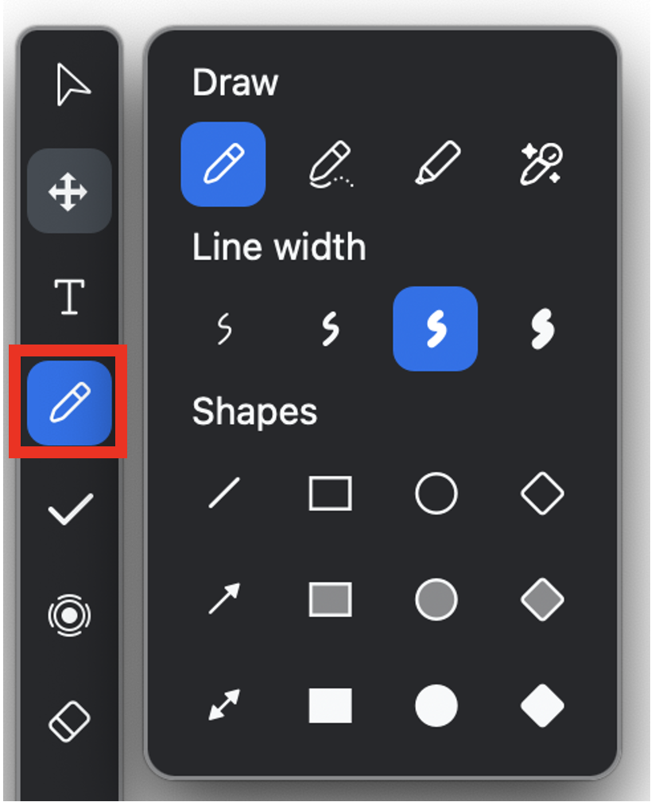{:.extra-small}
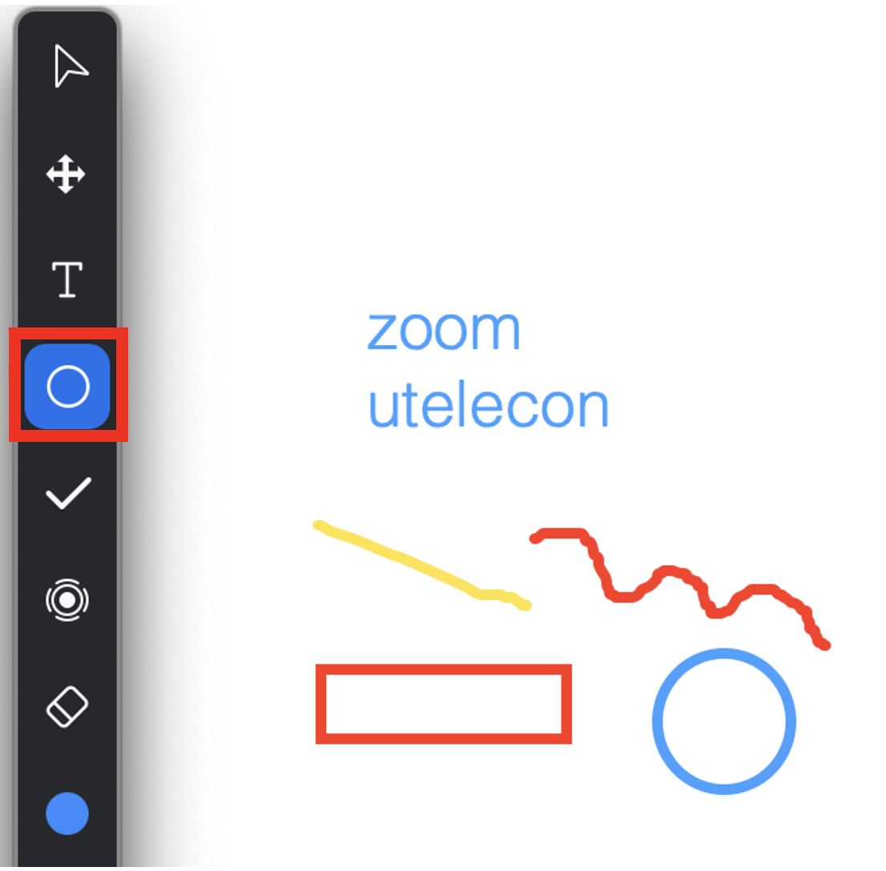{:.small}

* **[Stamp]** Insert predefined icons like a check mark or star.

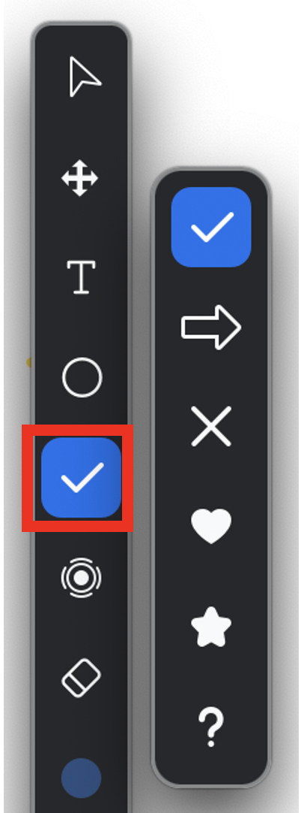{:.extra-small}
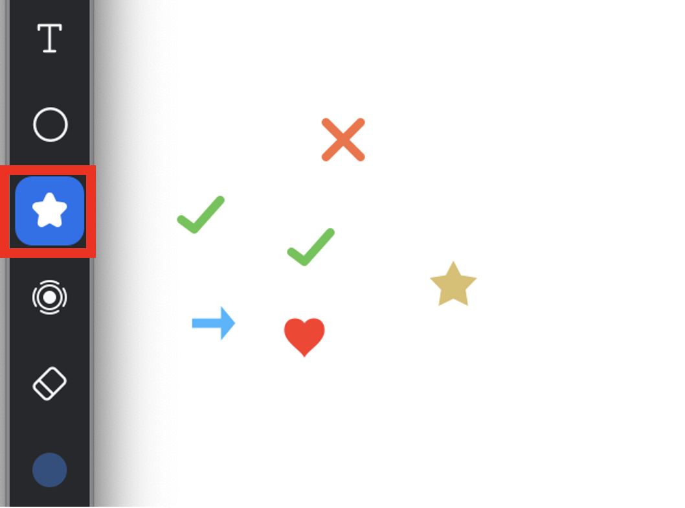{:.small}

* **[Spotlight/Arrow]** Turn your cursor into a spotlight or arrow. Display your mouse pointer to all participants when your mouse is within the area being shared. Use this to point out parts of the screen to other participants.
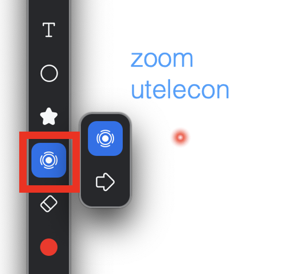

* **[Eraser]** Click and drag to erase parts of your annotation.

* **[Format]** Change the formatting options of annotations tools like color, line width, and font.
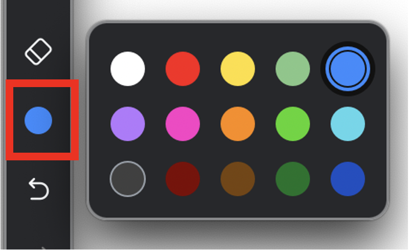{:.extra-small}

* **[Undo]** Undo your latest annotation.
* **[Redo]** Redo your latest annotation that you undid.
* **[Clear]** Delete all annotations. 
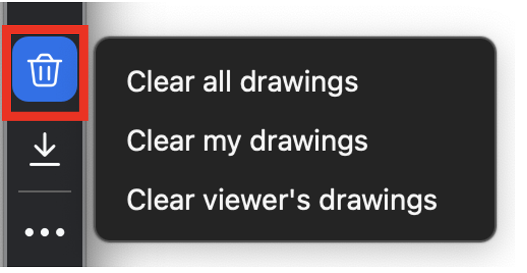{:.extra-small}

  + Clear all drawings: Clear all annotations on the shared screen.
  + Clear my drawings: Clear all your annotations.
  + Clear viewers’ drawings: (Teachers only) Clear all participants' annotations.
 * **[Save]** Save all annotations on the screen as a screenshot. The screenshot is saved to the local recording location.

## Participants’ controls

Participants can annotate the shared screen and change the screen settings during sharing on their own devices. 
Click the "..." at the top of the sharing screen, to the right of "xxxx's screen" field, and open the pulldown.

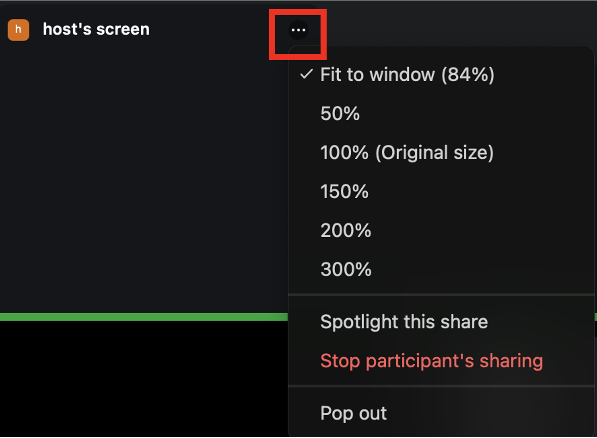

### Annotation on a shared screen
The annotation tools appear when a viewer clicks the circular pen icon in the lower-left corner of the shared screen. Details are explained in [Screen Annotation](#Screen Annotation)above.  
However, if "Disable Annotation for Others” is enabled, no annotations can be added.

### Screen settings during sharing
Click the “^” button next to the "Share" menu in Zoom. In the selection screen that appears, select “Share settings” to display the “Share screen” tab. Here, you can configure the window size for the shared screen, settings for your own window when sharing, and the behavior of the share button. 
If "Side-by-side Mode" is selected, the shared screen will appear on the left while the speaker on the right. You can adjust the relative space devoted to the shared screen by dragging the vertical gray bar. To set it as default, go to "Settings","Share Screen", and select "Side-by-side Mode" in the Zoom application.

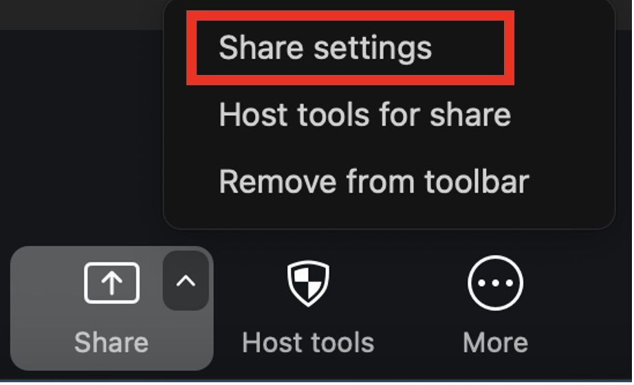{:.extra-small}
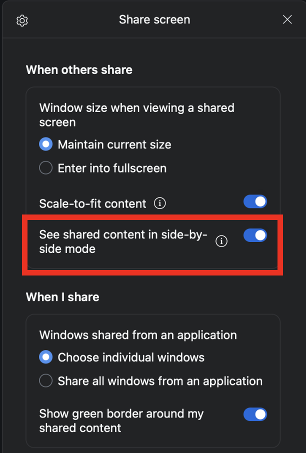{:.small}
