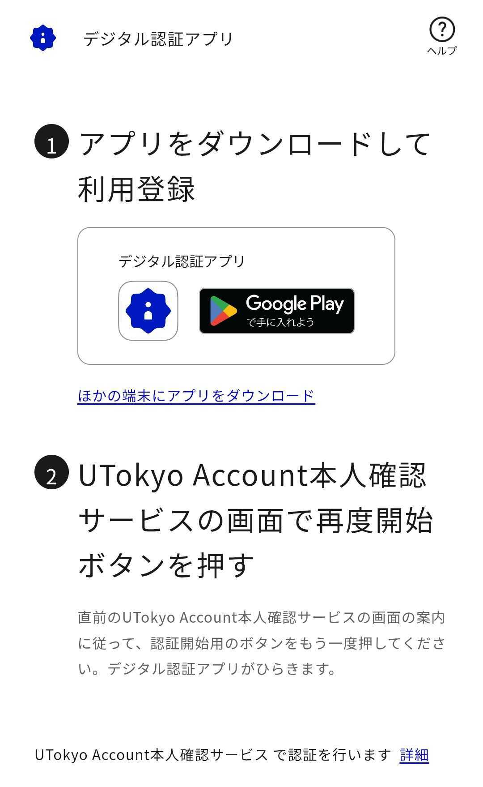

マイナアプリが開かず別の画面が表示された場合

マイナアプリがインストールされていない場合は，以下のようにアプリのインストールを促す画面が表示されます．またブラウザの表示倍率の設定によっては，PCからのアクセスと判定され，画面にQRコードが表示されることもあります．いずれの場合も，[手順1](#app-setup)に従って，マイナアプリのインストールと利用登録を行ってください．
{:.border}{:.small}

マイナアプリが開いたが別の画面が表示された場合

マイナアプリはインストールされているが，利用登録が行われていない状態であるため，利用登録手続きが開始された可能性があります．[手順1](#app-setup)に示す手順により，マイナアプリの利用登録を行ってください．

