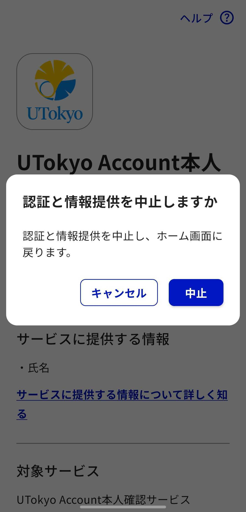
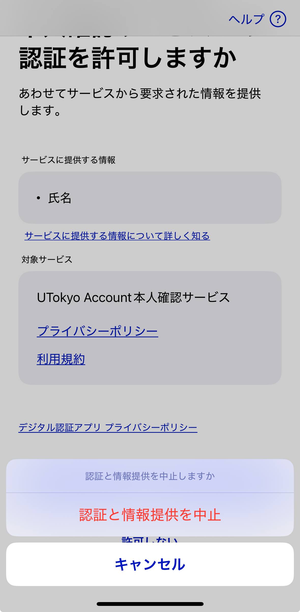

「認証と情報提供を中止しますか」という選択ボタンが出た場合

AndroidとiOSで少し形式が異なりますが「認証と情報提供を中止しますか」という選択ボタンが出現します．「中止」を選択した場合，UTokyo Account本人確認サービス側が対応していないためBad Requestと表示されるページに移動します．UTokyo Account本人確認サービスのページにアクセスし直し，[手順2](#auth)の最初からやり直してください．このポップアップのキャンセルを押した場合は元の画面に戻るので，続きの手順を進めてください．

<figure class="gallery">{:.border}{:.small} {:.border}{:.small}</figure>

{:.border}{:.small}

