import CheckStatus from "../_CheckStatus.mdx"
import IdentMynaRequiredThings from "@components/ja/IdentMynaRequiredThings.mdx"
import DeviceTabs from "@components/ja/ident-myna/DeviceTabs.astro"
import CardTabs from "@components/ja/ident-myna/CardTabs.astro"
import AppTroubleshooting from "./_AppTroubleshooting.mdx"
import CancelPopup from "./_CancelPopup.mdx"

## はじめに
このページでは，UTokyo Account本人確認サービスを利用するために，あらかじめ済ませておく必要がある，「事前連携」の手続きについて説明します．

全体の流れは以下のようになります．

- 手順1:[マイナアプリをセットアップする](#app-setup)
- 手順2:[アプリとマイナンバーカードで本人認証する](#auth)
- 手順3:[UTokyo Accountでサインインしてひも付けを行う](#signin)
- 手順4:[連携状況を確認する](#statuscheck)

UTokyo Account本人確認サービスにアクセスする端末（スマートフォンのみ／PCとスマートフォンを併用）と，利用するマイナンバーカード（実物のカード／スマートフォンのマイナンバーカード）により，手順2での作業が異なります．端末については，手順が簡潔であるため，スマートフォンのみで完結する方法を推奨します．

## 必要なもの

<IdentMynaRequiredThings variant="usablePC"/>

## 手順1: マイナアプリをセットアップする
{:#app-setup}
まず，マイナアプリのセットアップを行います．

1. 以下のリンクから，マイナアプリをインストールしてください．
    - [iPhone用リンク](https://apps.apple.com/jp/app/%E3%83%9E%E3%82%A4%E3%83%8A%E3%83%9D%E3%83%BC%E3%82%BF%E3%83%AB/id1476359069)
    - [Android用リンク](https://play.google.com/store/apps/details?id=jp.go.cas.mpa)
1. デジタル庁公式HPに記載されている[マイナアプリの利用登録の方法](https://services.digital.go.jp/mynaapp/register/)に従って，マイナアプリの利用登録を済ませてください．

## 手順2: アプリとマイナンバーカードで本人認証する
{:#auth}

続いて，マイナンバーカードとマイナアプリを用いた本人認証を行います．以下の2点によって手順が異なるため，該当するタブを選択して作業を進めてください（同じ種類のタブは，ページ内で選択内容が連動します）．

- **UTokyo Account本人確認サービスにアクセスする端末**：スマートフォンのみ／PCとスマートフォンを併用
  - スマートフォンのみで行う方が簡便です．
- **利用するマイナンバーカード**：実物のカード／スマートフォンのマイナンバーカード（iPhoneのマイナンバーカード，Androidのマイナンバーカード）

### 2-1. UTokyo Account本人確認サービスからマイナアプリを起動する
{:#auth-start}

<DeviceTabs>
<Fragment slot="smartphone">

1. [UTokyo Account本人確認サービス](https://identification.adm.u-tokyo.ac.jp/verify/)にスマートフォンでアクセスしてください．
1. 「マイナンバーカードで本人確認」ボタンを押してください．マイナアプリの画面に遷移します．
    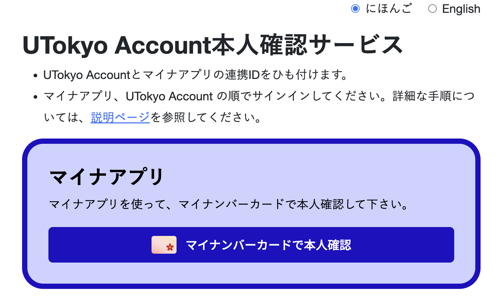{:.border}{:.medium}

    <AppTroubleshooting />

</Fragment>
<Fragment slot="pc">

1. [UTokyo Account本人確認サービス](https://identification.adm.u-tokyo.ac.jp/verify/)にPCでアクセスしてください．
1. 「マイナンバーカードで本人確認」ボタンを押してください．
    {:.border}{:.medium}
1. 画面上に表示された大きなQRコードを，手順1でセットアップを済ませたスマートフォンで読み込んでください．QRコードが無効になった場合は，下に表示される「二次元コードを更新」を押してQRコードを更新してください．以降，**PCのページは閉じないでください**．

    <figure class="gallery"> 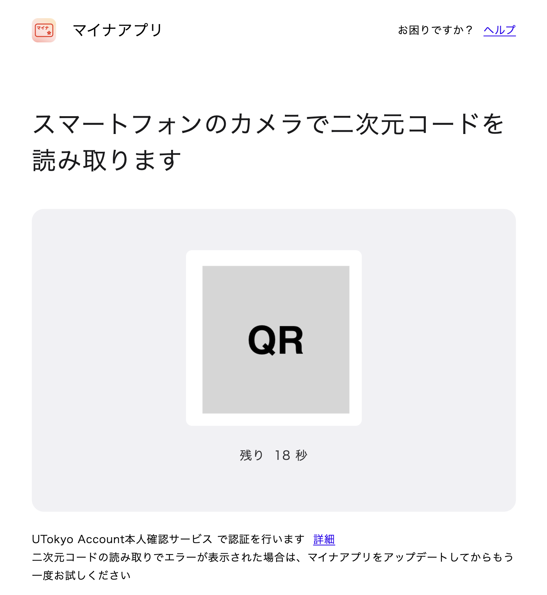{:.border}{:.medium} 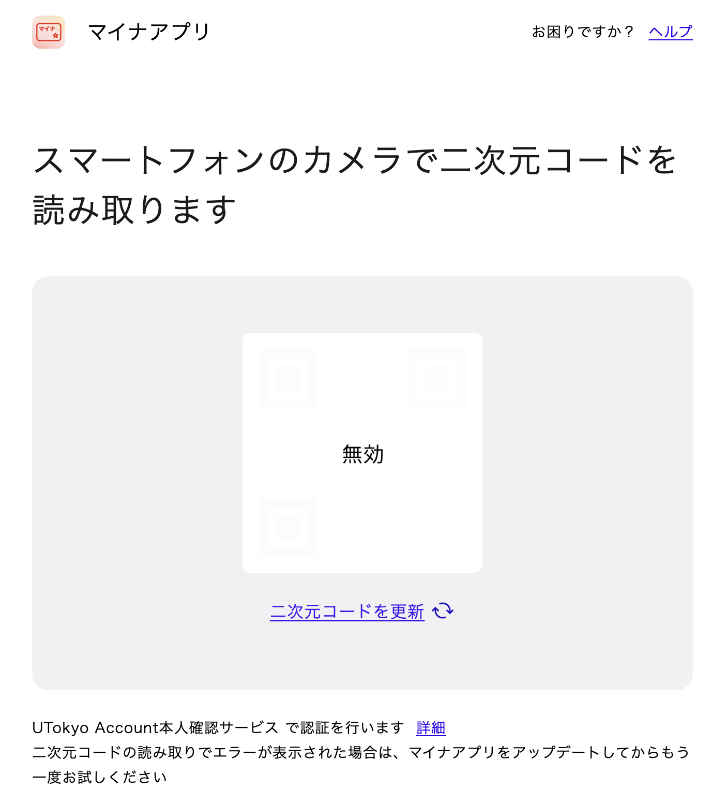{:.border}{:.medium}</figure>

    

    
PCのページを閉じてしまった場合

    [手順2](#auth)の最初からやり直してください．
    

    <AppTroubleshooting />
1. スマートフォンに表示される6桁の数字をPCに入力してください．有効期限が切れた場合は6桁の数字を更新してください．

</Fragment>
</DeviceTabs>

### 2-2. マイナアプリでマイナンバーカードを用いて認証する
{:#auth-card}

以降の操作は，すべてスマートフォン上のマイナアプリで行います．

<CardTabs>
<Fragment slot="physicalCard">

1. マイナアプリ上の案内に従って，生体情報・パスコード等による認証を行ってください．
1. 「はじめる」ボタン（PCとスマートフォンを併用する場合は「次へ」ボタン）を押して認証手順をすすめてください．
    <figure class="gallery">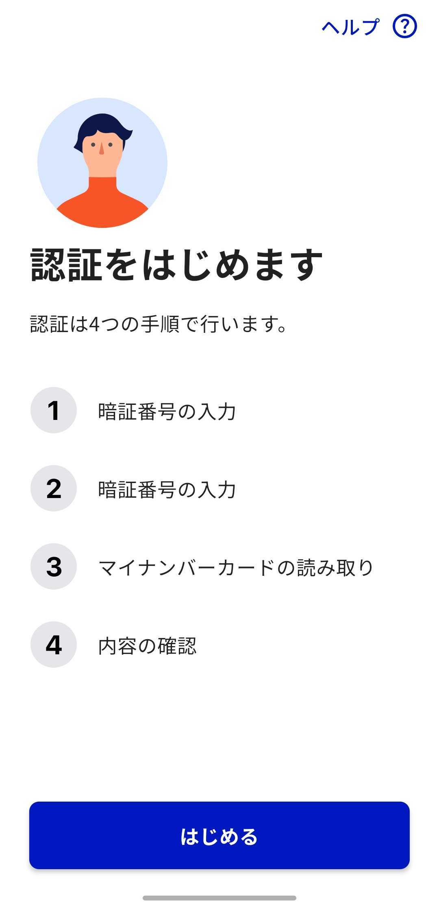{:.border} 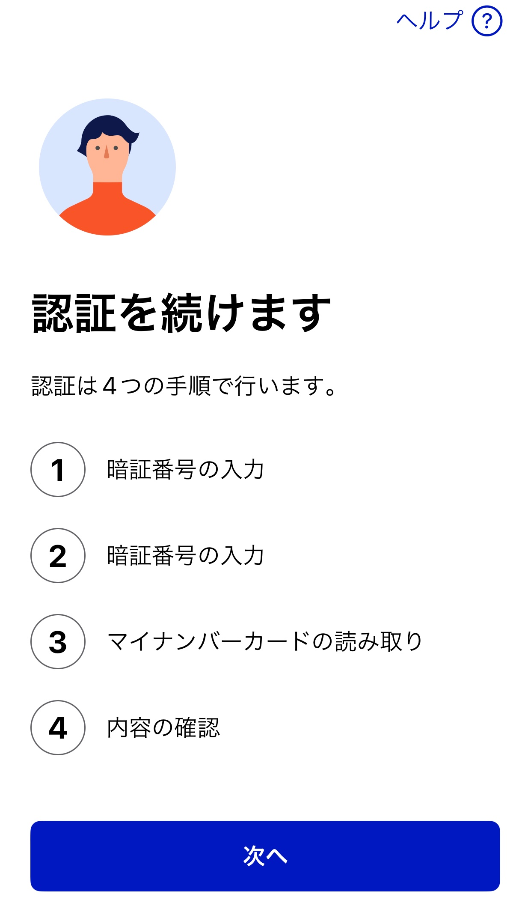{:.border}</figure>
1. マイナンバーカードの利用者証明用電子証明書の暗証番号を入力してください．
    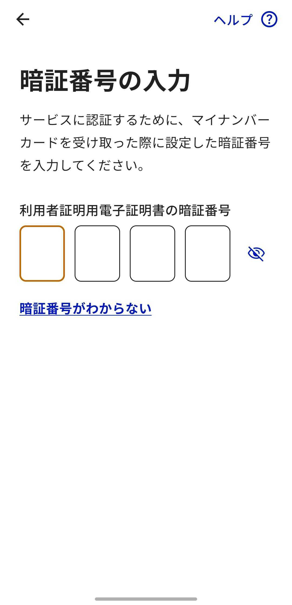{:.border}
1. 券面事項入力補助用の暗証番号を入力してください．利用者証明用電子証明書の暗証番号と同じものを使用している場合は「直前と同じ番号を入力」ボタンを押すことで省略できます．
    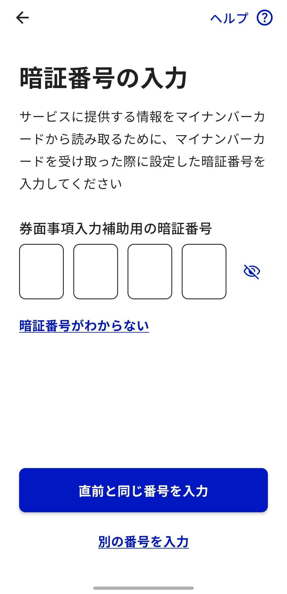{:.border}
1. アプリの案内に従い，「読み取り開始」ボタンを押し，マイナンバーカードをスマートフォンで読み取ってください．
    - 「カードを読み取っています…」と表示されている間は，マイナンバーカードをスマートフォンから離さないでください．
    - 読み取りが完了すると，データが自動的にサーバーに送信されます．

    <figure class="gallery">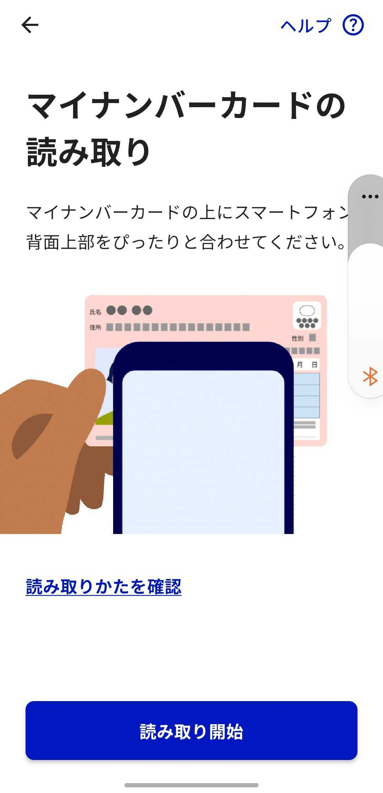{:.border} 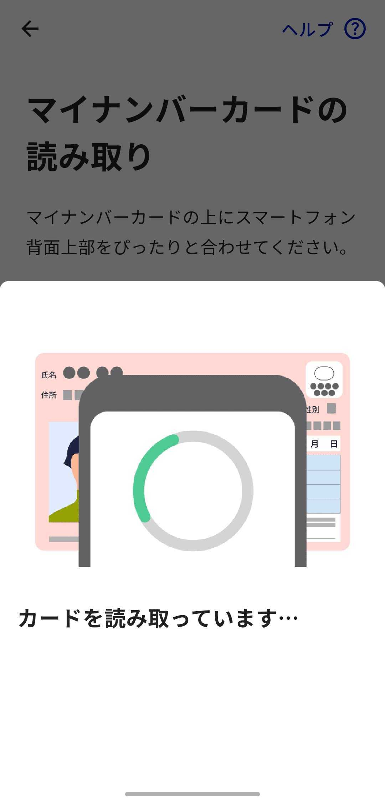{:.border} 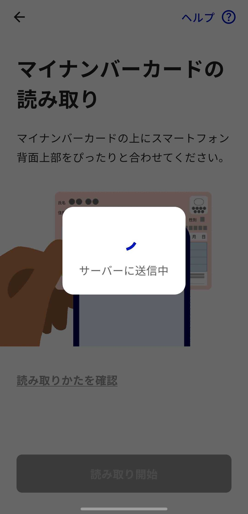{:.border}</figure>

</Fragment>
<Fragment slot="smartphoneCard">

{/* TODO: 実機で画面遷移を確認し，スクリーンショットを追加する（iPhone／Androidで画面が異なる可能性あり） */}
1. マイナアプリ上の案内に従って，生体情報・パスコード等による認証を行ってください．
1. 「はじめる」ボタン（PCとスマートフォンを併用する場合は「次へ」ボタン）を押して認証手順をすすめてください．
    <figure class="gallery">{:.border} {:.border}</figure>
1. アプリの案内に従い，スマートフォンのマイナンバーカードを利用する方法を選択してください．
1. スマートフォンの生体認証（顔認証・指紋認証など）を行ってください．暗証番号の入力や，実物のカードの読み取りは不要です．
    - 認証が完了すると，データが自動的にサーバーに送信されます．

</Fragment>
</CardTabs>

### 2-3. 認証を許可する
{:#auth-permit}

<DeviceTabs>
<Fragment slot="smartphone">

1. UTokyo Account本人確認サービスへの認証の許可を求める画面が表示されます．プライバシーポリシーや利用規約を確認の上，「許可」ボタンを押してください．
    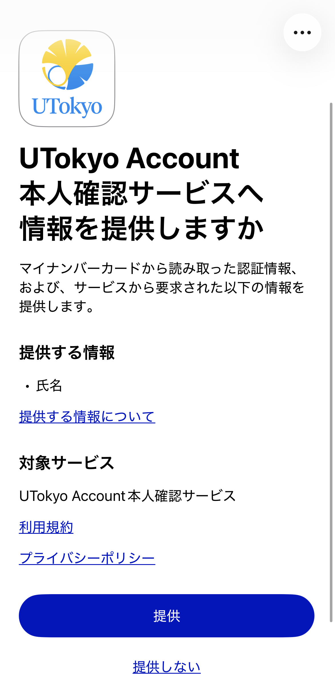{:.border}

    <CancelPopup />
1. マイナアプリの「利用中のサービスへ戻る」を押すか，画面遷移後10秒経過するのを待ってください．UTokyo Account本人確認サービスへ戻ります．
    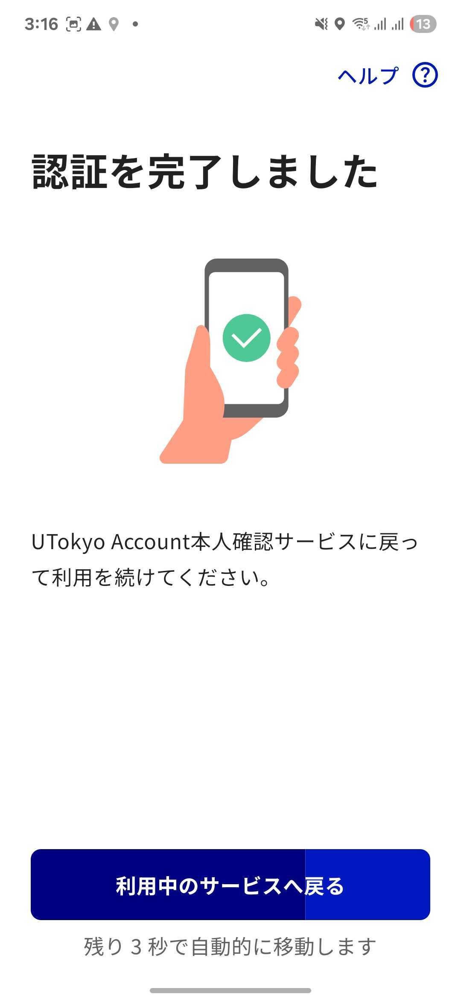{:.border}

</Fragment>
<Fragment slot="pc">

1. UTokyo Account本人確認サービスへの認証の許可を求める画面が表示されます．プライバシーポリシーや利用規約を確認の上，「許可」ボタンを押してください．
    {:.border}

    <CancelPopup />
1. スマートフォンでの作業は終了です．PCの画面に戻ってください．

</Fragment>
</DeviceTabs>

初期設定はまだ完了していません．[手順3](#signin)に進んでください．

## 手順3: UTokyo Accountでサインインしてひも付けを行う
{:#signin}

1. 「UTokyo Accountでサインイン」ボタンを押してください．
    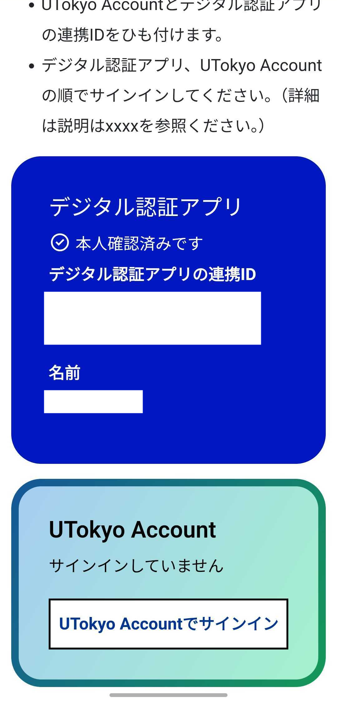{:.border}{:.medium}
1. 既にUTokyo Accountにサインイン済みの場合を除き，UTokyo Accountのサインイン画面が表示されるので，サインインしてください．
1. 「ひも付けを行う」ボタンを押して，マイナアプリの連携IDとUTokyo Accountをひも付けしてください．
    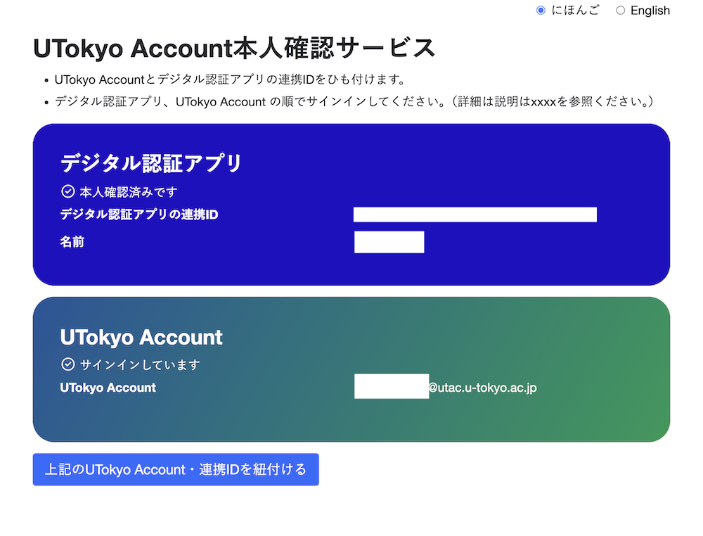{:.border}{:.medium}
1. 「上記のひも付けを解除する」ボタンが出てくれば，連携が出来ています．
    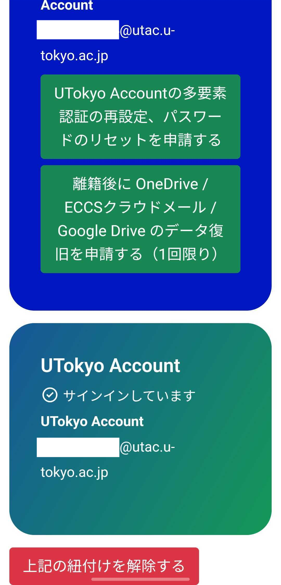{:.border}{:.medium}

## 手順4: 連携状況を確認する
{:#statuscheck}

<CheckStatus variant="link"/>
