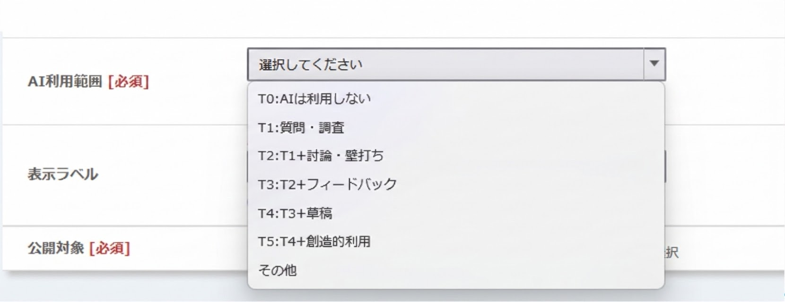
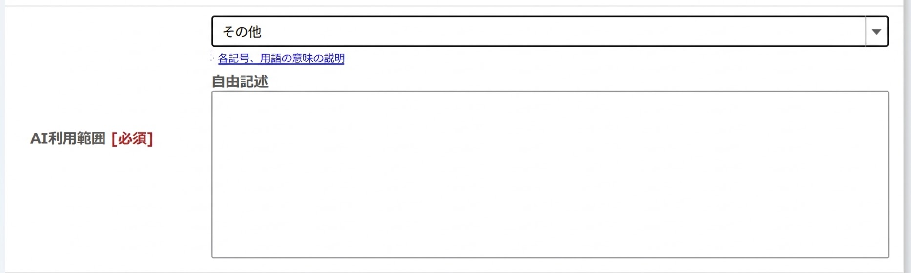

**AI利用範囲**
- 学生が課題に取り組む際にAIをどの程度利用してよいかを，ドロップダウンリストの中から指定してください．
  - AI利用範囲の選び方については，「[授業課題・取り組みにおけるAI利用範囲の類型と表示](https://utelecon.adm.u-tokyo.ac.jp/gen-ai/education/ai-use-policy-levels/)」を参照してください。
  
  - 許可したいAI利用範囲がT0～T5のいずれにも該当しない場合は，「その他」を選択した上で，自由記述欄に当該課題におけるAI利用範囲を記入してください．
  