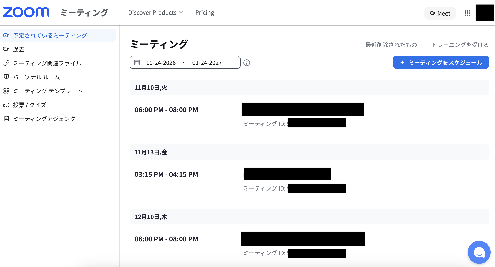
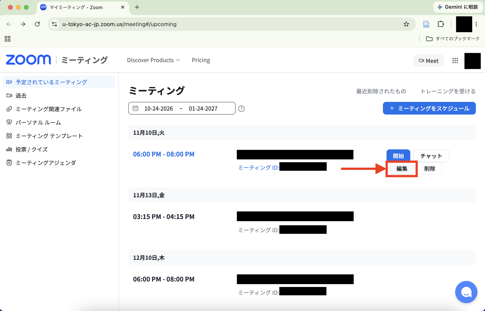
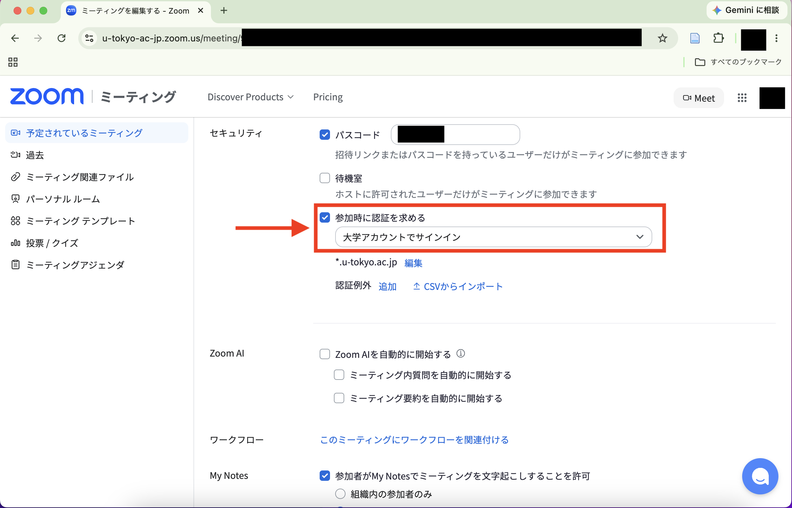
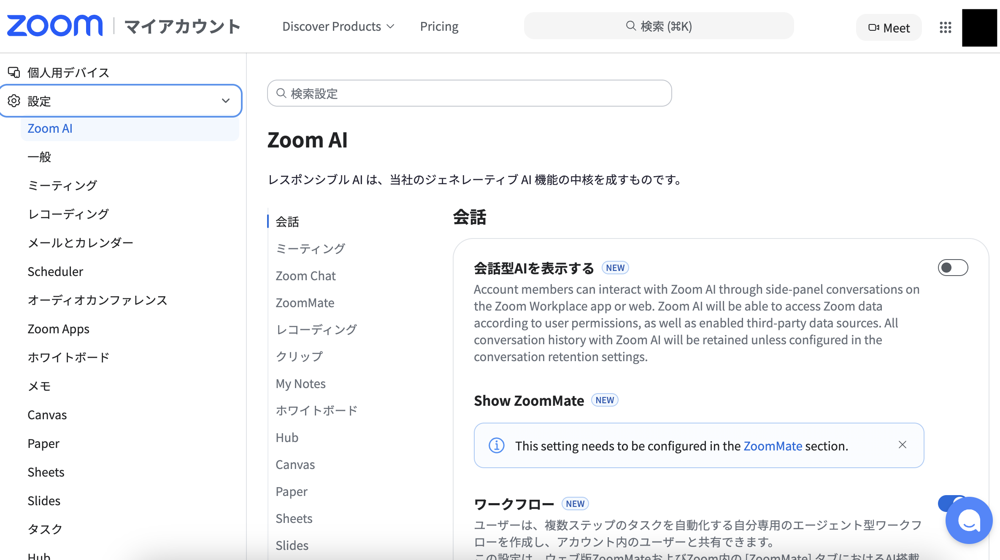
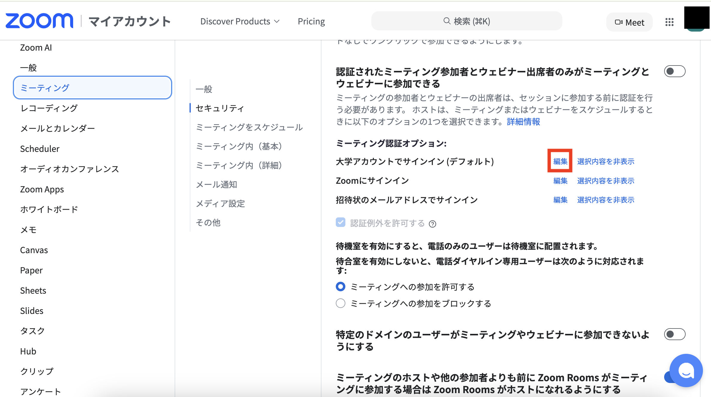
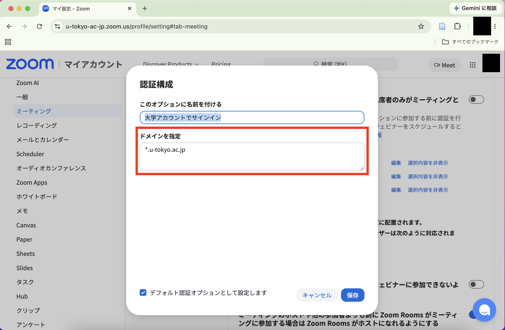

Zoomでは，ミーティングに参加できるユーザーを制限できます．「大学アカウントでサインイン」の設定を行うと，参加時に東京大学のZoomアカウントでのサインインが必要になり，サインインしていない人（学外のゲストなど）は入室できません．．

ただし，大学のアカウントでのサインインに参加者が慣れていない場合（特に，授業の学期開始当初）は，設定をオフにすることを推奨します．設定に関する考え方については，「[授業におけるZoom会議の入室制限](./../../../faculty_members/zoom_access_control/)」もご覧ください．

<a href="../../../change2021s/">2021年春のシステム変更</a>後，古い設定をそのまま利用していると，東京大学のアカウントに正しくサインインしているユーザーがミーティングに入れないことがありますので，このページの説明を読み設定内容を必ず確認してください．

## 個々のミーティングで設定する

1. Webブラウザで[Zoomの「ミーティング」のページ](https://u-tokyo-ac-jp.zoom.us/meeting#/upcoming)へ移動してください．
{:.medium}
2. ミーティングの設定画面を開いてください．
    - 新しくミーティングを作成する場合は，「ミーティングをスケジュール」を押してください．
    - 以前に作成したミーティングの設定を確認・変更する場合は，一覧に表示されているミーティングにマウスを重ねると右側に「編集」ボタンが表示されるので，このボタンを押してください．
    {:.medium}
3. 「セキュリティ」の中の「参加時に認証を求める」をオンにし，「大学アカウントでサインイン」を選択してください．
    - 東京大学のZoomアカウントでサインインしないと入室できなくなります．
    - 「大学アカウントでサインイン」の下に表示されるドメインが`*.u-tokyo.ac.jp`であることを確認してください．異なる場合は「編集」を押して`*.u-tokyo.ac.jp`に変更してください．
{:.medium}

<strong class="box--alert">
<a href="../../../change2021s/">2021年春のシステム変更</a>後，東京大学のZoomアカウントは @utac.u-tokyo.ac.jp に変更されました．このため，これまでドメインの設定を <code>g.ecc.u-tokyo.ac.jp</code> としていた場合，そのままの設定では東京大学のアカウントに正しくサインインしているユーザーがミーティングに入れなくなります．必ず上記の通り <code>*.u-tokyo.ac.jp</code> に変更してください．
</strong>

## デフォルトのドメイン設定を確認する

新しく作成するミーティングのデフォルトの設定を変更することもできます．

1. Webブラウザで[Zoomの設定ページ](https://u-tokyo-ac-jp.zoom.us/profile/setting)へ移動してください．
{:.medium}
2. 「ミーティング」から「セキュリティ」を開き，「ミーティング認証オプション：大学アカウントでサインイン(デフォルト)」の編集ボタンを押してください．
{:.medium}
3. 「ドメインを指定」が`*.u-tokyo.ac.jp`となっていることを確認してください．なっていなければ`*.u-tokyo.ac.jp`を入力し保存してください．
{:.medium}
