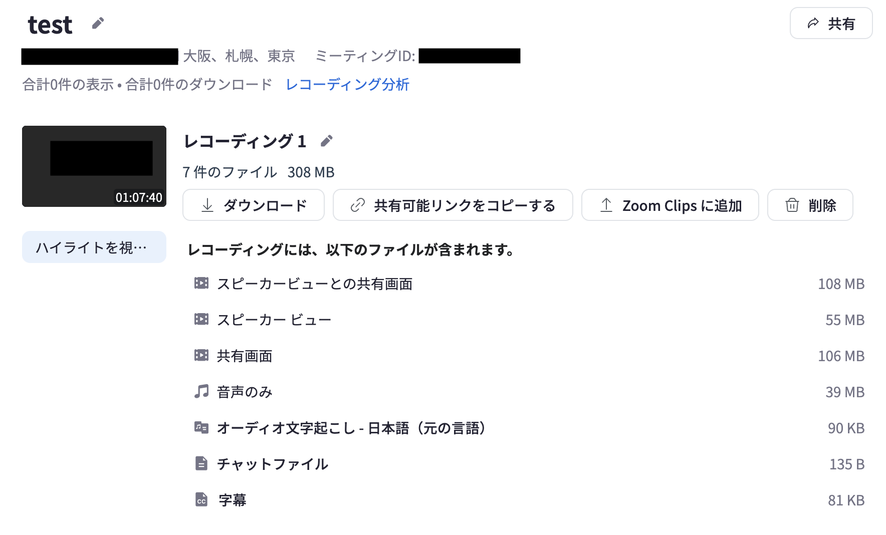

* これまで無期限だったクラウド録画の保存期間を，**2027年3月1日**から最大3年とします．
* 2027年3月1日以降に，その時点で作成から3年が経過しているクラウド録画をまとめて削除します．
  * 対象となる方には，別途メールでも通知します．
* 変更の経緯については「[東京大学におけるZoomの提供内容の変更について](/notice/2026/0801-zoom-contract-renewal/)」および「[第2報（クラウド録画削除開始日の延期）](/notice/2026/0925-postpone_zoom_cloudrec_deletion/)」をご覧ください．

## 概要
{:#overview}

UTokyo Accountで利用するZoomでは，クラウドレコーディング（以下「クラウド録画」）の保存期間を**一律で最大3年**としています．作成されてから3年が経過したクラウド録画は自動的に削除され，**削除されたクラウド録画は復元できません**．【要確認：自動削除されたものがいったんゴミ箱に入るか，入る場合は何日間復元できるか】

クラウド録画が削除されると，共有用のURL（[クラウドレコーディングをURLで共有する](../#manage-share-url)を参照）や，UTOLのZoom連携機能（「[LTI連携機能でUTOLからのZoomミーティングを利用する](/utol/lecturers/integrations/zoom/)」を参照）からも視聴できなくなり，授業資料などに掲載したURLはリンク切れになります．ただし，視聴者がすでにダウンロードしたファイルは，視聴者の手元に残ります．3年を超えて利用する必要があるクラウド録画は，削除される前に[対応](#action)してください．

このページでは，削除の対象になるもの・ならないもの，削除される時期，および対応方法を説明します．

## 削除の対象になるもの
{:#target}

UTokyo Accountでサインインした状態で作成したミーティングで，**Zoomのクラウドに保存された録画**が対象です．Zoomのウェブポータルの「レコーディング」→「クラウド レコーディング」に表示されるものが該当します．

また，次のものも，作成から3年が経過すると削除されます．

* Zoomミーティングのクラウド録画に付随するチャット・音声ファイル・文字起こしデータ・字幕
    * 以下のページ内からダウンロードできるものが，削除されます．
      {:.border}
* ウェビナーのクラウド録画
* ゴミ箱に移動したクラウド録画
* ほかのユーザーから所有権を移されたクラウド録画

## 削除の対象にならないもの
{:#not-target}

次のものは，保存期間経過後の自動削除の対象になりません．

* Zoom Chatのメッセージやファイル
* Zoom Clips
* AI Companionによるミーティングの要約
* Zoom Whiteboard，Zoom Docs

## 削除される時期
{:#schedule}

* 保存期間は，クラウド録画が**作成された日**から数えます．【要確認：「作成日」はミーティング（録画）の開始日か，録画の処理が完了した日か】
* 作成から3年が経過したクラウド録画は，3年が経過した日に自動的に削除されます．削除は毎日行われます．

ご自身で「指定された日数が経過した後、クラウド レコーディングを削除します」の設定（[クラウドレコーディングを削除する](../#delete)を参照）を有効にしている場合は，その設定と3年の保存期間のどちらか短い方が優先されます．

## 対応方法
{:#action}

### 削除対象のクラウド録画を確認する
{:#check}

1. Zoomのウェブポータルの「レコーディング」から，「クラウド レコーディング」を開いてください（「[レコーディングを確認する](../#manage-check)」を参照）．
2. 一覧上部の期間指定欄で，終了日を「確認したい日の3年前の日付」に設定して絞り込んでください．たとえば，2027年3月1日の時点で削除されるクラウド録画を確認する場合は，終了日を2024年3月1日に設定します．【要確認：期間指定欄のUI表記と，期間指定の上限（過去何か月分まで指定できるか）】
3. 一覧に表示される各クラウド録画の「開始時間」から3年が経過した日が，削除される日の目安です．

削除の対象となるクラウド録画をお持ちの方には，別途メールでも通知します．

### 必要なクラウド録画をダウンロードして保存する
{:#backup}

3年を超えて保存する必要があるクラウド録画は，削除される前にダウンロードし，別の場所に保存してください．

#### クラウド録画をダウンロードする
{:#backup-download}

1. Zoomのウェブポータルの「レコーディング」から，「クラウド レコーディング」を開き，保存したい録画のトピックを選択して詳細画面を開いてください．
2. 詳細画面の「ダウンロード」ボタンを押すと，その録画に含まれるすべてのファイル（動画・音声・文字起こし・チャット・字幕）をまとめてダウンロードできます．特定のファイルだけをダウンロードしたい場合は，ファイル名にマウスポインタをかざすと表示されるダウンロードのアイコンを選択してください．【要確認：個別ダウンロードのアイコンの表示位置】

録画の設定によっては，同じミーティングについて「スピーカービューとの共有画面」「スピーカー ビュー」「共有画面」など複数の動画ファイルが作成されています．「[削除の対象になるもの](#target)」の画像の例では，約67分のミーティングで動画3種類を含め合計約308 MBです．保存先の容量を節約したい場合は，必要な動画ファイルだけを選んでダウンロードしてください．

#### ダウンロードしたファイルを保存・共有する
{:#backup-storage}

ダウンロードしたファイルは，PCのストレージだけでなく，次のような場所にも保存してください．各サービスの容量の上限や操作方法は，それぞれのページを参照してください．

* Googleドライブ（ECCSクラウドメール）：「[Googleドライブの基本的な使い方](/google/drive/basic/)」「[ECCSストレージ管理システムについて](/google/drive/storage/)」
* OneDrive（UTokyo Account）：「[OneDriveの基本的な使い方](/microsoft/onedrive/basic/)」「[OneDrive](/microsoft/onedrive/)」
* YouTube（ECCSクラウドメール）：「[YouTubeに動画をアップロードする](/google/youtube/upload/)」
  * YouTubeに保存できるのは動画のみです．チャット・文字起こし・字幕などのファイルは，GoogleドライブやOneDriveに保存してください．

#### 共有していたURLを差し替える
{:#backup-share}

クラウド録画の共有用URLを授業資料やメール，UTOLのコースなどで案内していた場合は，保存先で新たに共有用のURLを発行し，差し替えてください．共有の方法は「[レコーディングをクラウドストレージにアップロードして共有する](../#manage-share-upload)」および「[YouTubeで動画の公開範囲を設定する](/google/youtube/sharing/)」を参照してください．

### ローカルレコーディングを利用する
{:#local}

これから録画する講義や会議で，3年を超えて保存する必要があるものについては，ローカルレコーディングを利用する方法もあります．ローカルレコーディングでは録画ファイルが各自のPCに保存されるため，クラウド録画の保存期間による削除の対象になりません．

ローカルレコーディングの方法や利用できる環境・権限は，「[ローカルレコーディングとクラウドレコーディング](../#overview-local-and-cloud)」「[レコーディングの方法](../#procedure)」を参照してください．録画ファイルの保管は各自で行う必要があるため，「[ダウンロードしたファイルを保存・共有する](#backup-storage)」で挙げた保存先も利用してください．なお，音声文字起こしなど，クラウド録画でのみ利用できる機能があります．【要確認：ローカルレコーディングで利用できない機能の一覧】

## 問い合わせ先
{:#contact}

ご質問・ご相談は[uteleconサポート窓口](/support/)までお願いします．
